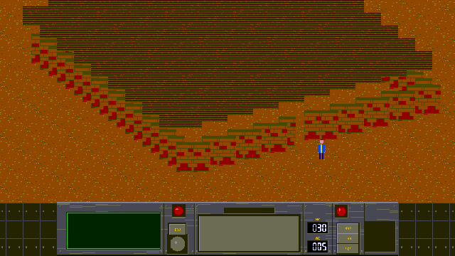
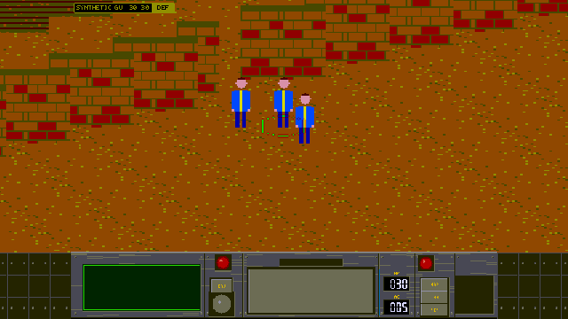
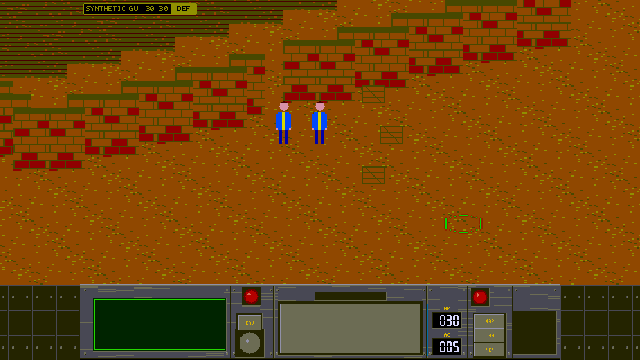
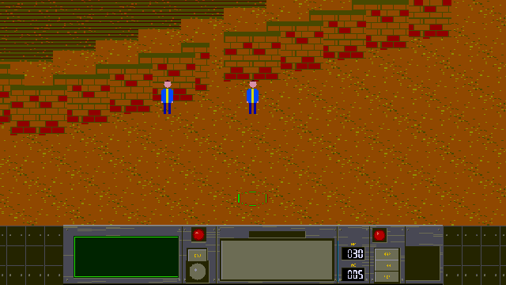
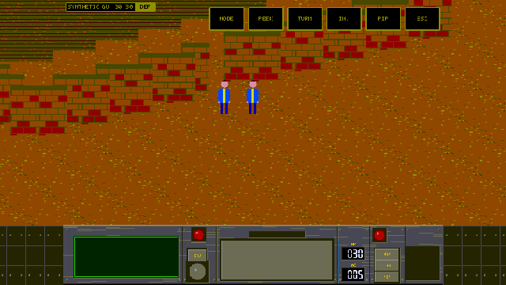
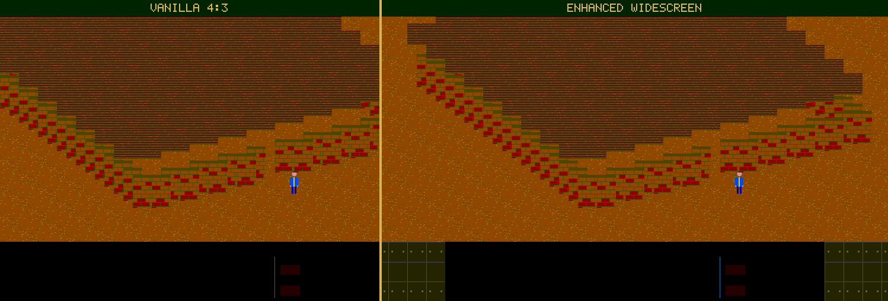

# Vault Engine

[](https://github.com/mikyowski-ui/vault-engine/actions/workflows/ci.yml)
[](LICENSE)
[](Cargo.toml)

**Vault Engine** is a clean-room game engine in safe Rust. One binary runs
retail ***Fallout* (1997)** and ***Fallout 2* (1998)** from your own `.DAT`
archives, on Linux, Windows and macOS. Every behaviour is built from written
specifications (`SPEC-001` to `SPEC-019`) by a two-team clean-room process.
No game data ships with it.

## Showcase

| | |
| :---: | :---: |
|  |  |
| **Tactical camera**: 0.5× to 3.0× zoom, pans and shakes | **X-ray roof peek**: hold `Alt` to see inside |
|  |  |
| **Combat info** (`Alt+H`): HP bars, to-hit, companion pills | **Widescreen windows**: `Shift` highlights, TAKE ALL, WIELD |
|  |  |
| **Live debugger** (`F9`): VM trace, inspector, mod export | **Touch UI** (`--touch-ui`): pill bar, hold for the action menu |
|  |  |
| **Vanilla 4:3 or enhanced widescreen**, one key apart | **Launcher**: both games found and checked, one click apart |

<sub>Every picture is rendered by `cargo xtask capture-gallery` from synthetic
fixtures and procedural art. No game data is used.</sub>

## Quick start

1. **Download** a prebuilt archive from
   [Releases](https://github.com/mikyowski-ui/vault-engine/releases), unpack
   it and run `vault-engine`.
2. **Or build** from source with Rust 1.88+:

   ```sh
   cargo run --release -p vault-platform
   ```

The launcher finds your installs, or you browse to `MASTER.DAT`. It
switches between *Fallout* and *Fallout 2*, and picks the `vanilla` or
`enhanced` preset.

**Hotkeys:** `Alt+V` widescreen · mouse wheel zoom · hold `Alt` roof peek ·
`Alt+F` game speed · `Alt+H` combat info · `F6`/`F7` quick save/load · `F9`
debugger. All but `F6`/`F7` and `F9` are enhanced-preset features.

## Crates

| Crate | What it does |
| --- | --- |
| `vault-formats` | Archives (DAT, DAT2, zlib), palettes, FRM art, maps, prototypes, messages, fonts, saves |
| `vault-vm` | The `.INT` script VM and its opcode sets |
| `vault-core` | The world: host opcodes, routing, combat and AI, party, saves, world travel |
| `vault-guidance` | Pip-Boy holodisks and quest status |
| `vault-render` | Indexed sprite, map, text and layer composition |
| `vault-debug` | Headless VM stepper, trace, variable watches, inspectors |
| `vault-platform` | The desktop shell: launcher, game, input logs and replays, gallery |
| `vault-fixtures` | Synthetic test fixtures (dev only) |
| `xtask` | Gates (`check`), fixtures, mod export, gallery capture |
| `asset-audit` | Corpus validation and audits |

## Docs

- [`docs/REFERENCE.md`](docs/REFERENCE.md): settings, flags, the launcher,
  enhanced features, mods, audits and per-spec notes.
- [`PROVENANCE.md`](PROVENANCE.md): the clean-room process and who wrote
  each spec.
- [`CONTRIBUTING.md`](CONTRIBUTING.md) and [`AGENTS.md`](AGENTS.md): how to
  contribute.
- [`docs/fallout2-and-qol-roadmap.md`](docs/fallout2-and-qol-roadmap.md):
  the Fallout 2 and quality-of-life roadmap.
- [`LICENSE`](LICENSE): Apache-2.0.
