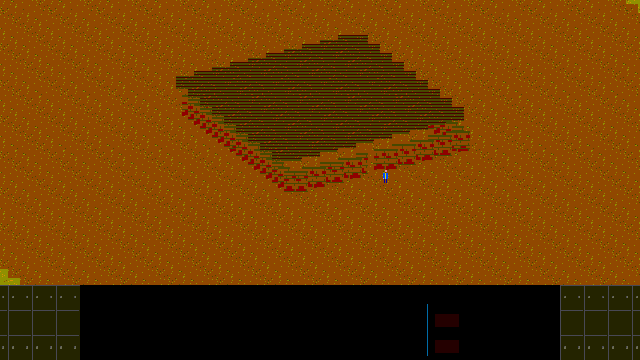
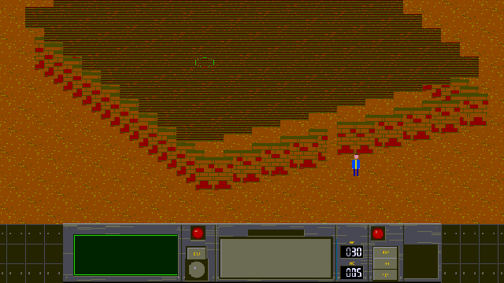
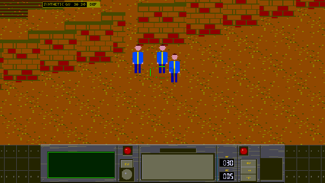
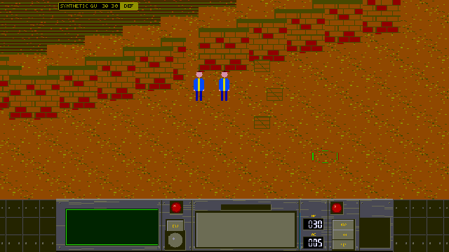
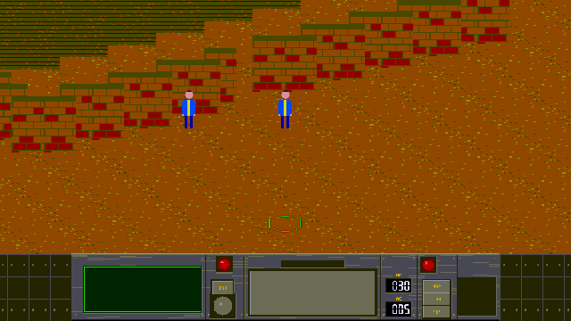
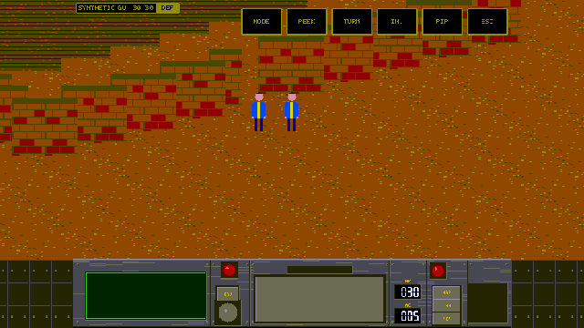
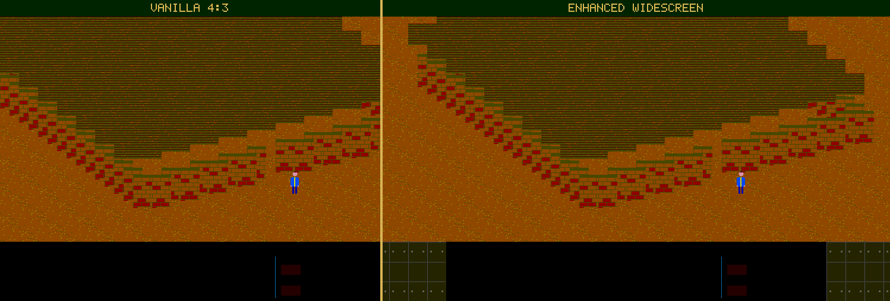
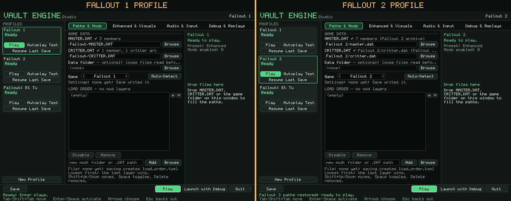

# Vault Engine

[](https://github.com/mikyowski-ui/vault-engine/actions/workflows/ci.yml)
[](LICENSE)
[](Cargo.toml)

> *War never changes. The engine did.*

**Vault Engine** is a clean-room engine for the classic ***Fallout* (1997)**
and ***Fallout 2* (1998)**, written in Rust. One native binary runs both
retail games from your own `.DAT` archives, on Linux, Windows and macOS.

Think of it as a new Pip-Boy for two very old holotapes: same wasteland,
same dice, same talking heads, but with widescreen, zoom, a live debugger
and a save system that knows what a hash is. Every behaviour is built from
written specifications in `specs/approved/` by a two-team clean-room
process, so nothing here was copied from anyone's vault. No game data ships
with it: bring your own.

## What sets it apart (S.P.E.C.I.A.L. edition)

| | |
| --- | --- |
| **One runtime, both games** | *Fallout* and *Fallout 2* run natively on one engine and one session pipeline, switched in the launcher |
| **Live debugger** | `F9` opens the script VM trace, variable watches and object inspector while you play |
| **Deterministic state** | 64-bit world and combat state hashes, with VM and combat trace oracles (`SPEC-021`) |
| **Clean-room specs** | One team writes specs; another builds only from them ([`PROVENANCE.md`](PROVENANCE.md)) |
| **Built-in QoL, external mods** | Widescreen, zoom, roof peek and combat info ship in the engine; total conversions and cut-content packs load as external mod layers (`load_order.toml`) |

## Showcase

| | |
| :---: | :---: |
|  |  |
| **Tactical camera**: 0.5× to 3.0× zoom, pans and shakes | **X-ray roof peek**: hold `Alt` to see inside |
|  |  |
| **Combat info** (`Alt+H`): HP bars, to-hit, companion pills | **Widescreen windows**: `Shift` highlights, TAKE ALL, WIELD |
|  |  |
| **Live debugger** (`F9`): VM trace, inspector, mod export | **Touch UI** (`--touch-ui`): pill bar, hold for the action menu |
|  |  |
| **Vanilla 4:3 or enhanced widescreen**, one key apart | **Launcher**: both games found and checked, one click apart |

<sub>Every picture is rendered by `cargo xtask capture-gallery` from synthetic
fixtures and procedural art. No game data is used.</sub>

## Quick start (leave the vault in two steps)

1. **Download** a prebuilt archive from
   [Releases](https://github.com/mikyowski-ui/vault-engine/releases), unpack
   it and run `vault-engine`.
2. **Or build** from source with Rust 1.88+:

   ```sh
   cargo run --release -p vault-platform
   ```

The launcher finds your installs, or you browse to `MASTER.DAT`. It
switches between *Fallout* and *Fallout 2*, and picks the `vanilla` or
`enhanced` preset.

With one game installed, it boots at once. With both, the **boot menu** asks
which, and after that a 3-second banner starts the one you last played, unless
you press a key to switch. The menu also flips between Vanilla and Enhanced with
`P`, and `S` opens Setup, where the mod stack is chosen. Naming anything on the
command line skips both, so scripted runs are unchanged.

**`Alt+L`** switches between *Fallout* and *Fallout 2*, or between presets, in the
same window, without restarting. It warns first, because unsaved progress is lost, and `Esc` goes back
exactly where you were. Short hints teach the main keys the first time you play.

**Hotkeys:** `Alt+V` widescreen · mouse wheel zoom · hold `Alt` roof peek ·
`Alt+F` game speed · `Alt+H` combat info · `F6`/`F7` quick save/load · `F9`
debugger · `Alt+L` switch game. All but `F6`/`F7`, `F9` and `Alt+L` are
enhanced-preset features.

## Crates (what is in the footlocker)

| Crate | What it does |
| --- | --- |
| `vault-formats` | Archives (DAT, DAT2, zlib), palettes, FRM art, maps, prototypes, messages, fonts, saves |
| `vault-vm` | The `.INT` script VM and its opcode sets |
| `vault-core` | The world: host opcodes, routing, combat and AI, party, saves, world travel |
| `vault-guidance` | Pip-Boy holodisks and quest status |
| `vault-render` | Indexed sprite, map, text and layer composition |
| `vault-debug` | Headless VM stepper, trace, variable watches, inspectors |
| `vault-platform` | The desktop shell: launcher, game, input logs and replays, gallery |
| `vault-fixtures` | Synthetic test fixtures (dev only) |
| `xtask` | Gates (`check`, `wasm-check`), `clean-room-check`, fixtures, mod export, gallery capture |
| `asset-audit` | Corpus validation and audits |

## Specs and oracle vectors

[`specs/approved/`](specs/approved) holds 26 specifications, `SPEC-001` to
`SPEC-024c`, indexed in the [reference](docs/REFERENCE.md). Each classifies
behaviour as `[Must-match]`, for what must be reproduced exactly, or
`[May-improve]`, for defects replaced by an explicit error or a stated safe
rule. The builder implements from these specs alone, and they reach it by two
routes, both recorded in [`PROVENANCE.md`](PROVENANCE.md):

- **Research vault.** A separate repository and agent session studies the
  reference and hands specs and oracle vectors across one way. Implementation
  sessions cannot read it.
- **Team A.** When no research-vault file is attached, a dedicated spec-author
  sub-agent drafts and approves the spec from public format standards, the
  project's own specs, the owner's briefs and general knowledge of publicly
  documented formats. A different agent implements it. This is a weaker
  separation than the first route, and each such spec says so.

[`oracle/`](oracle) holds the vectors handed over for `SPEC-010`, `SPEC-012`,
`SPEC-024b` (in `oracle/SPEC-024`) and `SPEC-024c`. They are hashes, counts,
header values, word tables, short sample excerpts and hand-designed synthetic
streams, and each folder's README says what it holds. The generators stay on
the research side. Team A's vectors are computed from the spec and kept in
`tests/fixtures/` instead.

`cargo xtask clean-room-check`, which CI runs, fails on a 40-character hash, a
foreign `src/` path or a C code fence in `specs/`, `oracle/` or `docs/`.

## Docs

- [`docs/REFERENCE.md`](docs/REFERENCE.md): settings, flags, the launcher,
  enhanced features, mods, audits and per-spec notes.
- [`PROVENANCE.md`](PROVENANCE.md): the clean-room process and who wrote
  each spec.
- [`CONTRIBUTING.md`](CONTRIBUTING.md) and [`AGENTS.md`](AGENTS.md): how to
  contribute.
- [`docs/fallout2-and-qol-roadmap.md`](docs/fallout2-and-qol-roadmap.md):
  the Fallout 2 and quality-of-life roadmap.
- [`LICENSE`](LICENSE): Apache-2.0.
