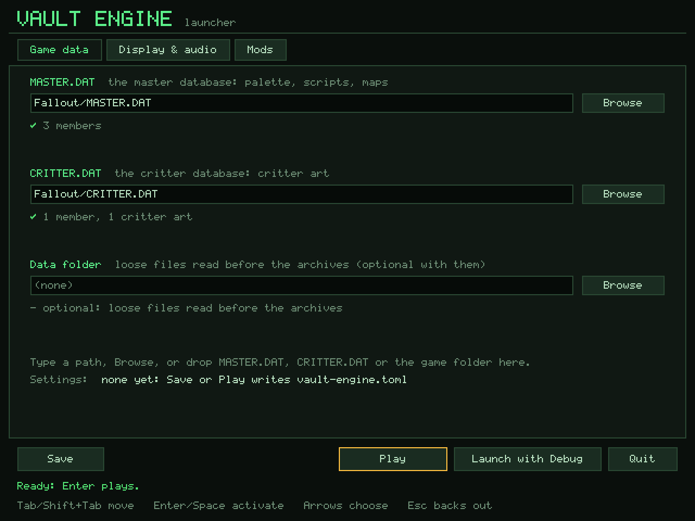

# Vault Engine

[](https://github.com/mikyowski-ui/vault-engine/actions/workflows/ci.yml)
[](LICENSE)
[](Cargo.toml)

**Vault Engine** is a cross-platform, clean-room game engine in safe Rust
(`unsafe` is forbidden). One binary runs retail **_Fallout_ (1997)** and
**_Fallout 2_ (1998)** from your own copy of each game. It builds and is
tested on Linux, macOS and Windows.

Everything is implemented from written specifications, `SPEC-001` to
`SPEC-019`, produced by a two-team clean-room process (see
[`PROVENANCE.md`](PROVENANCE.md)).

> **No game assets are included.** Point the engine at your own copy of the
> game. Synthetic fixtures let you build, test and preview without retail data.

<p align="center">
  
</p>

## Highlights

<p align="center">
  
</p>
<p align="center"><sub>Vanilla 4:3 (left) beside the enhanced widescreen view.
Pictures are rendered from synthetic data by <code>cargo xtask capture-gallery</code>.</sub></p>

- **Both games in one binary.** Fallout 1 and Fallout 2 (archives, maps,
  scripts, saves, interface, party and car). The first start finds your
  installs, and the launcher switches games with one click.
- **Widescreen and tactical camera** (`preset = "enhanced"`): the world fills
  a widescreen window, 0.5×–3.0× zoom, a smooth follow camera, and a
  cursor X-ray roof peek (hold **Alt**). **Alt+V** returns to the original frame.
- **Quality of life** (`preset = "enhanced"`): TAKE ALL, item highlight
  (**Shift**), companion PUSH/WIELD and HUD pills, auto-opening doors, game
  speed (**Alt+F**), a combat overlay (**Alt+H**), and quick save/load
  (**F6**/**F7**).
- **Additive mods** (`vault-mod.toml`): add scripts, maps and record patches
  without editing base tables; collisions stop the load, and scripts are
  checked before they run.
- **Touch UI** (`--touch-ui`): pinch, drag, hold menus and an on-screen pill bar.
- **The full engine underneath:** format decoders, a `.INT` script VM, an
  isometric hex world, turn-based combat and AI, `.MVE` movies, `.ACM` audio,
  deterministic replays and a headless debugger.

## Quick start

**Prebuilt archives** for Linux x86_64, Windows x86_64 and macOS arm64 are on
the GitHub Releases page. Unpack, run `vault-engine`, and the launcher opens to
find your games. (Linux needs ALSA and Wayland or X11; macOS builds are
unsigned, so right-click and choose Open.)

**From source** (Rust 1.88+):

```sh
git clone https://github.com/mikyowski-ui/vault-engine.git
cd vault-engine
cargo run -p vault-platform --release
```

- The first start writes the installs it finds to `vault-engine.toml`; if none
  validate, the launcher opens. Reopen it with `-- --launcher`.
- Flags win over the settings file, for example
  `-- --game-profile fallout2 --preset enhanced` or `-- --touch-ui`.
- The default preset, `vanilla`, keeps the original rules, interface and frame.

## Development

```sh
cargo xtask check   # rustfmt, clippy (-D warnings) and tests, all --locked
```

No desktop, GPU or game data is needed for the checks. Specs live in
`specs/approved/`; see `AGENTS.md`, `PROVENANCE.md` and `CONTRIBUTING.md` for
the clean-room policy.

## Full reference

The complete manual (launcher, camera, mods, Touch UI, desktop shell, CI and
release details, workspace layout, per-spec notes, safe rules and known gaps)
is in [`docs/reference.md`](docs/reference.md).
