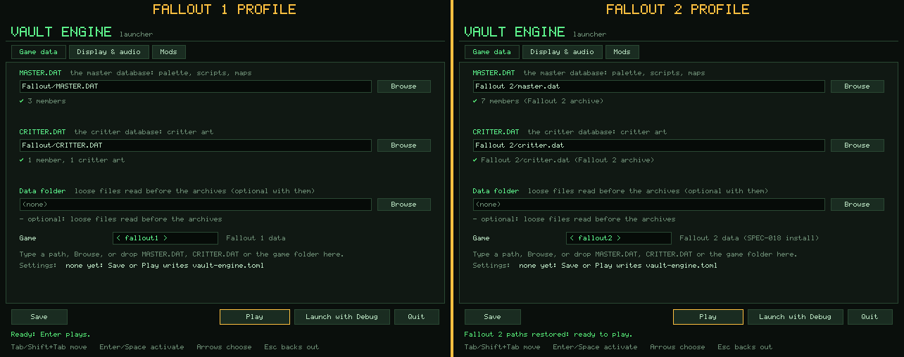
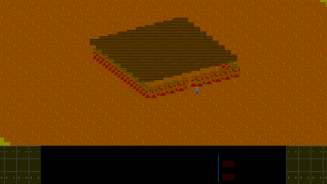

# Vault Engine reference

The full reference for [Vault Engine](../README.md): installing and building,
the desktop shell and its settings (`vault-engine.toml`), the launcher, the
touch UI, the enhanced view and quality-of-life features, mod manifests
(`vault-mod.toml`), the corpus audit tools, and the engine's notes on each
approved specification (`SPEC-001` to `SPEC-019`). The front page is the
[README](../README.md); the clean-room process is in
[`PROVENANCE.md`](../PROVENANCE.md).

## Install and run

**Prebuilt archives.** Each version tag publishes ready-to-run archives on
the GitHub Releases page:
- `vault-engine-linux-x86_64.tar.gz`
- `vault-engine-windows-x86_64.zip`
- `vault-engine-macos-arm64.tar.gz`

Each holds the `vault-engine` binary, the README, this reference
(`docs/REFERENCE.md`), `LICENSE`, `PROVENANCE.md` and the example mod layer
`mods/tactical-camera/`, the
enhanced widescreen camera at 1.25× with the cursor X-ray. Add it in the
launcher's Mods tab. Unpack the archive anywhere and run `vault-engine`;
the launcher opens to find your games.
- **Linux** needs ALSA (`libasound2`) and a Wayland or X11 session at
  run time.
- **macOS** builds are unsigned. Right-click and choose Open the first
  time.

**From source.** You need Rust 1.88 or newer (see
[Build and verify](#build-and-verify) for the platform libraries) and your
own copy of *Fallout*, *Fallout 2*, or both.

```sh
git clone https://github.com/mikyowski-ui/vault-engine.git
cd vault-engine
cargo run -p vault-platform --release
```

1. **First start.** The engine looks for both games (above) and writes what
   it finds to `vault-engine.toml`. If it finds nothing that validates, the
   **launcher** opens instead.
2. **Launcher.** Point it at your installs: type a path, use **Browse**, or
   drop `MASTER.DAT` or the game folder on the window. The **Game** row
   toggles `fallout1` and `fallout2`, and the Display & audio tab sets the
   preset, the viewport, the zoom and the Touch UI. **Play** saves and
   starts. To open it again later, run:

   ```sh
   cargo run -p vault-platform --release -- --launcher
   ```
3. **From the command line.** Flags win over the settings file:

   ```sh
   # Fallout 2, with the enhanced widescreen camera and quality of life:
   cargo run -p vault-platform --release -- --game-profile fallout2 --preset enhanced
   # The touch UI (pan, zoom, hold menus and the pill bar):
   cargo run -p vault-platform --release -- --touch-ui
   ```

The default preset, `vanilla`, keeps the original rules, interface and
frame.

`AGENTS.md` is the repository's implementation policy. `PROVENANCE.md` records
the two-team clean-room process, and `CONTRIBUTING.md` the clean-room
certification every contribution requires. Format behavior follows
`specs/approved/SPEC-001-pal-frm-lst.md` through
`SPEC-019-fallout2-interface-party-and-car.md`. No original game data is
needed to build, test, or run the synthetic shell and preview fixtures.

<details>
<summary><b>Specification index</b> (<code>specs/approved/</code>)</summary>

| Spec | Scope |
| --- | --- |
| `SPEC-001` | Palettes, FRM sprites and LST index files |
| `SPEC-002` | Bitmap fonts and message text |
| `SPEC-003` | Prototypes, map streams and isometric geometry |
| `SPEC-004` | Compiled script files and the core virtual machine |
| `SPEC-005` | Interpreter-library and game host opcodes |
| `SPEC-006` | World variables, character statistics, map events and dialogue |
| `SPEC-007` | Critter art, hex routing and combat resolution |
| `SPEC-008` | Archives, save slots, world travel and Pip-Boy state |
| `SPEC-009` | Combat AI packets, threat selection and NPC turns |
| `SPEC-010` | Sound effect names and ACM audio decoding |
| `SPEC-011` | Items, drugs, barter and character progression |
| `SPEC-012` | Movies (`.MVE`), movie fades and subtitles (`.SVE`) |
| `SPEC-013` | Active skills, loot and barter windows, poison and radiation, elevation transitions |
| `SPEC-014` | Game flow and interface: main menu, character creation, save/load, options, interface bar, cursors, endgame |
| `SPEC-015` | Fallout 2 archives (DAT version 2) and zlib members |
| `SPEC-016` | Map version 20 and Fallout 2 prototypes |
| `SPEC-017` | Fallout 2 host words and VM deltas |
| `SPEC-018` | Fallout 2 mounting, saves and data tables |
| `SPEC-019` | Fallout 2 interface, party control, the car and game-flow deltas |

The per-spec reference sections further down are collapsed; open the one
you need.

</details>

## Workspace

| Package | Responsibility |
| --- | --- |
| `vault-formats` | VFS, asset/prototype/map parsers, projection and picking |
| `vault-core` | Authoritative world, host services, stats/RNG, dialogue, combat and AI, animation sequences, roofs, click policy, world travel, legacy save slots |
| `vault-vm` | INT loader, two-stack core interpreter, explicit host interfaces |
| `vault-guidance` | Pip-Boy holodisk and quest status from campaign globals |
| `vault-render` | Indexed sprite/text/map/dialogue composition and palette rendering |
| `vault-debug` | Headless VM stepper and instruction trace, GVAR/MVAR/LVAR watches, and map object/critter inspectors with tick diffs and text rendering |
| `vault-platform` | Desktop shell, asset preview, input command logging |
| `vault-fixtures` | Dev-only synthetic test fixture builders, compiled once and shared by the crates' tests and `xtask` |
| `xtask` | Engineering gate runner, synthetic fixture writer, mod exporter (`export-mod`) and documentation gallery renderer (`capture-gallery`) |
| `asset-audit` | Loose-corpus counts and format validation |

## Build and verify

Use Rust 1.88 or newer, with Cargo, rustfmt, and Clippy installed. `Cargo.lock`
pins the workspace dependencies. Standard checks need no desktop, GPU, or corpus.

```sh
cargo fmt --all -- --check
cargo clippy --workspace --all-targets --locked -- -D warnings
cargo test --workspace --locked
# The portable crates compile for the browser target:
cargo xtask wasm-check
# Run all four gates:
cargo xtask check
```

`--locked` fails instead of updating `Cargo.lock`, so CI and local gates build
the committed dependency set.

The dev profile builds `vault-formats` and `vault-core` at `opt-level = 2`, so
debug runs of the desktop decode, decompress, light and route at near-release
speed while the other crates keep full debug builds.

CI (`.github/workflows/ci.yml`, read-only permissions, cached builds, every
Cargo command `--locked`) runs these jobs on each push and pull request:
- `check` (Linux): the first three gates.
- `wasm-check` (Linux): installs the `wasm32-unknown-unknown` target, runs
  `cargo xtask wasm-check` with `VAULT_REQUIRE_WASM=1`, so it can never pass by
  skipping, and runs the memory tests with `--no-default-features`.
- `msrv`: `cargo check --workspace --all-targets` on the `rust-version` from
  `Cargo.toml` (1.88).
- `fuzz-check`: rustfmt over `fuzz/fuzz_targets/` and
  `cargo check --manifest-path fuzz/Cargo.toml --bins` on stable.
- `windows-release`: a release build (`vault-platform.exe`, `asset-audit.exe`,
  uploaded as artifacts) and the workspace tests.
- `macos`: build and test.
- `supply-chain`: `cargo audit` and `cargo deny check` (policy in `deny.toml`)
  over both `Cargo.lock` and `fuzz/Cargo.lock`.

The release workflow (`.github/workflows/release.yml`) runs on a `v*` tag,
or by hand. For Linux x86_64, Windows x86_64 and macOS arm64, it runs the
workspace tests, builds `vault-platform` in release, and packages the
binary (as `vault-engine`), `README.md`, `docs/REFERENCE.md`, `LICENSE`,
`PROVENANCE.md` and `mods/tactical-camera/` into the archives above. On a tag it attaches them,
with a `SHA256SUMS.txt`, to that tag's GitHub Release through the runner's
`gh` CLI. Only that job may write; a re-run replaces the archives. A
manual run keeps them as workflow artifacts.

A scheduled nightly workflow (`fuzz.yml`) builds the `fuzz/` targets with
nightly and runs each for 60 seconds on synthetic seeds (see
`fuzz/README.md`).

On Linux the desktop shell needs a Wayland or X11 session, the corresponding
window-system libraries (including libxkbcommon), and a Vulkan or OpenGL driver.
Building its default `audio` feature also needs the ALSA development package
(`libasound2-dev` / `alsa-lib-devel`); `--no-default-features` builds it without
audio output. Windows and macOS use winit/wgpu/cpal's native backends.

### Documentation gallery

```sh
cargo xtask capture-gallery
```

This renders the pictures in `docs/assets/` from synthetic data only, so they
are clean-room safe:
- `compare-viewport.png`: Vanilla 4:3 beside the enhanced widescreen view.
- `launcher-overview.png`: the launcher with each game's profile checked.
- `roof-xray-peek.gif`: the cursor X-ray (Alt) through a roof.
- `tactical-zoom.gif`: scripted camera requests (zoom, pan, shake, reset).
- `combat-overlay.gif`: a companion's HUD pill cycled through its distance
  modes, then a punch starting combat under the tactical overlay (Alt+H):
  the hurt critter's HP bar and the crosshair's to-hit.
- `widescreen-modals-qol.gif`: Shift's ground-item outlines, a crate's
  loot window over the dimmed widescreen world, TAKE ALL, then the
  companion's Gear window from its pill and WIELD twice.
- `f9-live-debugger.gif`: the F9 overlay's pages (the script trace, the
  object inspector on a clicked critter, the GVAR and MVAR editors, the map
  jump, the item spawner) to the camera page's Export Current Setup as Mod.
- `touch-ui-menu.gif`: the touch UI's pill bar, a tap on MODE, then a
  finger held on the companion opening the action menu, sliding down to
  Gear and lifting there. A thin ring, drawn by the gallery, marks the
  finger.

How it works:
- **Staging.** It stages its inputs in `target/gallery` (`--stage`,
  emptied each run; a folder it did not create is refused):
  - the synthetic corpus, restyled by `vault_fixtures::gallery` with
    procedural art (sand, paving, a corrugated roof, brick walls, figures
    for every unarmed animation, a crate, a barrel, a knife and a spear
    with their inventory icons) and a showcase map (the camera demo's
    walled, roofed building with a figure inside, without its script);
  - `write_hud`'s interface art over it: the bar, its buttons and
    counters, the cursors, the action menu's icons, the AP pips, the combat
    panel, the loot window and a text font;
  - placeholder Fallout 1 and Fallout 2 installs the launcher accepts.
- **Rendering.** It then runs the shell's hidden `--capture-gallery`
  headlessly, as a release build, from the stage.
- **Sessions.** Each picture comes from a map session on a fixed 30
  frames-a-second clock, composed on the CPU as the desktop composes its
  layers. The session starts through the same `SessionRuntime` as the
  desktop's (SPEC-020 §2.3), from a configuration of its own (origin
  `Gallery`: no window and no audio output). The scripted camera moves go
  through the camera opcodes' `WorldEffect::Camera` path, and the roof peek
  holds Alt.
- **Encoders.** The files are written by zero-dependency encoders in the
  shell:
  - indexed PNGs (fixed-Huffman DEFLATE with LZ77);
  - looping GIF89a files with one global palette, 3/100 s, 3/100 s and
    4/100 s delays for 30 frames a second, each frame stored as only the
    rectangle that changed.
- **Determinism.** The same sources give the same files byte for byte.
- **Output.** `--output` chooses another folder than `docs/assets`.

## Desktop shell

```sh
cargo run -p vault-platform
# Present a frame and exit, failing if setup/presentation fails:
cargo run -p vault-platform -- --smoke-test
```

Without game data set up, `cargo run -p vault-platform` opens the launcher
(see [Launcher](#launcher)). The bare smoke test displays the color test: a
centered 16×16 synthetic sprite containing all 256 indices,
scaled to whole pixels where space permits. An `R8Uint` texture holds indices;
WGSL resolves them through a separate 256-entry RGB332 palette texture. The
sprite retains its aspect ratio on resize. Minimized windows suspend rendering;
lost/outdated surfaces are reconfigured.

The 640×480 frame is scaled one of two ways (`scaling` in the settings,
`--scaling`, or **Alt+S** at run time). `aspect_fit`, the default, fills the
window on one axis and centers it on the other. At a fractional scale the
shader samples sharp-bilinearly: it pre-scales by the whole part and blends
the palette-resolved colours only in a thin band at each texel edge, so pixels
stay crisp while scrolling. `integer` keeps whole-pixel scaling with a border.
Pointer mapping, the cursor warp and replay all use the same integer-snapped
viewport. **F11** or **Alt+Enter** toggles borderless fullscreen. The shell
keeps these keys (and, under `preset = "enhanced"`, **Alt+V** and
**Alt+F**), and F10 stays the game's quit confirmation (SPEC-014 §3.17).
The window opens at 1280×960, or at the largest multiple of 640×480 that
fits a smaller monitor.

With no arguments the game starts from the data named in `vault-engine.toml`,
looked for beside the executable and then in the working directory. Keys:
`master_dat`, `critter_dat`, `data_root`, `mod_list` (or `load_order`),
`game` (`fallout1`, the default, or `fallout2`; the `--game-profile` flag),
`preset` (`vanilla` or `enhanced`), `scaling`, `fullscreen`, `touch_ui`
(see [Touch UI](#touch-ui)), `debug` and `audio` (`false` keeps the audio
device closed, as `--no-audio` does), plus the enhanced preset's
`viewport_mode`, `default_zoom`, `smooth_camera`, `roof_peek` and
`ui_scale` (see [Enhanced viewport & camera](#enhanced-viewport--camera))
and `game_speed` (`1.0`, the default, `1.5` or `2.0`; see
[Quality of life](#quality-of-life)), and `render_path` (`reference`, the
default, or `instanced`; see [Render path](#render-path)).

Under `fallout2` the data is read in Fallout 2's formats:
- SPEC-015 archives, mounted as SPEC-018 §1 says: an optional
  `patch000.dat` over `MASTER.DAT`, and `CRITTER.DAT` for critter art;
- SPEC-016 version 20 maps (with Fallout 2's two-word ladder records) and
  416-byte critter prototypes (412-byte ones are read with damage type 0).

`--game-profile fallout2 --preview-map MAP` previews a Fallout 2 map. Under
`fallout2`, Play validates the install and starts a new game from its SPEC-018
tables on `maps/artemple.map`, with its scripts running (SPEC-017 Revision 3
recorded the §8 audit and opened the §8.5 gate), in SPEC-019's interface: its
main menu, world and town maps, Pip-Boy, character folders, party control
panels, the car and the endgame. See the
[Fallout 2 and QoL roadmap](fallout2-and-qol-roadmap.md).

Settings values are quoted
strings, `true`/`false`, decimal numbers (`2`, `1.25`, `5e-1`, `1_000`) or
one-line string arrays; a bad value or an out-of-range number fails with
`line N:` and the reason.

Each game keeps its own last-used paths in a `[profiles.fallout1]` and a
`[profiles.fallout2]` table at the end of the file (`master_dat`,
`critter_dat` and `data_root` only). The top-level path keys stay the active
game's, so a file from before profiles reads as it always did; when both name
paths, the top-level keys win. `--game-profile` launches with that game's
profile (or the top-level paths when it has none).

When there is no file, each game's `MASTER.DAT` and `CRITTER.DAT` are looked
for in its own directories. Both games check the working directory and the
executable's. Fallout 1 then checks `../local-corpus`, `~/games/fallout1`
and its usual Steam and GOG install directories (`Fallout`). Fallout 2 checks
`~/games/fallout2` and its Steam and GOG directories (`Fallout 2`). A folder
counts for a game only when its `MASTER.DAT` opens in that game's archive
format. What is found is written to a new `vault-engine.toml`, the game named
by `--game-profile` (else the first found) active. Command-line flags always
win over the file. When that still names no game data that validates, the
launcher opens instead (below).

### Render path

SPEC-022 gives the world canvas two render paths. Both draw the same 8-bit
indexed canvas, byte for byte; the display stage after it (palette, cycling,
brightness, scaling, the interface frame) is shared.

```sh
cargo run -p vault-platform -- --render-path instanced
```

- **`reference`** (the default everywhere: the desktop shell, replays and
  the documentation gallery) is the CPU compositor of `vault_render::map`.
- **`instanced`** draws each refresh with GPU-instanced sprite batches
  (`vault_render::SceneRenderer`): one draw call per batch, and a snapshot
  copy per batch of canvas-reading draws (translucency, the player cutout,
  translucent outlines, the enhanced shroud). Its GPU device is created on the first refresh and
  shared by every world of the session.
- **Fallback.** A refresh the instanced path cannot draw exactly is drawn by
  the reference path, and its cause is logged once per session. Refused
  today: only SPEC-022 §3.12's error states, among them a roof peek whose
  radius or center a safe bound of §3.10 would change, which the shell's zoom
  range never reaches. The `enhanced` shroud, the cursor roof peek, every
  ground-item highlight and a cutout drawn without a light are drawn
  instanced. Without a GPU adapter or device, or after a lost device, the
  reference path draws the rest of the session.
- **Selection.** `--render-path reference|instanced`, else the settings'
  `render_path`, else `reference`. It is read under every preset and game,
  since it changes no output. A replay takes only the flag, and the
  shell's hidden `--capture-gallery` honors it too.
- **Never recorded.** The setting writes no input-log record, changes no
  replay record or digest, and is never written to a save. The launcher
  does not save the flag, and a rewrite of `vault-engine.toml` keeps the
  file's own `render_path` line as it was.
- **Metrics.** The F9 overlay's Renderer page shows the path and its counts
  (see [Game flow and interface](#game-flow-and-interface-spec-013-spec-014)).

The vault-platform tests check the parity: the map view over a short play
session, the Vanilla and enhanced replay logs (frame by frame and by
digest), and every world file of the gallery, each on the reference path
and on the instanced path. The CPU executor runs everywhere. The GPU
variants skip with `skipped: no GPU adapter` unless `VAULT_REQUIRE_GPU=1`,
and one lock serialises their device creation. They skip the same way when
the device is lost on its first draw, as on the software Direct3D 12 adapter
of the Windows runners, printing the adapter and the cause. Each test process
makes that draw once, on a device of its own. Any other failure of that draw,
such as a shader the backend rejects, fails the tests and names the cause, so
it cannot pass for a missing GPU.

### Launcher

<p align="center">
  
</p>
<p align="center"><sub>Each game's profile, one click on <b>Game</b> apart
(synthetic placeholder installs).</sub></p>

The launcher is a native pre-game window. It is drawn into the same 640×480
indexed frame as the game, with its own 5×8 bitmap font (ASCII 32-126 plus
✓ and ✗, 776 bytes of glyph data drawn for this project) and its own palette.
It uses no game art or fonts, so it works before any game data is found. It
opens when:

- the binary starts with no asset named (no `--game`, `--preview-*`,
  `--play-movie` or `--smoke-test`) and `vault-engine.toml` is missing, fails
  to parse (the error shows in the status line, and Save replaces the file),
  or names game data that does not validate; or
- `--launcher` is given. Display flags given with it (`--scaling`,
  `--fullscreen`, `--touch-ui`, `--preset`, `--viewport`, `--zoom`,
  `--no-audio`) pre-set its choices.

Replays (`--replay-inputs`), `--smoke-test`, `--game` and the `--preview-*`
and `--play-movie` flags never show it, and `--launcher` conflicts with them.
A Shift-held-at-startup trigger is not offered: winit reports modifiers only
through later events, not when the window opens.

It has three tabs and a bottom bar:

- **Game data**: `MASTER.DAT`, `CRITTER.DAT` and the data folder. Each takes
  typed text, **Browse** (a built-in folder browser over `std::fs`), or a file
  dropped on the window. A dropped `.DAT` goes to the field its name matches
  (`critter` in the name: CRITTER.DAT, otherwise MASTER.DAT). A dropped folder
  becomes the data folder, unless it holds both archives: then it fills all
  three fields the way discovery does. Each field is validated as it changes,
  and a ✓ or ✗ with a reason and the member count shows under it:
  - MASTER.DAT must open as a DAT archive (only its directory tables are
    read). It must hold `color.pal`, `data/vault13.gam` and the new-game map
    `maps/v13ent.map`, or the data folder must hold the missing ones.
  - CRITTER.DAT must open and hold members under `art/critters/`.
  - The data folder must be an existing directory. Without the archives it is
    the whole game data, so it must then hold those three files itself.
  - The two archives are named together or not at all.
  - **Game** toggles `fallout1` and `fallout2`. The fields are kept as the
    old game's profile and show the new game's. A game with no paths yet gets
    its data discovered as above (and a start whose active game has none does
    the same, showing the launcher with what it found). Save and Play write
    both profiles.
- **Display & audio**: two columns of evenly spaced rows, with one help
  line below them for the focused (else hovered) row.
  - **Left column:** scaling (`aspect_fit` or `integer`), fullscreen, the
    touch UI, preset (`vanilla` or `enhanced`), audio on or off, and the
    debug overlay.
  - **Right column, enhanced preset only:** these rows are hidden, and out
    of the focus order, under Vanilla, where the column says how to show
    them.
    - **Widescreen:** `On`, or `Off (4:3 Classic)`, the
      `viewport_mode`; Alt+V toggles it in play too.
    - **Default zoom:** a stepper over 0.5, 0.75, 1, 1.25, 1.5, 2, 2.5
      and 3.
    - **Smooth camera.**
    - **Roof peek mode.**
    - **Interface scale:** auto, 1, 1.5, 2, 2.5 or 3.
    - **Game speed:** 1.0x, 1.5x or 2.0x.

  Left and Right step the rows back and forth; Save writes them.
- **Mods**: the `load_order.toml` layers, lowest first, with their per-layer
  check (each layer is mounted on its own over an empty base) and the whole
  stack's check. Layers can be added (typed, browsed or dropped while the tab
  shows), moved up or down, enabled or disabled, and removed. Paths inside the
  load order's directory are written relative to it. A layer outside it is
  reported, because a load order's layers must lie inside its own directory.
  With no load order yet, Save writes `load_order.toml` beside the settings
  and sets `mod_list = "load_order.toml"`. A `mod_list` given as an inline
  path list in `vault-engine.toml` is shown read-only, with that explanation:
  edit it in the file, or remove it to manage a `load_order.toml` here. A load
  order that does not parse is also shown read-only, Save leaves it alone, and
  Play is refused. A layer whose folder has a `vault-mod.toml` is listed by
  the mod's `name`, with an `[enhanced]` badge when the manifest carries
  launch settings. A malformed manifest fails its layer and refuses Play.
- **Save**, **Play**, **Launch with Debug** and **Quit**, with a status line.
  Save writes `vault-engine.toml`, rewriting the file it was read from in
  place or else creating one beside the executable (then in the working
  directory). Unknown keys are kept, and paths below the file's directory are
  written relative to it. Play refuses, with the reason, until the game data
  and the mod stack validate. Then it saves and starts the game in the same
  window and renderer, with the same launch a zero-argument start builds from
  those settings. Launch with Debug does the same with the debug overlay on
  for this run only (the Debug toggle is what is saved). If the game fails to
  load, the launcher stays open and shows why.

Keys: **Tab** and **Shift+Tab** move the focus, **Enter** or **Space**
activates, the arrows choose (Left and Right switch tabs and cycle choices,
Up and Down move between widgets or through a list), and **Esc** backs out of
the browser. In the browser, Enter opens a folder or picks a file, Backspace
goes up, and **Use this folder** picks the folder shown. In the layer list,
Shift+Up and Shift+Down move the selected layer, Space toggles it, and Delete
removes it. Text fields take US-layout text with Left, Right, Home, End,
Backspace and Delete. The mouse clicks, hovers and scrolls lists. F11,
Alt+Enter and Alt+S work as in the game.

Launcher input is never game input. Nothing is written to a `--record-inputs`
log while the launcher shows. The log starts when the game does: first its
`surface` and `scaling` records, as a direct start writes them, then the
game's frames. The game's clock also starts at zero then, so a log recorded
through the launcher replays like one from a direct start.

`load_order.toml` `[[layer]]` tables take an optional `enabled = false`. The
layer stays listed but is not mounted. `vault_formats::vfs::write_load_order`
writes entries back in the `[[layer]]` form, which `parse_load_order` reads
to the same entries.

`preset = "enhanced"` (or `--preset enhanced`) selects
`vault_core::EnginePreset::Enhanced`. That enables the versioned opcode range
`0x8200`-`0x82FF` (`0x8200` pushes the engine API version, 2) and reads table
overrides from `data/vault-engine/<table>.txt`. The tables are the critical
hits, critical failures, terrain, encounter frequency, regions, towns,
hotspots and map numbers, in the canonical text `build.rs` emits. Vanilla, the
default, keeps strict SPEC-004/005 behaviour: the enhanced words are unknown
opcodes, the compiled spec tables are used, and replay digests are unchanged
(a regression test pins them). `mod_list` stacks mod layers over the game data,
lowest first: each is a loose folder and/or a master `.DAT` with an optional
critter `.DAT`, routed as the base data is, and the highest layer wins. It is
either a list of paths or the path of a `load_order.toml` (`layers = [...]`, or
`[[layer]]` tables with `path`, `master_dat`, `critter_dat` and an optional `enabled = false`). A load order's
layers must lie inside its own directory. A mounted mod layer also enables the
table overrides.

### Touch UI

A touch layer for phones and tablets, testable on a desktop touch screen
(or with a mouse, for the on-screen buttons). It is off by default; turn it
on with `--touch-ui`, `touch_ui = true` in `vault-engine.toml`, or the
**Touch UI** row of the launcher's Display & audio tab. The flag wins over
the file, as `--fullscreen` does.

It works under both presets, and panning and zooming do too. Under
`preset = "vanilla"` the touch UI brings a **navigation-only** unlocked view:
the widescreen world with the camera (a drag pans, a pinch zooms 0.5× to
3×), and nothing else from the enhanced view. The gameplay rules stay
Vanilla's, and so do the keys: `-`, `=` and `0` remain the brightness keys,
and there is no roof peek (Alt, Alt+R, `PEEK`), no Shift item highlight and
no Take All. The fixed 640×480 view (`viewport_mode = "fixed_640x480"`
under the enhanced preset) has no camera, so there a drag only moves the
pointer and a pinch does nothing.

Gestures (thresholds: a 10-logical-pixel slop; a hold presses after 250 ms,
so the action menu opens at 500 ms):

| Gesture | Becomes |
|---|---|
| One-finger tap | The pointer moves where the finger lands; a left click when it lifts |
| One-finger drag past the slop | Unlocked view (either preset): a middle-button drag from where the finger landed, the camera's own pan. Fixed view: the pointer follows, nothing is clicked |
| One-finger hold (still for 250 ms) | The left button goes down and stays down, the mouse's press and hold. The game's own held-button pulse (SPEC-014 §3.28, 250 ms) opens the action menu over a critter, door or item at 500 ms (Talk, Look, Use, Push, Gear, Backpack, Skilldex, as that object offers), or a window's item menu. The pointer follows the finger, so sliding moves the highlight, and lifting picks the entry. Lifted before a menu opens, it is a click. While no menu is open, sliding past the slop or a second finger withdraws the press without acting, and the touch pans or becomes a two-finger gesture instead |
| Two-finger pinch | Unlocked view (either preset), over the world: wheel lines `ln(d / d_last) / ln(1.15)` at the fingers' midpoint, so the zoom follows the spread about that point and clamps to 0.5-3.0. Fixed view: nothing |
| Two-finger tap | A right click (the cursor-mode toggle), as the pill bar's `MODE` is |

A gesture is over once it has acted or been cancelled: the other fingers do
nothing until all have lifted, and a third finger is ignored. A cancelled
drag ends its pan, and a cancelled button press or hold is released outside
the window, so it does not act (an action menu already open still takes its
highlighted entry, as a mouse release would). Anything else cancelled does
nothing. While a finger is down, mouse events (which some platforms derive
from touches) are dropped.

Every gesture is logged and replayed as the mouse records it becomes
(`pointer_moved`, `pointer_left`, `pointer_button`, `wheel`), through the
mouse's own handlers; touches are not logged themselves. A touch UI session
logs one more record after `surface`, `scaling` and `enhanced`, so a replay
draws the pill bar and its buttons take the logged presses:

```json
{"command_id":4,"kind":"touch_ui","enabled":true}
```

A log without it replays without the bar, as before. The navigation-only
view's `enhanced` record carries `"navigation_only":true`. Other records
leave the key out, so earlier logs read and write unchanged.

An enhanced-preset session that starts at another speed than 1.0 logs a
`game_speed` record after those, and every **Alt+F** logs one where it
happened (Alt+F itself, a shell key, is not logged as a key). A replay
applies each where it stands, so the world's clock follows the same steps;
replay with `--preset enhanced`, as Vanilla worlds ignore the record. A log
without one runs at 1.0x, as before:

```json
{"command_id":5,"kind":"game_speed","speed":1.5}
```

**Pill bar.** On the map screen a row of amber-and-black buttons, 60×40
frame pixels and 6 apart, sits in the interface frame's top-right corner,
right-aligned to x 636 at y 12. It clears the party pills (top left), the
bar and the indicator boxes, and the enhanced view's edge-scrolling band.
It shows outside conversations, dialog boxes and the Set Timer and
called-shot windows, hides while the F9 overlay's panel is open, and every
full window covers it. A finger landing on a button presses it at once (it
draws black on amber while held); the button acts when released over it,
through its key's own press and release, so it does exactly what the
keyboard does, the combat lock's held keys included:

| Button | Acts as |
|---|---|
| `MODE` | A right click: the cursor-mode toggle |
| `PEEK` | Alt+R, the roof peek's cycle (enhanced unlocked view only; hidden elsewhere, the Vanilla navigation-only view included) |
| `TURN` | Space, ending the turn; held 500 ms or longer, Enter, ending combat (timed on the logged frame clock) |
| `INV` | I, the inventory |
| `PIP` | P, the Pip-Boy |
| `ESC` | Escape, the menu |

In the launcher a tap hovers and presses as a click does.

### Enhanced viewport & camera

The enhanced preset also changes the presentation; Vanilla (the default) is
untouched by everything here. Its shell, settings, launcher defaults, input
logs and replay digests are what they were. The one exception is the touch
UI's navigation-only view under Vanilla (see [Touch UI](#touch-ui)), which
takes this section's viewport and camera only.

- **Dual-layer viewport.** With `viewport_mode = "unlocked_widescreen"` (the
  default) the world is drawn across the whole window at an aspect-matched
  resolution, and the 640×480 interface frame is drawn over it at its own
  scale, anchored bottom-center. The map screen's interface is see-through
  over the world, and side panels continue the interface bar to the window's
  edges. `fixed_640x480` keeps the Vanilla frame. **Alt+V** toggles the two
  in play, on any screen (a shell key, like Alt+S; V is no game key).
- **Windows over the map.** The inventory, loot (Companion Gear included),
  barter and conversation, Skilldex, elevator, automap and options (pause
  and preferences included) windows keep the whole world canvas drawn
  behind them, at the camera's current position and zoom, under the frame's
  see-through map rows and beside it. The world is dimmed by a vignette
  darker toward the window: a ramp of six darkening tables (88% down to 48%
  brightness, the palette's nearest entries below the cycling range, never
  lighter than the pixel), chosen by the pixel's elliptical distance from
  the window's middle (about 54% there, 83% at the canvas's edges) and
  dissolved between tables by the 4×4 Bayer dither anchored to world
  pixels. Under the pause window the world is greyed first, as Vanilla
  greys its map. The simulation is untouched: a window that pauses the
  world keeps its canvas until input, a world change or a camera move
  redraws it; a conversation's world is drawn every frame. Without the bar
  (a conversation, barter, preferences) the canvas runs down to the
  window's bottom edge and no side panels show.
- **Bezel.** Full-screen windows (the main menu, splash, character
  selection and editor, credits, death scene and endgame slides, the
  Pip-Boy, the character screen, save and load, help, the world and town
  maps) are framed by an engine-drawn bezel in place of the world and side
  panels (`vault_render::bezel`): brushed dark steel, lighter toward the
  top, with a thin amber inner edge, a bevelled steel lip, amber corner
  brackets, and bevelled panel seams and rivets on a lattice anchored to
  the frame's corners. It is drawn in frame pixels (scaled with the frame
  at any window size and `ui_scale`), from integer hash noise with fixed
  seeds, in the display palette's nearest entries outside index 0 and the
  cycling range, so it is the same every frame. Outside a world it fills
  the letterbox around the single 640×480 frame without changing its
  viewport or the pointer mapping. Movies keep black around them, and
  Vanilla and the fixed view keep the plain clear colour.
- **Zoom.** The mouse wheel and `-`/`=` zoom the world (0.5× to 3×), and `0`
  goes back to `default_zoom`. On the enhanced map screen this takes `-` and
  `=` from Vanilla's brightness keys: **Ctrl+`-`/`=`** adjust the brightness
  there instead.
- **Auto-fit floor.** The least zoom rises above 0.5 when a wider view
  would show past the map. The floor is the least zoom at which the view,
  centred anywhere in the camera's soft bounds, stays inside the drawn map
  area, capped at 3.0. The drawn map area is the bounding box of the
  elevation's drawn floor squares (80×36 each, neither hidden nor the
  blank floor, art index 1), cut to the grid's extent (the intersection of
  the hex cells' and floor squares' bounding boxes, `[0, -1188, 7984,
  2404]` in default-grid pixels). A floor that does not hold the 640×380
  view everywhere the camera rests (no floor, a few squares, or floor that
  ends at the blockers) does not frame the map, and the grid's extent is
  used instead. Views smaller than 640×380 reach as far as that view does
  (see Camera bounds), so with `margin` the least room between the rest
  bounds and the area on an axis, the floor is `world_rect / (ui_scale ×
  (2 margin − 2))` on each axis; under 320 or 190 pixels of room it is
  3.0, and the shroud covers what remains. It follows the window size,
  `ui_scale` and the map, and binds the wheel (and a pinch's lines), the
  zoom keys, a scripted `SetZoom` and `default_zoom`.
- **Panning.** Dragging with the middle button pans the camera. Holding
  **Space** and dragging does too, out of combat only, because Space ends the
  turn in combat. `smooth_camera = false` makes camera moves snap instead of
  glide.
- **Roof peek.** Holding **Alt** peeks under the roofs around the cursor.
  **Alt+R** cycles `roof_peek` between `vanilla` (the Vanilla roof rules),
  `cursor_xray` (a cutaway around the cursor) and `hidden` (no roofs). Alt
  rather than Tab is the peek modifier, because Tab is the automap.
  - The cutaway is a 96-pixel disc with a 48-pixel ring, a constant size on
    screen at every zoom.
  - The ring dissolves the roof through a 4×4 ordered (Bayer) dither anchored
    to world pixels, so it stays in the 256-colour palette and does not swim
    while panning.
  - Clicks go through a cut-away roof to the floor, object or critter
    beneath.
- **Camera bounds.** The camera follows the player and eases back inside
  the region the map's scroll blockers enclose (`CameraRegion::compute`,
  below). The blockers bound only the camera center, never what is drawn.
  Floor, walls, scenery and critters past them are drawn normally, because
  narrow maps such as `artemple.map` rely on that art to fill the view. A
  view zoomed in smaller than 640×380 may move as far as that view's edges
  would reach, so the player stays in sight at the region's edges. A larger
  view (zoomed out, or widescreen) keeps the region's bounds. Only what lies
  off the 200×200 grid is shrouded, in a flat dark colour rather than
  drawn as empty space.
- **Debug camera.** On the **F9** overlay, **F8** reaches a Camera page in
  the unlocked view, between the Spawn and Renderer pages.
  - **F** toggles the "unbounded free-cam and roof cutaway": no bounds, no
    clamp and no roofs.
  - **C** runs a camera demo: a pan, a 2× zoom, a shake with an X-ray peek,
    then a reset.
  - The **Export Current Setup as Mod** button (or **E**) writes the running
    setup as a mod folder (below).

The settings are `viewport_mode` (`"fixed_640x480"` or
`"unlocked_widescreen"`), `default_zoom` (a number from 0.5 to 3.0, default
1.0), `smooth_camera` (default `true`), `roof_peek` (`"vanilla"`, the default,
`"cursor_xray"` or `"hidden"`) and `ui_scale` (`"auto"`, the default, which
fits the interface to the window's height, or a number from 0.5 to 8). They
are read only with the enhanced preset. `--viewport MODE` and `--zoom ZOOM`
override the first two from the command line (and pre-set the launcher).

#### Camera opcodes and the camera demo

<p align="center">
  
</p>
<p align="center"><sub>Scripted camera requests: zoom to 0.5×, a pan, a
smooth zoom in to 3.0×, a shake, and the reset.</sub></p>

Under `preset = "enhanced"` scripts can drive the view with four words of the
versioned range. Operands are integers, pushed in the order written and popped
last first; none pushes a value. Each request leaves the world as a
`WorldEffect::Camera(CameraCommand)` effect: presentation only, never part of
the simulation, saves or replays. Durations are presentation milliseconds (0
applies at once). Requests run in the order given: each starts when the one
before it has run its duration, so a script can give a whole sequence at once.

| Word | Name | Operands | Meaning |
|---|---|---|---|
| `0x8210` | `op_cam_pan_to` | `tile_num, duration_ms` | Move the view center to hex `tile_num` (0-39999) |
| `0x8211` | `op_cam_set_zoom` | `zoom_pct, duration_ms` | Zoom to `zoom_pct` percent (100 is 1.0x; the view clamps to 50-300) |
| `0x8212` | `op_cam_shake` | `intensity, duration_ms` | Shake by up to `intensity` pixels, decaying over the duration |
| `0x8213` | `op_cam_reset` | `duration_ms` | Follow the player again at the configured zoom, with no shake |

A hex outside 0-39999, a negative duration, a zoom of 0% or less or a negative
intensity is refused with a world diagnostic and no effect; the script goes
on. A non-integer operand is the ordinary VM type error. `engine_api_version`
(`0x8200`) now pushes 2. Under Vanilla all four are unknown words: a script
using them fails to parse with `invalid instruction 0x8210`, and the map
loads without it.

The view stays in the region `vault_core::camera::CameraRegion::compute`
returns for the current elevation. It is a breadth-first fill, in hex
neighbor order, from the player's hex (from the view center while the player
is not placed), through hexes that pass the map-dependent scroll tests of
SPEC-014 §3.29: inside the map border, with no unowned scroll blocker (PID
`0x0500000C`, `SCROLL_BLOCKER_PID`) on that elevation. It omits the
player-distance limit, so it is every hex the view may ever reach. A start
hex that fails the tests falls back to the view center, and if both fail the
region is the start hex alone.

`cargo xtask fixtures --output DIR` also writes `DIR-cam-demo`: the same
synthetic corpus plus `maps/cam_demo.map` and its map script
`scripts/camdemo.int`. Scroll blockers on the ring of hex columns and rows 60
and 140 enclose the camera's region. Inside it stand a walled, roofed building
with a doorway, a critter and an item, and the entry hex outside the building.
At map entry the script pans to the building's interior over 1500 ms, zooms to
200% over 1000 ms, shakes with intensity 6 for 800 ms and resets over 1500 ms,
all requested at once; the view sequences them by duration. A Vanilla audit
of `DIR-cam-demo` reports `camdemo.int` as an unknown-word failure; `DIR`
stays clean.

    cargo xtask fixtures --output target/state-corpus
    cargo run -p vault-platform -- --corpus-dir target/state-corpus-cam-demo \
      --preset enhanced --preview-map maps/cam_demo.map

An enhanced session's input log has one more record after `surface` and
`scaling`, and another on every Alt+V:

```json
{"command_id":3,"kind":"enhanced","settings":{"viewport_mode":"unlocked_widescreen","default_zoom":1.0,"smooth_camera":true,"roof_peek":"vanilla","ui_scale":null}}
```

A replay applies it to the world. While the world shows the unlocked
viewport, the replay routes pointer moves, buttons (the middle one included)
and the wheel through the same layout for the logged surface as the desktop
does, laid out at the auto-fit floor at least, as the desktop lays it out.
The digest then covers the enhanced frame, that is the world canvas (the
dimmed one behind a window, black behind a full-screen one), the interface
frame, its see-through index, the side-panel tile if any, and a `bezel`
marker when the frame asks for the bezel (the bezel itself is drawn by the
shell in the display palette), in place of the Vanilla frame, and
`--replay-frame` writes the world canvas. A log without an `enhanced` record
replays exactly as before.

#### Quality of life

The enhanced preset adds some of Fallout 2's conveniences to Fallout 1
natively, with no data conversion. The design is in the
[Fallout 2 and QoL roadmap](fallout2-and-qol-roadmap.md). Under Vanilla
none of it is reachable, and menus, windows, saves and replay digests are
unchanged.

- **Take All.** The loot window has an engine-drawn **TAKE ALL** button over
  its middle panel. It does what Shift+A already does, and is absent while
  stealing.
- **Ground items.** Holding **Shift** on the map outlines every item lying
  on the ground in the item color. The highlight is drawn after the
  outlines and outside their list of 100.
- **Push.** Out of combat, a standing party member's action menu has
  **PUSH**, so shopkeepers and guards stay where their scripts put them (a
  `--debug` session offers it on any standing critter). The critter walks
  one hex directly away from you, or to one of the two
  neighbouring directions when that hex is taken. With no free hex the
  status line says so.
- **Gear.** A party member's action menu has **GEAR**. It opens the loot
  window on the companion with no steal roll and no risk of being caught, so
  gear can be traded both ways. Equipped items stay hidden.
- **Distance.** The gear window's **DISTANCE** toggle cycles *default*,
  *close*, *hold* and *charge*. It changes how the companion's AI packet
  `max_dist` is read at SPEC-009's pursuit stop (§3.6 step 4) and flee stop
  (§3.8 step 1):

  | Mode | Pursuit stop | Flee stop |
  |---|---|---|
  | default | the packet's value | the packet's value |
  | close | 3 hexes | 3 hexes |
  | hold | 1 hex | 1 hex |
  | charge | none | the packet's value |

  The settings are saved beside the slot's `SAVE.DAT` in `VAULTENG.TOML`,
  only by an Enhanced save that has some to keep. Any other save into the
  slot, a Vanilla one included, removes an old `VAULTENG.TOML`, so an
  overwritten slot never carries stale settings. `SAVE.DAT` itself is
  byte-identical to a Vanilla save.
- **Auto-open doors.** Out of combat, a click beyond a closed door routes
  you through it, in both games. You open it on the way, as other critters
  do, and walk on. The door must be neither locked nor jammed. It must also
  have no script, or be one you have already opened yourself in this game,
  since traps are scripted. A scripted door still runs its use script each
  time, and if that script stops the door, you stop beside it. The doors you
  opened are kept in `VAULTENG.TOML` the same way. In combat, doors block
  your route as in Vanilla.
- **Companion WIELD.** The gear window has a **WIELD** button above
  **DISTANCE**, with a plate naming the companion's held weapon, or
  *Unarmed*. Each press takes the next weapon of the companion's inventory
  in hand, in inventory order, then none, through the same wield and
  unwield path the script words use. The companion's art shows the
  weapon's animation code when its critter art has that weapon, else it
  keeps its unarmed art while holding the weapon. Under the Fallout 2
  profile there is no gear window: the same button and plate sit along the
  top of the middle panel of a party member's **Trade** window, and the
  held weapon stays hidden from the trade.
- **Party status pills.** The HUD shows a small amber-and-black pill for
  each companion in the top-left corner: its name, current and maximum
  HP, and its distance mode (*DEF*, *CLS*, *HLD*, *CHG*; under Fallout 2
  the control record's distance, with *SNP* for snipe). Clicking the name
  opens the companion's gear window, or under Fallout 2 its Trade window
  (within talking distance), and clicking the mode cycles the distance.
  Out of combat only; otherwise the status line says so. No companion, no
  pills.
- **Game speed.** `game_speed = 1.5` or `2.0` in `vault-engine.toml`, the
  launcher's **Game speed** row, or **Alt+F** in play (a shell key, like
  Alt+V: it cycles 1.0x, 1.5x, 2.0x and back, and the HUD names the new
  speed) speeds up the world. The world runs on its own clock, which
  advances by each frame's shell-clock delta times the speed, counted in
  exact half milliseconds, so it stays a pure function of the logged frame
  times. That clock times everything the world does: walking and running,
  animations and attack shows, combat turns, scripts, the game clock and
  floating texts. These keep the shell clock and their own pace: the
  interface (the action menu's hold, hover rests, fades, counters, panel
  animations, key repeat, the camera), movies, audio (no pitch change) and
  world-map travel. An open conversation runs at 1.0x. At 1.0x the world's
  clock is the shell clock itself, so every specification timing is
  unchanged.
- **Tactical overlay.** **Alt+H** toggles it; it starts on. In combat, on
  the map:
  - **HP bars.** A compact bar sits above each injured critter (current
    HP below its maximum; the dead have none). It fills green above half,
    amber above a quarter and red below, in the palette's own colours
    (below the cycling range), with a black frame. It is drawn on the
    world canvas in the widescreen view and on the frame in the fixed
    view, and at zoom below 0.75 its pixels double so it stays readable.
  - **To-hit.** The crosshair shows the to-hit chance beside it while it
    is over a target, at once. The number is the one the Vanilla hover
    shows after its 250 ms rest (the uncalled SPEC-007 chance, or a red
    `X` when the attack is refused), and that text takes over when it
    appears. No formula changes.

  Alt+H is presentation only: it is logged and replayed as the key it is.
- **Quick save and quick load.** **F6** saves at once and **F7** loads at
  once, with no pick screen and no prompt, to a dedicated slot,
  `SAVEGAME/QUICKSAV` beside `SLOT01`-`SLOT10`. The SPEC-014 §3.14 screen
  lists only the ten numbered slots, so it never shows the quick slot, and
  a quick save never touches a numbered one. The slot holds the same files
  as any other (SPEC-008's `SAVE.DAT`, the saved maps and `AUTOMAP.SAV`,
  in the running game's layout), written through the same staged save
  path, with the `VAULTENG.TOML` sidecar as any enhanced save keeps it.
  The HUD says `Quick Saved.` or `Quick Loaded.`, or in red `Quick save
  failed.`, `Quick load failed.` or `No quick save to load.` Under Vanilla
  F6 and F7 keep SPEC-014 §3.16 exactly: the first press opens the pick
  screen, later ones save or load the picked slot.
- **HUD messages.** The QoL messages above show in an amber plate near the
  top of the interface frame for 2 s, then dissolve through a 4×4 ordered
  dither over 0.5 s (shell time).

Fallout 1 has no art for the new buttons and menu entries, so they are
drawn by the engine in the palette's amber and black.

#### Mod manifests and exporting a setup

Any loose-folder layer in the load order can carry a `vault-mod.toml` at its
root. It names the mod and can ship the enhanced launch settings with the
layer's maps, scripts and `data/vault-engine/<table>.txt` overrides:

```toml
name = "Tactical camera"
version = "1.0.0"
author = "someone"
description = "Widescreen, a closer default zoom and the roof X-ray."

[enhanced]
preset = "enhanced"
viewport_mode = "unlocked_widescreen"
default_zoom = 1.25
smooth_camera = true
roof_peek = "cursor_xray"
```

- `name` is required; `version`, `author`, `description` and every
  `[enhanced]` key are optional.
- The values are those of `vault-engine.toml`. Unknown keys or tables, and
  values outside their range, are errors naming the line, because a
  misspelt setting would otherwise do nothing.
- On launch each **enabled** layer's `[enhanced]` keys apply over
  `vault-engine.toml`, lowest layer first, so the highest layer wins a key
  as it wins a file.
- Command-line flags (`--preset`, `--viewport`, `--zoom`) still win over
  both. A replay takes nothing from either.
- A malformed manifest stops the launch with `mod_list:` and the folder's
  name. The launcher shows the same error on the layer.

A manifest can also **register** additions without replacing whole files:

```toml
[[scripts]]            # a script row past the base scripts.lst
file = "camdemo.int"   # under scripts/
index = 4096           # not a scripts.lst row; unique across mods
local_vars = 0

[[maps]]               # reachable by load_map name, transitions and saves
file = "cam_demo.map"  # under maps/
number = 100           # 66-65535 (SPEC-008's table is 0-65); unique

[[patches]]            # single records of a campaign table
table = "towns"        # critical, critical_failure, terrain, frequency,
                       # region, towns, hotspots or maps
file = "data/mymod/towns.patch.txt"
```

- **Scripts.** A row the base `scripts.lst` lacks resolves to the
  registered file and local count. Registering a row the list already has
  is refused at load.
- **Maps.** `load_map` first matches `map.msg` 0-65 exactly as SPEC-008
  §3.10 says. A name that matches nothing is then compared with the
  registered file names, uppercased. A loaded map whose header name §3.10
  does not match takes its registered number, so saves and transitions
  find it again.
- **Patches.** A patch file holds `<record index>|<fields>` lines, `#`
  comments allowed. Each table starts from its whole-file override (or the
  compiled table), takes the patches in load order (a later layer wins a
  record), and is then validated like an override.
- **Conflicts.** Two mods registering one script row, map number or map
  file stop the load, naming both. So does an unknown table, or a record
  past a table's end.
- **Where they are read.** Each enabled layer's own `vault-mod.toml` is read
  from that layer, so layers never hide each other's manifests.
  `vault_fixtures::state::write_cam_demo_mod` ships the camera demo this way,
  leaving `scripts.lst` untouched.

**Mod-script verification.** Every `.INT` a mod layer serves is checked
before it enters the VM. That covers a registered script and an override of
a retail script path. The check runs the SPEC-017 §8 stack model
(`vault_vm::stack_check`) with the active profile's table: `fallout1` or
`fallout2`, plus the enhanced range under `preset = "enhanced"`.

- **Clean.** A script with no finding runs, under either profile.
- **Refused.** A script with a finding, or one its word set refuses, does not
  load: nothing runs and the host default follows. One diagnostic names the
  script's path and layer, with the findings by kind and word.
- **Caching.** The verdict lasts the session.
- **Retail scripts.** Scripts from the base archives or folder are not
  checked at load. `asset-audit --report-script-stack` audits them offline.

A setup can be exported as a ready-to-share mod folder in two ways:

- **In game.** On the **F9** Camera page, the **Export Current Setup as
  Mod** button or **E** writes `mods/enhanced-setup` (then `-2`, `-3`, and
  so on; an export never overwrites). The folder goes beside the load order,
  else in the working directory. The manifest holds the running viewport,
  smoothing and roof peek (an Alt+R change included), and the camera's
  current zoom as `default_zoom`.
- **From the command line.** This reads `vault-engine.toml` as the game does,
  with the enabled mods' manifests over it, and never discovers data or
  writes settings:

      cargo xtask export-mod --name tactical-camera --output mods/tactical-camera
      # extra sources, e.g. the camera demo corpus, and overrides:
      cargo xtask export-mod --name cam-demo --output mods/cam-demo \
        --from target/state-corpus-cam-demo --zoom 1.5

  It runs the shell's `--export-mod NAME [--export-output PATH]
  [--export-from DIR]...`.

Both write the folder's `vault-mod.toml`, a `README.txt` on loading it in
the launcher's Mods tab, and the setup's files:

- every `data/vault-engine/<table>.txt` override in the game data, mod layers
  or `--from` folders;
- every `scripts/*.int` that only an enhanced parse accepts, such as the
  camera demo's `camdemo.int`;
- every script, map (with its `.gam`) and table patch the mod layers
  register, with their `[[scripts]]`, `[[maps]]` and `[[patches]]` entries.

`scripts.lst` is not copied: a whole-file override would replace the game's.
An unregistered copied script therefore runs only where a map or list row
already names it.

With `--record-inputs FILE` (`-` for stdout), keyboard, pointer, wheel,
focus, modifier, resize, display-scaling, enhanced-presentation, touch-UI, game-speed, vault-debug and quit observations are
written as JSON Lines; without it nothing is logged. Command IDs begin at 1 in
each session:

```json
{"command_id":1,"kind":"key","physical_key":"KeyA","pressed":true,"repeat":false}
```

Pointer coordinates and resize dimensions are physical pixels; wheel commands
specify `lines` or `pixels`. Physical keys use winit key-code names. Escape or the
window close button exits. Operational diagnostics are structured JSON on stderr,
controlled by `RUST_LOG` (default `info`). `WGPU_BACKEND` can select a graphics
backend for troubleshooting. Input order is sequenced deterministically; actual
OS event delivery is external to the simulation.

A captured log replays headlessly (no window, GPU, or audio device) against the
same preview options (`--game` included), then prints the final state digest as
one JSON line; `--replay-frame frame.ppm` also writes the final frame:

```sh
cargo run -p vault-platform -- --master-dat /path/to/MASTER.DAT --critter-dat /path/to/CRITTER.DAT \
  --preview-map maps/v13ent.map --replay-inputs session.jsonl
# {"commands":8,"elapsed_ms":128,"state_sha256":"…"}
```

The desktop logs its initial window size (`surface`, the first record), its
display scaling (`scaling`, then on every Alt+S; a log without one replays
with integer scaling) and every frame's clock (`tick`), so a replay ticks at exactly the logged times,
with the same engine key repeats (SPEC-014 §3.29). A log without a leading
`surface` record comes from an older desktop: each command then advances a
simulated 16 ms frame on a 960 x 640 surface. Command identifiers must increase; replay stops at `quit` or an unconsumed
Escape. The digest covers the central save (or its encoding error), every
working saved map, the automap (for a map preview or the game's world), and the
presented frame with its palette. `--render-path instanced` replays on the
instanced path, and the digest is the same as on the reference path.
Replays, like every headless `WorldHost`, complete movies immediately
(`MoviePolicy::CompleteImmediately`), so a script's `playmovie` never waits;
the desktop map preview plays them and waits (`MoviePolicy::WaitUntilFinished`).

## Loose-directory VFS and corpus audit

<details>
<summary>The <code>asset-audit</code> commands, spec by spec</summary>

```sh
cargo run -p asset-audit -- --corpus-dir /path/to/unpacked/game
# Committed synthetic example:
cargo run -p asset-audit -- --corpus-dir tests/fixtures/loose
# Validate every supported asset and report all failures:
cargo run -p asset-audit -- --corpus-dir /path/to/unpacked/game --validate-formats
# SPEC-008 §3.10: map.msg against the fixed map table, header map numbers, §4.5 vectors:
cargo run -p asset-audit -- --corpus-dir /path/to/unpacked/game --validate-map-numbers
# SPEC-014 §3.36: roof words of every map (roofed squares, stored hide bits):
cargo run -p asset-audit -- --corpus-dir /path/to/unpacked/game --validate-roofs
# Resolve every PRO/MAP art identifier through the SPEC-007 codec:
cargo run -p asset-audit -- --corpus-dir /path/to/unpacked/game --validate-art-ids
# Round-trip every PRO/MAP through the SPEC-003 writers:
cargo run -p asset-audit -- --corpus-dir /path/to/unpacked/game --validate-writers
# SPEC-008: enter every map, round-trip SAVE.DAT, and write/read a temporary slot:
cargo run -p asset-audit -- --corpus-dir /path/to/unpacked/game --validate-saves
# SPEC-009: load combatai.msg and data/ai.txt and resolve every critter's packet:
cargo run -p asset-audit -- --corpus-dir /path/to/unpacked/game --validate-ai
# SPEC-010: check every ACM and effect name against the oracle tables:
cargo run --release -p asset-audit -- --corpus-dir /path/to/unpacked/game \
    --validate-acm --validate-sfx --validate-lip --oracle-dir oracle/SPEC-010
# SPEC-011: check the item-prototype invariants and consume every drug:
cargo run -p asset-audit -- --corpus-dir /path/to/unpacked/game --validate-items
# SPEC-013: skill, lock, kit, explosive, poison, radiation and loot messages, window
# art sizes and the elevator destinations:
cargo run -p asset-audit -- --corpus-dir /path/to/unpacked/game --validate-interactions
# SPEC-014: interface art, intrface.lst positions, cursor hotspots, color keys,
# fonts, menu/save/options texts, splash images, credits, endgame slides, premades:
cargo run -p asset-audit -- --corpus-dir /path/to/unpacked/game --validate-ui
# SPEC-012: decode every movie, fade file, and subtitle file against the oracle:
cargo run --release -p asset-audit -- --corpus-dir /path/to/unpacked/game \
    --validate-movies --movie-oracle-dir oracle/SPEC-012
# SPEC-008: stream every MASTER.DAT/CRITTER.DAT member and match its SHA-256 to
# the loose file (archives default to the corpus directory's parent):
cargo run --release -p asset-audit -- --corpus-dir /path/to/unpacked/game --validate-dat \
    [--master-dat /path/to/MASTER.DAT --critter-dat /path/to/CRITTER.DAT]
# Campaign readiness: script words and scripts.lst references, every exit
# destination, and multi-map transition sequences from the new-game map:
cargo run --release -p asset-audit -- --corpus-dir /path/to/unpacked/game \
    --validate-scripts --validate-exits --validate-transitions
# SPEC-017 §8: the script stack model with the Fallout 1 table, and with the
# Fallout 2 table over a Fallout 2 install (counts and signatures only):
cargo run --release -p asset-audit -- --corpus-dir /path/to/unpacked/game \
    --report-script-stack [--fallout2-dir /path/to/fallout2]
# SPEC-019 §2.2 / D-2: which Fallout 2 interface art names the install's
# intrface.lst lists, role by role:
cargo run --release -p asset-audit -- --corpus-dir /path/to/unpacked/game \
    --report-fallout2-art --fallout2-dir /path/to/fallout2
# SPEC-021 §3.7: the VM opcode trace of one script (no corpus needed):
cargo run -p asset-audit -- --dump-vm-trace tests/fixtures/vm/program.int.hex \
    [--max-steps N] [--trace-out OUT]
# SPEC-021 §3.7: the seeded combat hash trace of a map:
cargo run -p asset-audit -- --corpus-dir target/state-corpus \
    --dump-combat-trace maps/synthetic.map [--seed S] [--max-rounds R] [--trace-out OUT] \
    [--checkpoints-out FILE] [--checkpoints-expect FILE]
```

The `--validate-*` flags combine freely. All requested categories share one
mount, and each runs to the end even when an earlier one failed. The run then
prints `Audit categories: N run, M failed`, lists each failed category on
stderr, and exits nonzero if any failed. Without a validation flag the tool
only counts files.

**Trace dumps (SPEC-021 §3.5-§3.7).** `--dump-vm-trace` and
`--dump-combat-trace` are dump modes, not categories. Each is exclusive: with
the other dump flag or any `--validate-*` or `--report-*` flag it is a usage
error. A dump prints no `Audit categories` summary. The trace goes to stdout,
or with `--trace-out OUT` to OUT (created or replaced). Diagnostics go to
stderr. Both are ASCII TSV with tab separators and LF line ends, under a fixed
header line.

| Flag | Mode | Meaning |
| --- | --- | --- |
| `--dump-vm-trace FILE` | VM | Trace FILE, one row per executed instruction. A name ending in `.hex` is read as an offset-addressed dump (the format of `tests/fixtures/vm/program.int.hex`); any other name as raw `.INT` bytes. `--corpus-dir` is not needed. |
| `--dump-combat-trace MAP` | Combat | Start a new game on MAP (a VFS path under `--corpus-dir`, which it requires), then write one row per combat event. |
| `--max-steps N` | VM only | Write at most N rows (default 100000). Reaching the bound adds no row. |
| `--max-rounds R` | Combat only | Trace at most R complete rounds (default 10, at least 1). |
| `--seed S` | Combat only | The game RNG seed, as `vault-platform --seed` takes it (default 1; -1 is an ambient seed). |
| `--trace-out OUT` | Both | Write the trace to OUT instead of stdout. |

`--max-steps`, `--max-rounds`, `--seed` and `--trace-out` without a dump flag,
or with the other mode's flag, are usage errors.

The VM trace runs the program from offset 0 with empty stacks, under a
headless host with an empty world: no map, no objects, no campaign globals,
and the clock at 0 ms. Its header is
`step program pc word imm next_pc vsp rsp fp gp top status` (tab-separated).
The status is one of `ok`, `yield`, `wait`, `blocked`, `stopped`, `ended` or
`error`. A host word the headless host cannot carry out writes an `error` row
and ends the trace. It exits 0 when the last row is `ended` or `stopped`, 1 on
a usage or load error (no trace is written), and 2 when the trace ends on an
error, on a block, wait or yield with nothing left to resume, or at
`--max-steps`.

The combat trace mounts the corpus under the Fallout 1 profile with the
default player sheet and runs the map-entry sequence. It then requests
combat between the player and the critter with the smallest handle on the
player's elevation, ends every player turn at once and lets the combat AI play
the NPCs. Its header is `seq event round turn actor combat_hash state_hash`.
The rows are one `start`, a `turn` after each turn's end-of-turn steps, and an
`end` after cleanup. The hashes are `WorldState::combat_hash()` and
`WorldState::state_hash()` as 16 uppercase hex digits. The trace stops after
`end`, or after R complete rounds without an `end` row, and exits 0. A map with
no critter to defend exits 1 without a trace.

The goldens live in `tests/fixtures/spec021/`: `vm-trace-program.tsv` and
`vm-trace-program-branch.tsv` for SPEC-004 §4.1's program and its branch
mutation, and `combat-trace-synthetic-seed1.tsv`. The last is
`--dump-combat-trace maps/synthetic.map --seed 1 --max-rounds 5` over the
first directory `cargo xtask fixtures --output DIR` writes.
`tools/asset-audit/tests/spec021.rs` runs the binary against all three.

On the local corpus every category passes. Besides the counts quoted below,
the full run reports: 17760 assets parsed by `--validate-formats` with 0
failures; 137427 art identifiers resolved, 27 missing and 0 invalid; 4378
writer round trips; 72 maps entered, 42 working saves written, 0 failures;
95 AI packets, 312 critters, and 1140 taunt ranges; every DAT member
(19784 in `MASTER.DAT`, 5459 in `CRITTER.DAT`) matching its loose file; and
`LIP files: 1601, 1601 passed, 0 failed; 202 end before the audio`. With every
flag the run ends `Audit categories: 19 run, 0 failed`.

`--validate-scripts` decodes every `.int` from its code start to the end of the
image and requires every instruction word to be one the dispatcher executes:
pushes, the core words `0x8000`-`0x804B`, and the library and game words the
SPEC-005 catalog registers (`0x807D`, `0x807E` and `0x8091` raise a VM error).
Unknown words are listed with the files that use them. It then resolves every
map's script index, every script record's file index (through `scripts.lst` to
a loadable `.int`) and every object's script id (to a script record), and
requires the procedure index 1 the request path falls back to (SPEC-004 §3.7)
in every referenced script. Problems on the six unlisted maps are warnings. On
the local corpus 952 files (740977 instructions, no unknown word), 65 map
script indexes, 2121 script records, 1956 object scripts and 608 fallbacks
pass, with 26 warnings for `JUNKDEMO.MAP`'s missing scripts.

`--report-script-stack` runs SPEC-017 §8's abstract value-stack model over
every `.int` that `scripts.lst` names, with SPEC-005's host-word table, and
with `--fallout2-dir` also over a Fallout 2 install's scripts with SPEC-017's
table. It prints findings by kind, the consistent pop/push signatures of the
host words involved (and of SPEC-017's eleven words under Fallout 2) and
operand-type evidence; no script byte. Host results that statement calls
leave on the stack are absorbed where branches rejoin (Revision 2), and the
units where that happened are counted. Recorded exceptions print on their
own line and are not findings; a stale one is. The report ends with
`Script stack model check: passed` or `failed`. It is a report, not a
category, and never fails the run. On the local corpus the model check
passes: 884 scripts (62 listed ones absent), 16148 units, 0 findings, 487
units with leaked results, and the one recorded exception, `gatedemo.int`'s
underflow at `start_gdialog` (`0x80de`). On the owner's retail Fallout 2
install the `fallout2` table gives 1248 scripts (40 listed ones absent),
29956 units and 0 findings; that audit is recorded in SPEC-017 Revision 3,
which opens the §8.5 gate, so Fallout 2 scripts run.

`--report-fallout2-install --fallout2-dir <install>` checks a Fallout 2
install over SPEC-018 §1's mount (its loose `data` folder as the data root):
the required members, the `data/*.txt` tables' load with their diagnostics
grouped by kind, every `.map` (with the prototype catalog), `.pro`,
`.frm`/`.fr0`-`.fr5`, `.msg`, `.pal`, `.lst` and `.int` (with
`WordSet::FALLOUT2`) parsed under the `fallout2` profile, the map and
prototype writers' round trips, and a headless smoke run: SPEC-018 §6's
new-game hand-off onto `artemple` with its scripts running for 60 seconds of
world time, listing VM errors by script, procedure and word and the
diagnostics by kind. Only counts, names, PIDs, word and line numbers and
lengths are printed. It is a report, not a category, and never fails the
run; it ends with `Fallout 2 install check: passed` or `failed`.

`--validate-exits` checks every distinct exit grid destination of each map
(map 0 and -1 open the world and town maps and need no tile) and every
elevator destination (SPEC-013
§3.21-§3.22): the map is in `map.msg` and present, the hex is 0-39999 on
elevation 0-2 (a grid hex of -1 or 0 checks the map's default entrance), that
elevation has a tile block, and no wall or scenery blocks the hex. Ladder and
stairs instance words, which the engine never reads (SPEC-013 §3.23), are
checked the same way as warnings, and so are scripted `load_map` calls with
constant operands whose map name `map.msg` does not list: `mvdwn2up.int` and
`mvup2dwn.int` name `master12.map` and `master34.map`, so no transition happens
(SPEC-008 §3.10). On the local corpus 13055 grids (108 distinct destinations),
34 elevator destinations, 99 ladders and stairs and 68 `load_map` destinations
pass, with those 2 warnings.

`--validate-transitions` starts a headless world as the desktop does (the
campaign, the language filter and the combat AI, then `V13ENT.MAP`) and leaves
map after map through the engine's own paths, running each map for 3 seconds
of game time in 50 ms frames: an exit grid (the player placed on it), the
world map's town entry (`enter_town`), a ladder's Use, and a scripted
`load_map` as `0x80E4` does it (campaign index 32 = the parameter found in the
scripts, then a transition with hex, elevation and facing -1). The sequences
are V13ENT → Vault 15 (`VAULTENT`) → its ladder → `VAULTBUR`, V13ENT → Shady
Sands (`SHADYW`), and a campaign tour: V13ENT → `VAULT13` → V13ENT → Vault 15 →
`VAULTBUR` → Shady Sands → Junktown → `JUNKCSNO` → the Hub → Necropolis → the
Brotherhood → the Boneyard → the Raiders → the Glow → the Military Base → the
Cathedral. Each entered map must be the expected one, no script may end with
the error bit on a missing symbol, the player must stand on a passable hex
reaching at least 20 hexes, and the landing must honour the scripted start:
within 2 hexes of 20719 on `VAULTBUR` (header default 20100, an 8-hex pocket)
and of 12107 on `SHADYW`, on the target of an `override_map_start` that ran,
and on the grid's own hex after an exit grid (SPEC-013 §3.22 step 2). On the
local corpus all 19 entries pass on every check: no script faults, and
`VAULTBUR` lands on 20719 and `SHADYW` on 12107. A symbol fault here means the
exported-variable registry is no longer cleared on map change (SPEC-005
§2.2).

`--validate-lip` parses every `.lip` (version 2, exact size, P = M - 1, no
loading-check findings, markers increasing from 0) and checks its stored stem,
length word (2N or 2N + 1) and final marker against the companion ACM header.

`--validate-map-numbers` checks that `map.msg` 0-65 equals the fixed SPEC-008
§3.10 table, that the 66 numbered maps and the six unlisted ones are present
and no other `.map` is, that each header's word `0x34` equals the number its
header name takes (-1 for the unlisted six), and the §4.5 vectors (number,
town, music, and whether a save is written). On the local corpus 66 table
rows, 73 presence checks, 72 header words, and 6 vectors pass.

`--validate-roofs` reads every map's roof words: no roofed square (roof index
other than 1) has index 0 or the barrier bit `0x20000000`, stored hide bits
`0x10000000` appear only in `LAGUNRUN.MAP` (257 of them), parsing clears every
hide bit (SPEC-003 §2.8), and the roofed squares total 15056 over the 72 maps.

`--validate-movies` requires every corpus `.mve` to have an `mve-summary.tsv`
row and every row to match: file size and SHA-256, frame size, chunk, frame,
and video-frame counts, the timer, the audio format, the decoded PCM byte
count and SHA-256, and the block-type and opcode histograms. Every show-frame
must match its `mve-frames.tsv` row (push range, video and suppress flags, the
device palette, the pixels, and for movies with a fade file the palette after
the fade hook), every track-0 audio opcode its `mve-audio.tsv` row, every
parsed fade effect its `moviefx.tsv` row, and every `.SVE` entry its
`sve-subtitles.tsv` row, including the frame that draws it. A fade file
without a movie of its name (the corpus `movie.cfg` example) is reported and
skipped. On the local corpus all 13 summaries, 8978 frames, 8085 audio
opcodes, 18 fade effects, and 147 subtitle entries (15 files) pass.

`--validate-items` checks the SPEC-011 §4.12 invariants: subtypes and reader
lengths, drug selectors (the -2 form only in slot 0, healing through slot 1),
delayed stages, addiction chances and withdrawal perks, the addiction-table,
alcohol, healing, and money PIDs, armor perks and DR/DT ranges (EMP DR above
100), magazine calibers, minimum strength, pack sizes, and the `perk.msg` name
and description ranges. It reports the counts next to the §4.12 survey, then
has the player consume every drug through the engine with the installed
campaign and messages. On the local corpus, all 18 invariants pass, every survey
count matches (242 items: 9 armor, 77 containers, 14 drugs, 43 weapons, 16
ammunition, 77 misc, 6 keys), and the 14 drugs queue the 18 delayed stages.

`--validate-ai` initializes the combat AI exactly as the host does (a missing
file, a packet without all 25 keys, or an empty table fails), then reports
counts only: packets and token diagnostics, critter prototypes whose default
packet resolves or falls back to entry 0, and nonempty taunt ranges with and
without `combatai.msg` lines.

`--validate-acm` requires every corpus `.acm` to have an `acm-corpus.tsv` row
and every row to match: source SHA-256 and size, header values, block count,
zero bytes read past EOF, the SHA-256 of the decoded s16le PCM, and the first 8
and last 4 samples. Every wrapped sample must equal its `acm-wrap.tsv` row.
`--validate-sfx` rebuilds each `sfx-resolution.tsv` request with the builders
(critter-list stems and suffixes, weapon sound bytes), runs the lookup chain
against `sound/sfx/`, and compares the attempt order and resolved stem. It also
recounts the item (0x38), scenery (0x28), and weapon (0x79) sound bytes of every
prototype against `sfx-proto-bytes.tsv`, including which open/close names exist.
On the local corpus, all 2511 ACM rows (124 wrapped samples) and all 760
resolution rows pass.

`--validate-saves` checks that the campaign initializer covers every fixed
SPEC-008 campaign index (towns, entrances, quests, disks, encounter globals),
enters each map through the world host so it joins the working saved-map set,
requires every working `.SAV` to reparse with the saved bit, requires the central
`SAVE.DAT` to be a byte-exact parse/write fixpoint, and writes then restores a
save slot in a temporary directory.

`--validate-art-ids` reports, per source, identifiers whose decoded file exists,
decodable identifiers whose file is absent from the mounted corpus (`MISSING`
lines; not fatal, since the reference guarantees no fallback resource), and
identifiers the codec rejects (`FAIL`; nonzero exit). `--validate-writers` requires
PRO output to equal the consumed input exactly (the safe-rule writer keeps reader
order and omits the reference's scenery suffix), and MAP output to be a parse/write
fixpoint that keeps every saved object and retained script.

The CLI prints total mounted files and counts for `.frm`, `.pal`, `.fon`, `.aaf`,
`.pro`, `.map`, `.int`, `.msg`, `.lst`, `.gam`, and `.gcd`, including zero counts. It traverses the
VFS namespace without parsing file contents. Invalid arguments or mounts exit
unsuccessfully with a diagnostic. With `--validate-formats`, the tool additionally
parses every `.pal`, `.frm`, `.fr0`–`.fr5`, `.lst`, `.fon`, `.aaf`, `.msg`,
`.pro`, `.map`, `.int`, `.gam`, and `.gcd`,
prints per-format pass/fail counts, and reports failing paths, formats, byte
offsets, and reasons on stderr. Any failure produces a nonzero exit after the
remaining assets have been checked. A `.msg` file that stops early under the
strict SPEC-002 rules (see "Format safety and compatibility") is reported, not
failed: `MSG STOPS EARLY <path>: <n> record(s) kept: <error>` on stdout, and a
`Message files stopping early (SPEC-002 §3.5)` count in the summary. The local
corpus has 6 such files. Phase 0's `loose/` markers are deliberately
not valid binary formats; use `tests/fixtures/formats/materialize.py` for a valid
synthetic corpus.

MAP validation resolves item/scenery state trailers through the mounted
`proto/<category>/<category>.lst` and `.pro` files. Missing dependencies are
reported as map validation failures. INT validation parses images without
executing game extensions.

Mount the directory whose immediate children include `art`, `data`, `maps`,
`premade`, `proto`, `scripts`, `sound`, `text`, root `color.pal`, and font files
such as `font0.aaf` and `font5.fon`. Folder names and extensions are not an
allowlist: partial corpora and other regular files are supported.

```rust
use vault_formats::{LocalDirProvider, Vfs};

fn main() -> Result<(), vault_formats::VfsError> {
    let assets = LocalDirProvider::mount("tests/fixtures/loose")?;
    let palette = assets.read("CoLoR.PaL")?;
    let sprite = assets.read(r"ART\ITEMS\test.frm")?;
    for path in assets.files() {
        println!("{path}");
    }
    Ok(())
}
```

Paths are relative ASCII names, normalized to lowercase with `/` separators.
Both slash styles are accepted in queries. Absolute paths, drive/UNC paths,
`.`/`..`, repeated/trailing separators, control characters, Windows special
characters/device names, and components ending in dots or spaces are rejected.
Unicode names are rejected to keep case folding identical across host platforms.

Mounts reject symlinks inside the tree, special files, and case collisions in
either files or directories. Reads check for replacement symlinks and use
`cap-std` directory capabilities, so confinement holds even across filesystem
races and renames of the mount's ambient path. A mount snapshots names and lists
them in lexical order; remount to list added or renamed files. Reads use current
contents, and a read that misses the snapshot resolves the path against the live
directory (case-insensitively, with the same symlink and collision checks), so a
stale index never hides a file added later (SPEC-008 §3.2 safe rule). Stable file
contents require an unchanged corpus.

Keep local proprietary data outside the repository or in ignored `corpus/`.

</details>

## Sprite, font, and message preview

```sh
cargo run -p vault-platform -- --corpus-dir /path/to/unpacked/game \
  --preview-frm art/items/example.frm
# Explicit overlay selection, also compatible with --smoke-test:
cargo run -p vault-platform -- --corpus-dir /path/to/unpacked/game \
  --preview-frm art/items/example.fr3 --font font0.fon \
  --msg text/english/game/example.msg --message-id 100
```

Left/right arrows wrap orientations 0–5. Up/down arrows step forward/backward
through animation frames, with wrapping. The window title shows the current
orientation/frame. Directional suffixes select the initial orientation while
retaining all six header slots. Escape exits. Preview images use nearest-neighbor
scaling and rectangle centering, which intentionally differs from world-anchor
placement. Sample text and the selected message are composited through the loaded
font and palette; index zero is transparent in sprite drawing.

The viewer loads root `color.pal`. It defaults to `font0.aaf`, then `font0.fon`,
then another root AAF/FON in lexical order (AAF preferred). It selects the first
MSG below `text/` in VFS order and its lowest ID with nonempty text. Explicit
missing/invalid assets or message IDs produce an error. Text remains raw bytes
mapped to font glyphs; the viewer does not assume UTF-8 or change languages.

## Desktop game shell (SPEC-008 to SPEC-012 integration)

<details>
<summary>How the shell runs the game: SPEC-008 to SPEC-012</summary>

```sh
# Loose files, or the SPEC-008 databases with an optional loose patch root:
cargo run -p vault-platform -- --corpus-dir /path/to/unpacked/game --preview-map maps/v13ent.map
cargo run -p vault-platform -- --master-dat /path/to/MASTER.DAT --critter-dat /path/to/CRITTER.DAT \
  [--corpus-dir /path/to/patches] --preview-map maps/v13ent.map
```

`--master-dat` and `--critter-dat` mount a `DatProvider`: ordinary requests use
the master database, and `art/critters/` requests use the critter database. Each
consults the loose `--corpus-dir` first, with no fallback to the other archive.
A loose `sound/music` or `data/sound/music` directory beside `--master-dat`
(any letter case) is mounted behind the archives for the music tracks
(`vault_formats::PrefixMount`). Every preview and the world host read through
this namespace. Archives are
opened lazily (`DatArchive::open`): startup reads only the directory tables,
and each member is read and decoded from the file when requested, keeping the
64 MiB bound per extracted file. `VfsWorldAssets` caches every decoded
resource by path or identifier, failures included (prototypes, list files,
message catalogs, frames and palettes), so a member is read and decompressed
once per session; the frame cache starts over past 256 MiB, and a
conversation's end releases only talking heads and backgrounds. The map view
binds sprites through that cache only for art it has not seen, keeps the
pixel-to-hex light mapping until the view moves, and shades in bulk through
the palette's intensity table.

On the local map, **W** opens the world map and **P** the Pip-Boy. Script
`world_map` opens the current town's town map first, then the world map;
`town_map` opens the world map directly. Both screens are modal and suspend map
processing and palette cycling. The world map (SPEC-014 §3.39) shows
`worldmap.frm` through the 450-by-442 hole of `wmapbox.frm`, darkened by
discovery cell, with the party marker, the destination crosshair, travel dots,
the hover label, the town buttons and name plates, the Town/World button and
the date; `03wrldmp` starts each time it is built. A view click travels to that
pixel, and a known town's button to its jittered center. Clicking the party at
rest, or its town's button, enters. Arrival never enters a town. A (follow), C,
arrows, Home/End and 2-pixel edges scroll, and no key closes it. A pass runs two
travel iterations every 41 ms, and an encounter flashes 7 times before its map
loads. The town map (§3.40) shows `twnmapNN.frm` with a triangle per known
entrance (Vault 15 is `VAULTENT.MAP`, then `VAULTBUR.MAP`). A choice in the
party's town loads its map; a choice elsewhere travels there on the world map
(`vault-platform/src/map_preview/world.rs`, `vault_core::worldmap::screen`).

The Pip-Boy (SPEC-014 §3.41) is drawn on `pip.frm` with its companion art: the
date and time from `numbers.frm` and `months.frm`, the vault-water note
(`pip2.frm`, `notenums.frm`), and the red page buttons and Alarm Clock button,
which act on release. Status lists the quest locations and holodisks (SPEC-008
§3.8, through `vault-guidance`), with location details (completed quests struck
through) and holodisk pages of 35 records with BACK, MORE/DONE and
PageUp/PageDown. Automaps lists the automap database's areas by short name,
then an area's captured elevations and its two-row-pitch raster. Video
Archives replays a played movie with flags `0x0B`. The Alarm Clock offers the
`pipboy.msg` 302-314 rests, one UI step per at least 50 ms through
`WorldHost::begin_rest`/`advance_rest` under the watch cursor; Escape stops a
rest, and a queue interruption closes the Pip-Boy. After two idle minutes the
screen saver runs. Closing runs `map_update_p_proc`. The `[May-improve]` safe
rules apply (`vault-platform/src/map_preview/pipboy.rs`, `vault_core::ui::pipboy`).
The game calendar starts at midnight on 5 December 2161 (SPEC-014 §3.1;
`host_save::game_date`), shared by the Pip-Boy, the world map, the date
opcodes and the save header.

Audio plays SPEC-010 sounds on the default device (`--no-audio` keeps it silent):
- Effect requests resolve through the lookup chain, with the owner's gender
  alias. They are decoded with the exact ACM decoder, cached, and played mono at
  22050 Hz at the relative volume of their owner, scaled by the effect volume.
  The owner counts as on screen when its drawn frame (1 pixel larger while
  outlined) overlaps the map window, whatever its elevation, and art that
  cannot be read counts as on screen; the hex distance drops by 1 for each
  multi-hex object, never below 0 (SPEC-010 §3.11).
- Background music plays as interleaved stereo at 22050 Hz (SPEC-010 §3.6). A
  track is decoded on a worker thread and cached, so a repeated request restarts
  it at once. The main menu loops `07desert`; maps request their city track
  (SPEC-008 §3.10) after `wind2`, which loops while a map loads (and on an
  unnumbered map), and the world map plays `03wrldmp`; a dead player
  hears the narrator's death line on the speech channel.
- Every sound has a SPEC-010 §3.13 level: `floor(V x sndfx / 32767)` for an
  effect with an owner, `sndfx` for one without (interface buttons,
  `play_sfx`), `trunc(0.69 x speech)` for talking-head speech and narration,
  `trunc(0.94 x music)` for music and 32767 for `soundplay` library sounds.
  Master volume scales the level, `v = floor(master x L / 32767)`, which
  becomes the attenuation `-1000 x log2(32767 / v)` hundredths of a decibel
  (clamped, truncated; v = 0 is silence) and the gain `10^(A/2000)`
  (`vault_formats::sfx::device_volume`, `attenuation`). Changing master volume
  re-applies to every loaded sound at once; music volume updates the playing
  music and speech volume playing narration, while talking-head speech and
  effects keep the level they started with. **F2** and **F3** lower and raise
  the mixer master by 2047 without changing the preference, so the next
  preferences sync restores it; they never switch music off.
- Music starts off and the `fallout.cfg` `[sound]` key `music` (default 1)
  turns it on; with `music=0` it stays off for the whole run. Setting master
  or music volume to 0 (sliders, a loaded save's preference words, startup
  configuration) turns it off by volume, stopping the track and silencing
  movie audio; setting them nonzero again turns it back on and replays the
  last recorded track (SPEC-008 §3.10, `vault_core::worldmap::MusicSwitch`).
- A dialogue session changes the music when it opens and undoes the change
  when it closes (SPEC-008 §3.10 rule 4). A talking head stops the track, and
  closing replays it from the beginning. Without a head the music volume is
  halved (truncated), and closing restores the volume the session opened with
  (the `[May-improve]` safe rule, not the reference's halving of a stale stored
  volume). A volume of 1 halves to 0 and turns music off by volume. Barter and
  the Review and Ask About windows inside a session change nothing.
- At most four effects play at once. A fifth request fails rather than evicting
  one.
- Talking-head speech plays `sound/speech/<head>/<stem stored in the .LIP>.ACM`
  at `trunc(0.69 x V)` of the speech volume (0 plays silently and still
  lip-syncs). Every dialogue speech starts through one speech-enabled message
  lookup (SPEC-006 §3.9, `vault_core::host_talk`): message-backed replies,
  `message_str` (`0x8105`) and Ask About answers get the same lip-sync, and
  speech is requested only once this talk session's `start_gdialog` has set
  up a talking head (the stale-head safe rule). Its playback position drives lip-sync (SPEC-010 §3.12): each head
  tick draws the speech frame of the current `.LIP` phoneme, and the speech ends
  normally when the audio finishes or passes the final marker. Without a file or
  device the next head tick ends it. Choosing an option or switching to Barter
  stops it without an ending.
- Library sound slots play their files, loop with mode bit 1, and stop when the
  slot stops, pauses, or is freed.

The engine requests these effects:
- `play_sfx` (no owner) and registered animation cues (owner).
- Door open/close and container open on use, including doors that movement opens
  automatically.
- Weapon attack effects, and hit effects with the target's material. Unarmed
  attacks use the punch/kick character effect, with contact on a hit.
- The walk/run character effect when a movement starts.
- The AI's ready and out-of-ammunition sounds.
- Desktop buttons play the small-button press and release names.

Movies (SPEC-012) play in the 640 x 480 window:

```sh
# One movie with its fade file (and subtitles with --subtitles), then exit:
cargo run -p vault-platform -- --corpus-dir /path/to/unpacked/game \
  --play-movie art/cuts/intro.mve --subtitles [--language french]
# The startup movies (iplogo, then intro) before the map:
cargo run -p vault-platform -- --corpus-dir /path/to/unpacked/game \
  --preview-map maps/v13ent.map --startup-movies
```

- In the world, `play_gmovie`, the endgame movie, the water countdown, and
  the Pip-Boy's **Video archive** tab request game
  movies. They queue and play one at a time, modally: the world and its
  scripts wait. Afterwards the previous screen returns.
- One movie step runs per shell update. Sync points wait on the frame timer,
  late frames without a palette push are dropped, and the movie's device
  palette replaces the display palette (color cycling stops). Audio streams
  through the mixer from the first sync point at `trunc(0.94 x music volume)`
  (silent while music is off). After a stall the stream plays silence while
  its clock runs on, then rejoins. Movie flag `0x04` stops the background
  music and `0x08` pauses it for the movie.
- Any key skips a movie. So does a mouse button pressed during the movie,
  once every button is released. Holding a button does not skip.
- Subtitles use font 101 and `art/cuts/subtitle.pal` with the RGB555 white
  text color. They are always on for the boil movies; `--subtitles` turns them
  on for the others. An entry wider than 640 pixels wraps at the last space
  before the overflow and every line shows, the band growing one text height
  per line; a line with no space breaks before the overflowing character
  (SPEC-012 §3.10 safe rules).

On the local map, **I** opens the inventory and **C** the character screen
(SPEC-011). Both are modal:
- The inventory is the SPEC-014 §3.34 window, `invbox.frm` at (80, 0) over
  the paused world: six list rows (item art scaled into 56 by 40, the loot
  window's quantity labels), the scroll buttons at (208, 39) and (208, 62),
  the rotating figure, the armor and hand slots, the stats panel at (377, 44)
  and Done at (517, 329). The figure shows the player's armor art (or the
  default player art) with the active hand's weapon code, turning one facing
  at most every 166 ms on a counter that persists between openings, drags
  included. The stats panel lists the name, SPECIAL, HP, AC, the five DT/DR
  pairs, a block per hand and the total weight; an arrow click or Look
  replaces it with the item's name, wrapped examine text and weight. In the
  hand cursor a left press on a filled slot lifts the item and the release
  drops it on the first target in the §3.34 order (the list, where
  ammunition dropped on a weapon reloads it through the counter for a stack;
  the left hand; the right hand; the armor; the figure; nowhere). A right
  press switches to the arrow cursor, where a held press opens the item menu
  (Look, Unload or Use, Drop, Cancel; `dropn.frm`/`unloadn.frm` icons),
  flipped and shifted against the window's edges. Using a skill book reads
  it (SPEC-013 §3.25), a drug is consumed (SPEC-011 §3.6), a kit heals, an
  explosive opens Set Timer and a Motion Sensor the automap. Use on a
  container opens it, up to nine levels deep: the list shows its contents,
  drops into the list go into it, an item dropped on the figure moves up one
  level, and a press on the figure goes up one level. A weapon reloaded in a
  hand stays in that hand. Keys are Esc, Up and Down, with Ctrl+Q/Ctrl+X for
  the quit confirmation. Opening it in combat costs the §3.11 action points.
  The use-on window (the world action menu's Inventory entry) is `use.frm`
  with the list, scroll buttons, figure and Cancel at (313, 328), plus Home,
  End, PgUp and PgDn.
- The character screen (SPEC-014 §3.42) reconciles levels on opening and is
  drawn on `edtredt.frm`: the SPECIAL column, the level block with grouped
  numbers, the skill list with the slider (refusals A, B and C), condition
  lines lit from poison, radiation and the effect flags, and the info card for
  every line. The Perks, Karma and Kills folders act on release (`fldrmask.frm`):
  perks and the trait slots, the reputation row and campaign titles, and the
  kill types sorted by name in two columns. A pending perk opens the chooser
  (sorted by name, double click within the idle timer); Tag! and Mutate! run in
  the same window, and cancelling either still consumes the pick (SPEC-011
  §3.21). PRINT (and `p`) writes the §3.43 printed sheet. Done keeps the sheet;
  Cancel or Escape restores the sheet saved on opening. The creation editor's
  Options SAVE, LOAD and PRINT TO FILE use the §3.43 file dialogs (`.GCD` and
  `.TXT` in the save root) with their overwrite question and messages
  (`vault-platform/src/map_preview/character.rs`, `editor_screen.rs`;
  `vault_core::ui::{character, sheet}`).
- A dialogue barter request (`gdialog_barter`) opens the SPEC-013 §3.18
  barter window (`barter.frm` under the conversation) with the dialogue's
  target. Its subwindow shows three rows each of your items, your offer,
  their offer, and their items, with scroll buttons (arrows, PageUp/PageDown,
  Ctrl for the merchant side) and the two totals. Drag an entry onto its
  route's drop rectangle to move it, through the move-items counter for a
  stack. **Offer** (**M**) tries the trade at the §3.18 price; **Talk** (**T**)
  or Escape returns the tables and the hidden equipment, then resumes the
  dialogue (closing a session that already ended).

</details>

## Game flow and interface (SPEC-013, SPEC-014)

<details>
<summary>SPEC-013 and SPEC-014 in the engine</summary>

```sh
cargo run -p vault-platform -- --master-dat /path/to/MASTER.DAT --critter-dat /path/to/CRITTER.DAT \
  --game [--save-dir /path/to/saves] [--config /path/to/fallout.cfg]
```

`--game` runs the SPEC-014 flow: the splash (`art/splash/splash<n>.rix`, chosen
from the `splash` key), `iplogo` and `intro`, then the main menu (Intro, New Game,
Load Game, Credits, Exit; Shift with Credits shows the quotes; two idle minutes
replay the intro). New Game opens the premade selection (**T** take, **M** modify,
**C** create, arrows cycle, **Escape** back); Modify and Create open the editor in
creation mode (SPECIAL plus/minus, tag and trait buttons, **N** name, **A**/**-**
age, **S** sex, **Enter** done with the specification's validation). Taking a
character plays `ovrintro` and starts `maps/v13ent.map` at 07:21, 5 December 2161.
A dead player sees the death scene; `endgame_slideshow` shows the slides chosen by
the campaign globals, and the ending plays `walkm` or `walkw` and the credits.
Quitting returns to the menu. Palette fades run over 700 ms (SPEC-014 §3.2
safe rule), outside the world too. In the world a game fade blocks: the world
does not update, input is swallowed, and the frame stays frozen until it
ends. This covers `gfade_in`/`gfade_out`, First Aid and Doctor, and the movie
flags (playback ends on black; flag `0x02` fades back); the library
`fadein`/`fadeout` run over their own duration without blocking
(`fadeout(0)` is instant; `WorldEffect::LibraryFade`). A
session ends on a fade to white; the death scene then fades from white into
`death.pal`, to black when it is dismissed, and the menu fades in. Knockout
and death are checked between world passes, and ending combat wakes a
knocked-out player. **F1** shows `helpscrn.frm` under `helpscrn.pal` (no fade,
cycling suspended) until any key or click.

In the world, the interface bar shows the message monitor, HP/AC counters, AP
pips in combat, the active item slot and the indicator boxes. When the core
reports a change (damage, healing, drugs, a turn's start or end), a counter
rolls one unit per step every `trunc(250 / (|P - V| + 1))` ms, switching color
at 25% and 50% of maximum HP; the world and input wait while it rolls. Its buttons and the
game-loop keys follow §3.19: **I** inventory, **Escape**/**O** options, **S** the
Skilldex, **C** character, **P** Pip-Boy, **B** swap hands, **M** or a right-click
cycle the cursor mode, **A** start combat, **1**-**8** skills (Sneak first), **,**
and **.** rotate, **/** the date, **Ctrl+S**/**F4** save, **Ctrl+L**/**F5** load,
**F6**/**F7** quick save/load, **Ctrl+P** pause, **Ctrl+Q**/**F10** quit. **Space**
ends a combat turn. **/** and **?** print the date line, for example
"December: 5/2161 7:21", also while the bar is disabled (`ui::bar::date_line`).
**F12** works in every screen: it writes the composed 640×480 screen, cursor
included, as an 8-bit `scrNNNNN.bmp` (SPEC-014 §2.5,
`vault_formats::screenshot`) in the working directory, taking the first free
number, and prints "Saved screenshot." or "Error saving screenshot.". Every
held key auto-repeats after more than 500 ms, then every more than 80 ms,
window toggles and modifier keys included; a player turn's start and each
main-menu pass cancel the repeats. A modifier or lock key (Shift, Ctrl, Alt,
Super, Caps, Num and Scroll Lock) translates to no key when it is read, so its
press or repeat takes a slot of the 32-event buffer and acts on nothing: no
"any key" test is met, and holding Ctrl never closes the pause window that
Ctrl+P opened (§3.29). The pause window greys the map through the
§3.17 grey table (max plus min of each `color.pal` entry's 5-bit components)
with the interface bar left on top; on the world map the grey stays until the
view next redraws. The message monitor's scroll areas scroll once per press
and are disabled with the interface bar. Medium dialog boxes put their Done
button at (53, 81). A skill book in the active hand is read at once from the
item slot (SPEC-013 §3.25): the skill gains `trunc((100 - S) / 10)` points,
the screen fades to black while 1-10 game hours pass, and the book is used
up; in combat it costs 2 AP and refuses with message 902. The Skilldex sets a skill's targeting mode; a click on an
object makes the SPEC-013 skill-on request. Using a container or an untalkable
critter, and the Steal default, open the loot window (Shift+**A** take all, arrows
scroll, **PageUp**/**PageDown** cycle stacked bodies); a drag lifts an entry
on the press and drops it on the release over the other pane, with the
move-items counter for stacks. `metarule` 15 opens the elevator panel. The
options menu leads to the save/load screens (slots below `--save-dir`), the
preferences (written to `--config`) and the quit confirmation. The
combat-message switch sets `WorldState::verbose_combat_messages` (1 Verbose,
0 Brief). It changes only the struck-target line of a critical hit: Verbose
appends the critical-effect text (and a separate "was killed" line), Brief the
status list (SPEC-007 §3.12, `vault_core::combat_messages`). Mouse sensitivity (1.0-2.5, applied on
the slider's release) has no spec formula. While the world draws its own
cursor, the engine multiplies the OS pointer's motion by it and warps the
hidden OS pointer after the scaled one. With the system cursor shown, or where
the platform cannot warp the pointer, the OS absolute position is used
unchanged. The input log records the scaled position, so a replay needs no
sensitivity of its own. These program-run preferences survive a game reset.

The world draws its own cursor (§3.26-3.29). It is a flat map object at the
hex under the pointer, drawn in the §3.44 flat pass in hex and insertion order
(each move reinserts it), lit by its hex like any object, clipped to the map
window, and under every upright object, roof and floating text. It exists
only in the render scene, so scripts, saves, picking and blocking never see
it. The movement-mode AP text is a separate upright object at the same hex.
Resting the pointer 250 ms shows
the hover: the movement cost (or a red X), the arrow's action icon with the
object's look-at text in the monitor, or the crosshair's hit chance. The
movement hover plans a path only when the hovered hex, the player's hex, AP,
legs or combat state, or a route blocker changes. With item highlight on, an
item under the arrow gets an item outline (key 30632) until the pointer
moves. Objects carry the SPEC-014 §3.44 32-bit outline word (type,
translucent and disabled bits; cleared on load, written as it stands on
save). Outlines are drawn after the roofs as the one-pixel two-pass ring, at
most 100 per refresh, hostile and friendly in cycling row bands and red, grey
and item ones optionally translucent (`vault_render::outline`). The movement
hex cursor's translucent red outline joins the outline list when the cursor is
drawn, so it is painted after the roofs. In combat every combatant is
outlined (hostile, or friendly for the player's team with Friendly Foe); the
outlines show on the player's turn in crosshair mode according to
`target_highlight` and on each NPC's own turn. A dead critter's
look-at line (491 or 492) draws from a presentation-only generator, so
looking never moves the world's random sequence. Map clicks
act on the release; holding the button 250 ms in arrow mode opens the action
menu (move vertically to choose, release to run it). A pointer on the frame's
edge scrolls the map, and the arrow keys share its blocked test and 33 ms
gate: the blocked art shows where the new center has no hex, is refused by
the player-distance test, holds a scroll blocker, or leaves the map border
(columns 45-155 and rows 45-154 under the safe rule). The border applies to
every view center, so a map whose entry hex lies outside it fails to load;
**Home** walks the view back toward the player hex by hex under the same
tests. Modal dialogs are `lgdialog.frm` boxes (302 by 127) at the
§3.13 positions: save/load errors at (169, 116), the Pip-Boy refusal in combat
at (192, 116).

**Tab** or the bar's MAP button opens the SPEC-014 §3.33 automap window
(`automap.frm` at (75, 0), the world paused): seen walls, the exit-grid
marker, the player and, in high detail, seen scenery, each map hex drawn at
pixel `(449 - 2c, 8 + 2r)`. **H** and **L** set high and low detail (the saved
display flag) and the switch toggles it; **S** or Scanner turns on the motion
sensor, which needs a Motion Sensor (PID 59) with charges and adds every
living, visible critter; Escape, Tab, **A** or Cancel close it, and **F10**,
**Ctrl+Q** or **Alt+X** ask to quit. Objects become
seen as the player moves (the visited-hex window around each step), and saving
records the seen state first; the Pip-Boy's automap page draws the stored
raster.

`--debug` (or **F9** during a run) attaches the vault-debug inspector to the
interactive world: every GVAR, MVAR and LVAR is watched after each update, the
live trace records every script instruction, and an overlay on the right of
the map view shows the newest changes (also logged at debug level, target
`vault_debug`). **F8** cycles the overlay's pages: Watch, Inspect (a left
click on the map selects an object instead of acting, showing its id, PID,
FID, script, AI packet, team, HP/AP, flags and LVARs, with LVAR edits and
**H** for a full heal), GVAR and MVAR editors, Map jump (any numbered map, an
elevation and an optional tile), Spawn (PID and quantity), the unlocked
view's Camera page, and Renderer. Up/Down choose a row, digits and Minus
type, Backspace deletes and Enter commits.

The Renderer page is read-only, so every key but F8 and F9 passes through to
the world. It shows the world canvas's [render path](#render-path) metrics
(`vault_debug::RenderMetrics`):
- the path, and on `instanced` its executor: `GPU` and the adapter's name,
  or `no GPU device: reference` after a device failure;
- the last frame's refreshes, one for the map view or one per tile of the
  unlocked canvas, split into instanced ones and fallbacks;
- the instanced refreshes' sprite instances, draw calls (one per batch) and
  snapshot copies (one per canvas-reading batch);
- the session's refreshes and fallbacks, and each fallback cause with its
  count.

The overlay never changes the world itself: each commit becomes a
`vault_core::debug::DebugCommand` (`SetGlobalVar`, `SetMapVar`,
`SetObjectLocalVar`, `TeleportMap`, `SpawnItem`, `HealCritter`, objects named
by map object id) that the shell logs as a `debug` record and then applies, so
a replay applies the same commands at the same points, exactly once. Without
debug mode the window title is the product name, "Fallout — Vault Engine".

</details>

## Map preview

```sh
cargo xtask fixtures --output target/state-corpus
cargo run -p asset-audit -- --corpus-dir target/state-corpus --validate-formats
cargo run -p vault-platform -- --corpus-dir target/state-corpus \
  --preview-map maps/synthetic.map
# The second fixture opens a no-head dialogue during startup for GPU verification:
cargo run -p vault-platform -- --corpus-dir target/state-corpus \
  --preview-map maps/dialogue.map --smoke-test
```

The fixture output directory must be empty. `--preview-map` and `--preview-frm`
are mutually exclusive. Arrow keys pan, **R** toggles roofs (a preview-tool key; `--game` disables it),
and **PageUp** and **PageDown** change the viewed elevation. Otherwise the
roofs follow the SPEC-014 §3.36 hide and restore rules. Hover records on stdout include hex, floor-square, roof-square,
and elevation coordinates; picking reverses the displayed image's scale and
letterbox offset before applying the specification's inverse projection.

A left click acts on its release by the SPEC-014 cursor mode (see "Game flow and interface"):
movement walks, the arrow performs the object's primary action (pick up, talk,
loot, use or look) and selects it, the crosshair attacks; a right-click cycles
the mode. The **L/D/U/G/T** preview keys route look, description, use, pickup ("get") and
talk on the selected object through the authoritative world and object scripts
(a script `key_callback` sees each key first). Under `--game` these and the
other preview keys work only with `--debug`. Approaches move one hex per animation
step and run spatial checks. Pickup updates inventory and removes the world
representation only after insertion succeeds.

Dialogue uses the actual script reply/options and callback procedure indices.
Click an option or use **1–9**; **0** selects the documented dummy no-callback
choice. **Space/up/down** navigate reply pages, the wheel scrolls options, and
**Escape** closes dialogue (on the map it opens the options menu). Head animation continues
while the world background clock is suspended. The `di_talk.frm` panel's
buttons follow SPEC-014 §3.45 (`map_preview/talk.rs`, `vault_core::ui::talk`):
Barter (or **b**) runs the SPEC-013 §3.18 merchant test; Review opens
`review.frm` over the 80-entry review history (replies and the options chosen
after them), scrolled a whole entry at a time with Up/Down and closed by Esc
or Done, stopping speech and freezing the head; Tell Me About (or **a**) shows
`proto.msg` 904 for a bad reaction or on map 35 and otherwise opens the Ask
About window on the next tick. Typed words are matched against the NPC's and
the map's keyword messages (1000-1099, the name answers 970-979, the fallback
980-999; the whole trimmed text is tried first), and the answer is spoken in
the reply area. The synthetic Guide demonstrates
two nodes with a real VM callback.

`--player-gcd <VFS_PATH>`, `--language <directory>`, and `--seed <integer>` select
the player sheet, language, and deterministic RNG initialization. Defaults are
a neutral character, English, and seed 1. Seed -1 asks for an ambient seed,
drawn from the host's hash-seed entropy (never from a wall clock) and masked to
31 bits.

The map view uses a 640×380 logical viewport, framed with the SPEC-014
indicator boxes and interface bar into a 640×480 image. Floor/roof images use the exact
square projection; roofs are 96 logical pixels above their floor. Objects use
hex centers, stored displacement, directional FRM shifts, and bottom-center
alignment. Tile images are not resized to the diamond footprint. Hidden objects,
hidden/blank tiles, and inventory children are excluded from placed-object drawing.
Objects draw in the SPEC-014 §3.44 order: flat before upright, by ascending
hex, and within a hex in insertion order. Any move to a hex (which also resets
the pixel offset), any pixel-offset change and every animation frame step
moves an object to the end of its group; art, frame, rotation, light, hide and
outline changes do not. Objects take one light per hex (capped at full light),
while floor tiles are lit per pixel by interpolating the light of ten nearby
hexes (`vault_render::map::render_floor_lit`). The complete indexed scene
scales with the window.

Object and tile art resolves through the SPEC-007 codec (`ArtCatalog`): the FID's
own category selects the list, critters append the two-letter animation/weapon
suffix and the selector's `.frm`/`.fr0`–`.fr6` extension, heads append their
selector/variant, and other categories use the list name verbatim. A decodable
object FID whose file is absent is logged and not drawn; codec failures are errors.
If the requested frame is unavailable, frame zero is reported and displayed.
Cached map art is limited to 256 MiB. Floor index 1 is drawn like any floor (only
roof index 1 is exempt). Palette cycling runs in the shell and follows the world's
cycling state (for example, disabled during dialogue); script-loaded palettes
replace the display palette.

## Format safety and compatibility

<details>
<summary>Parser limits and compatibility rules</summary>

All parsers forbid unsafe code and accept at most 64 MiB per asset. Audit/preview
reads enforce this limit before allocation and during reads. Font metrics are
limited to 4096 pixels, FON directories to 256 byte codes, and text tables to
1,000,000 entries. Diagnostics include the format and byte offset. Tests exercise
all section-4 fixtures from the approved specifications, prescribed mutations,
required-data truncation, and deterministic mutation/random-byte fuzz cases.

- `Palette` accepts the complete 33,536-byte RGB-plus-RGB555 base layout without
  a discriminator, as well as an optional four-byte tag/padding. A `CWEN` tag
  requires all three extended tables; a partial tag or table is rejected.
  Valid VGA channels multiply by four
  (63 becomes 252); invalid triples become unavailable black entries. Supplied
  tables are retained, and generated intensity is evaluated lazily. `PaletteCycler`
  implements the specified shared timers, rotations, red pulse, and reset rules.
- `FrmArchive` accepts arbitrary version words and preserves signed timing.
  Adjacent equal direction offsets share records. The SPEC-001 §3.3 safe rule
  requires packed sequential blocks (direction 0 at offset zero), a positive frame
  count, nonnegative dimensions and payload sizes, and payloads of at least
  width x height bytes; the next record starts after the declared payload. The
  number of stored sequences comes from the shared offset slots; the header
  always has six slots, with no separate orientation-count field. The declared
  total area is metadata only and is not checked (split animations retain the
  unsplit total); `stored_frame_area_len()` reports the actual bytes read.
  Trailing bytes after the frame area are ignored. World rectangles, cursor
  hotspots, preview centering, and cumulative displacement are separate operations.
- `LstTable` requires a consumer (`Art`, `Script`, `Prototype`, or `Raw`). Bounded
  line reads, blanks, comment-like lines, and duplicate names retain positions.
  Art/script/prototype lookups apply their distinct ID masks/bases. Unknown
  paths such as `data/*.lst` use raw physical lines without invented name rules.
  Embedded NUL and overflowing numeric metadata are rejected.
- `Font` retains bit-packed FON data and byte-level AAF coverage. It validates all
  drawable extents against the correct loaded block, rejects negative metrics
  and undefined AAF levels 14+, and preserves spacing, bottom alignment, space
  width, complete-advance clipping, and the legacy maximum-cell queries. There is
  no pair kerning. Rendering supports proportional/monospaced text, underline,
  shadow, and the specified palette blend levels, including 8–13.
- `MsgCatalog` preserves byte encodings, concatenates multiline fields, honors
  duplicate replacement, and supports merging. Loading is strict (SPEC-002
  §3.4-3.5): the first malformed record (an unmatched brace, an unterminated or
  missing field, an empty or out-of-range ID, a field over 1023 retained bytes,
  or a record or entry limit) ends the load. Records completed before it stay
  loaded; nothing after it is recovered. `parse` and `parse_with_mode` keep
  that error as `failure()` (with its byte offset) and return the partial
  catalog; `load` merges into an existing catalog and returns the error;
  `parse_strict` discards the partial catalog. The world host logs each file
  that stops early as a diagnostic. On the local corpus six files stop early
  (`--validate-formats` lists them): `obj_dude.msg` in English, French and
  Spanish keeps 392 of 865 records, and Spanish `darl`, `morph` and `nicole`
  keep 56 of 102, 182 of 188 and 260 of 269. `parse` uses archive/raw Ctrl-Z semantics;
  `parse_with_mode(..., TextMode::WindowsLoose)` exposes the original Windows
  loose-stream EOF behavior. Both translate CRLF. Audit/preview consistently use
  raw VFS byte semantics on every host.

Base PAL acceptance and split-animation area metadata implement the requested
real-corpus compatibility corrections to the initial
strict interpretation of the approved specifications. Automated regressions use
synthetic fixtures; original corpus data is not included in tests.

AAF blends read each destination pixel just before writing it (SPEC-002
§3.2): the shadow pass and earlier glyphs are part of the destination.

</details>

## Prototypes, maps, and geometry

<details>
<summary>SPEC-003 in the engine</summary>

`Prototype` dispatches all six categories from the PID's full high byte. Items
and scenery have unaligned subtype payloads, and tile/miscellaneous prefixes have
their own lengths. Every known subtype is typed; unknown subtypes are rejected.
`consumed_len` excludes tolerated trailing bytes, including the scenery writer
suffix. Basic, extended, critter, lock, container, map, script, and combat flags
have separate types and preserve uninterpreted bits.

`MapFile::parse` takes a `PrototypeLookup` provider. `LocalPrototypeCatalog` resolves
one-based prototype-list entries, caches subtype/default information, and uses
the selected file's PID to decode it. Maps retain embedded MVAR/LVAR pools for
later engine initialization; no campaign GVAR array or invented GAM parser is
involved. Negative header pool counts consume zero words. Tile omission flags
omit only the corresponding tile block, and roof-hide bits clear on loaded tiles.

All 16 script slots in each block are decoded using their individual category,
including padding slots. Active occupancy is checked. These records, which SPEC-003
permits, load with a diagnostic in `MapFile::diagnostics` instead of failing
the map: a script ID whose category differs from its block, a saved local
slice past the pool (an access past it reads zero, SPEC-003 §3.2), an
entry or object orientation outside 0-5 and a negative object frame (read as
0), and an inventory quantity of 0 (kept). For a duplicate active script ID,
the first record in its own category's stream binds and later ones are
diagnosed; they stay in the record list, pass their startup request,
critter-cycle turn and spatial location to the bound record, and are written
back unchanged (SPEC-003 §3.3). On the local corpus all 72
maps parse with no diagnostics. Object trees are consumed depth-first, quantities represent
one child tree, and enclosing elevations/owners are restored. Script bindings,
outlines, critter flags, stock ammunition, and exit-grid art receive the specified
loading adjustments. Obsolete pointer words never become offsets or live pointers.
Limits are 100,000 scripts, 100,000 total objects including children, and inventory
depth 64. Counts and actual read extents are checked before allocation.

`HexGrid` provides bounded neighbors, border-stop stepping, both distance
definitions, camera centering, and integer hex/floor/roof projection/picking.
Negative inverse coordinates use floor division. Under the SPEC-003 §3.5 safe
rule `angular_distance` returns the axial lattice distance for every valid pair;
the reference's walk (`angular_walk`) agrees wherever it stays on the grid and
leaves it for pairs such as `(0,199)`. Only the explicit `-1` sentinel gives 9999.
Multi-step movement with an orientation outside 0-5 returns the starting hex.

</details>

## Core VM

<details>
<summary>SPEC-004 and SPEC-005 in the engine</summary>

`IntProgram` validates the 42-byte executable bootstrap region, procedure records,
identifier/literal records and terminators, and complete instruction boundaries.
Procedure addresses are absolute image offsets and must select executable
instruction boundaries, with one loading exception: a procedure body/condition
may equal the exact image length to represent an unused trailing stub. Jumping,
calling, or evaluating a condition at EOF still raises a runtime address error;
addresses beyond EOF remain parse errors. Identifier-consuming operations resolve
their raw operand against the identifier table even if pushed with a string tag;
literal bounds are enforced when a value is consumed as a string. The image is
bounded to 64 MiB, procedure count to 65,536, and declared arguments to stack capacity.
All 32 slot-1 words `0x8001 + n x 0x0400` decode as six-byte pushes that keep
their full word as the tag (SPEC-004 §2.5); a non-standard tag such as `0x8401`
fails later at a type check, and `vault-debug`'s decoder agrees. Other words
with bits 10-14 set are rejected under the `[May-improve]` rule.

`Vm` implements all 76 core dispatch slots, including distinct raw/type-dependent
truth rules, asymmetric integer-addition promotion, float-bitwise conversion,
context returns, and mutable scheduling metadata. Under the SPEC-004 safe rules
`0x802E` discards exactly its counted values (the fixed-count rule; the reference
reuses each popped payload as the next bound) and a timed wait releases on its
first readiness check. Both stacks have 2048 bytes and fit 341 tagged values.
Frames and globals use byte bases, with checked live-slot access. Strings are
interned per program with an 8 MiB content budget; cross-program transfers copy text.

`update` uses ten instructions by default. Critical state can continue beyond the
ordinary budget; a separate 100,000-instruction hard limit prevents an unbounded
critical invocation. In the world host a run that ends in an error, including
an exhausted instruction budget, faults its program (ended with the error bit),
so it is never resumed mid-procedure (the `[May-improve]` bound on a runaway
script). A scheduled procedure whose condition or call fails faults the VM
instead of silently disappearing (SPEC-004 §3.8 safe rule). The SPEC-004 §3.5 safe rules define the remaining cases:
integer subtraction, multiplication, negation, and division wrap modulo 2^32
(`MIN / -1` is `MIN`), out-of-range or NaN float-to-integer conversions give
`80 00 00 00`, nonfinite floats format as `nan`, `inf`, and `-inf`, and every
operation that would consume its operands and push nothing (a string on the left
of arithmetic or bitwise operators, a string in the float-to-integer conversion)
raises a VM type error, as does a non-integer slot index or frame count.

`VmHost` supplies time, shared exports, program ownership/launching, wait predicates,
and extension opcodes `0x804C..=0x8155`. `BasicHost` supplies a deterministic clock
value and case-insensitive export registries. No process-global state or filesystem
access is implicit in execution. Host calls and external return contexts are
available explicitly; imported calls are rejected with `ImportedAbi`, the reject
choice the SPEC-004 §3.6 safe rule allows.

Lifecycle resolution preserves the generic index-1 fallback and the separate
map-enter/map-update presence checks. Scheduled conditions execute against the
real VM/host and can have side effects; no pure-procedure flag is invented.
Timed deadlines use strict unsigned comparison, condition flags take precedence,
and firing/canceling clears the specified metadata words.

</details>

## World state and host extensions

<details>
<summary>SPEC-006 in the engine</summary>

`GamFile` applies the exact 16-byte section comparisons and 257-byte translated
chunks. Names do not affect indices, only column-zero `//` is a comment, and later
section headings remain data. Missing markers yield an empty initializer. Under
the SPEC-006 §2.1 safe rule an assignment with no convertible number stores zero
and an overflowing decimal is clamped to the signed 32-bit range.

`GcdFile` decodes all 428 bytes with checked tags/traits, name termination, and
raw SPECIAL bounds. `player_normalized()` applies player-only EMP/body/reward/
kill-category changes; `CharacterSheet::from_gcd` then recomputes derived bases
and performs the bounded initial healing request.

`CharacterSheet` separates trait-adjusted raw attributes R from effective,
bonus-adjusted E. It implements all 16 trait selections, the SPEC-011 perk-effect
mechanism (ranks, armor perks, and withdrawal perks), tag investment,
difficulty, and accumulated level-up HP history. Perk effects are applied on
rank changes, not on each query. `ParkMiller` exposes a complete shuffle-state snapshot, preserves
entry zero on reseeding, distinguishes seed/draw sign correction, and supports
explicit startup diagnostic draws. Checks preserve the tick-864000 boundary and
their exact number of random draws.

`WorldState` owns generational entities and separate opaque VM references,
GVAR/MVAR/LVAR storage, the ten-tick clock, ordered timed events, lighting,
script contexts, and dialogue. Script requests distinguish their first bootstrap
execution from later named calls. Map loading records and executes the ten
specified stages, including full ambient before entry and player light after
the initial map-script request. Timers use stable insertion order at equal due
times; spatial callbacks are checked on each animated movement step with reentry
suppressed. Inventory stack splits preserve a distinct removed representative
(SPEC-011 §3.13). Each `WorldHost::tick` is one SPEC-006 §3.7 background pass:
the idle-fidget step, object animation, then the script task (VM slice, script
windows, one critter-script cycle step and the background clock checker);
combat advances after it. The cycle step requests one critter-stream record per
pass in list order with a program-wide counter (`critter_cycle`, kept across map
changes, loads and new games); a script without `critter_p_proc` runs procedure
1, and programs stopped by a VM error or suspended are skipped. A map's entrance
placement checks exit grids like any placement (SPEC-013 §3.22).

The extension ABI is compiled from the approved SPEC-005 table at build time.
All 266 slots are present: 264 registered words and holes `0x807D`/`0x807E`.
`vault-vm::extensions` preserves raw tags, uses mask `0xF7FF`, implements the
I/S/F/U/O/N/C/T checks and variable region arity, and does not synthesize statement
results. `WorldHost` connects the catalog to world services and managed-library
state. Documented stubs, defective tokenization, and wrong-string-tag paths are
explicit; the SPEC-005 `[May-improve]` rows apply their safe rules (listed
below under "SPEC-001 to SPEC-008 safe rules"), so null operands push the row's
null result, the host-busy bit is cleared on every return path, area visibility
terminates, and time arithmetic wraps at 32 bits.

Exports use separate 1013-entry registries. Variable ownership is by registered
program filename; same-owner registration resets to integer zero. Procedure
exports belong to a program instance and go with it (`0x800E`, `0x8009`, or
freeing). Variables are never removed per program: the whole variable
registry is cleared on every map load and leave, every game reset and every
new game (SPEC-005 §2.2), so each map's first exporter owns a name afresh.

The player has its own critter-category script record (`scripts.lst` entry 0),
which is party member 0 (SPEC-006 §3.5). It is created afresh at every new game
and reset. Leaving a map copies it, with each party member's record, and
removes it, so its timers end. After the next map loads it is recreated with
identifier 18000 and no loaded program, after the map's own critter records.
A game load gives the player a new record instead of the saved one.

A script that kills, damages or destroys its own object (`0x80ED`, `0x80EF`,
`0x80F4`) stops itself (SPEC-005 §3.2). The rest of that run does not execute,
its own `destroy_p_proc`/`damage_p_proc` requests are skipped while the opcode
runs, and every later request runs nothing with the override clear. Default
actions such as look and pickup therefore proceed, until the program is freed
at the next map load. A held item that destroys itself leaves the inventory
hidden, temporary and detached from its script. Named callbacks, keyboard bindings, and script timers retain their
separate lifetimes.

`GDialog` tracks session, node processing, review, paging, callbacks, and head
animation separately. Replies clear old options, IQ filtering happens at append
time, options are limited to 30 (a thirty-first is a diagnostic), review entries
to 80 (`gsay_start` empties them; the 80th entry's choice is still recorded), and literal replies and options are truncated to 899 and 897 bytes; every
reply page is remembered. Head/background IDs, filename suffixes, own-column
fidget counts (kept only when every selectable fidget file exists),
reaction transitions, and the 42 phoneme mappings follow SPEC-006. The platform
renders loaded head/background/interface art and font glyphs; no fabricated
conversation is substituted for a missing NPC script.

Host boundaries remain explicit where the approved specs do not define the
underlying tables or media formats. `WorldRules` supplies the medical-kit PID
roles, campaign reputation indices, the calendar base year, and numeric action
codes not enumerated by the specs; it can override the SPEC-011 money PID (41)
and weapon-perk numbers (58-61). `WorldAssets` supplies sound-name codecs and
localized continuation labels. Absent mappings are diagnosed or rejected, rather
than guessed from reverse-engineering sources. Unobstructed light arithmetic is
exact; occlusion/shot lines use the engine's bounded integer hex-line policy.
Audio, movies, general managed-window drawing, combat requests, and unspecified
item/medical defaults are typed host presentation/action requests. The map preview
implements world interaction, GDialog rendering, sound, and movies, not a full
combat/medical subsystem.

</details>

## Art identifiers, routing, and combat (SPEC-007)

<details>
<summary>SPEC-007 in the engine</summary>

`Fid` packs base/weapon/animation/category/selector fields; `ArtCatalog` parses the
category lists and implements the exact critter suffix table (weapon codes 0-10
checked before every branch, single alias substitution for animations
27/29/30/33/55/57/58/64, weapon actions requiring a weapon), head suffixes, and the
constructor's directional fallback (only critter animations 20-35 except 33 probe
the requested selector, then `.fr0` once; the original base is retained).

`routing` implements the heuristic best-first route search exactly as recovered:
seen-on-insertion, first-vacant frontier slots, 50 per hex plus 10 per direction
change outside combat (initial direction 0), 1999-entry frontier/expanded caps,
and an 800-byte backtrack that, under the SPEC-007 §3.1 safe rule, keeps the
first 800 steps from the source. The movement blocker covers
critter/scenery/wall art on the hex plus multihex neighbors; non-player
biped/robotic critters auto-open unlocked doors. Rays use pixel Bresenham between
hex centers with stride sampling, the 200-sample cap, and projectile-through
filtering at stride 32; the first eligible object on a hex masks the others.
Reaching the sample cap clears the obstacle output (safe rule).
`obj_can_see_obj` combines the sector perception rule with a stride-16 ray whose
first blocker must be the target (the ignored reference is explicitly null).
Move-to-object/tile planning shortens routes and derives the recovered replan
destination; execution opens usable doors, rebuilds blocked routes with a strict
goal, and charges 1/4/8 AP per hex (free movement first) in combat.

`combat` holds the explicit attack arithmetic: AP costs and ranges, the exact hit
chance (no lower cap; ammunition AC/DR/multiplier/divisor are not consumed), the
first-day-gated critical upgrade and forced upgrades, the 864 critical-success
entries and failure masks (compiled from the approved specification at build
time), per-round DT/DR damage, knockback that stops one hex short of the first
blocker (safe rule; the reference's double decrement stops two short),
burst/continuous sprays (budgets, direct trials, side rays, extra targets at
normal scale), death-animation selection (a rear hit falls back to 21 when
fall-front art exists, else 20, under the safe rule), and corpse rules.
`combat_state` implements initialization, the first unsorted pass, the round
sweep, turns, explicit end requests, automatic ending, and cleanup. Critical-
failure self damage and its flags are committed to a living attacker (safe rule).
NPC turns and danger targets come from a `CombatAi`; the default is the
built-in SPEC-009 `PacketAi` (see "Combat AI"). The weapon-splash helper adds no
victims (its setup is absent in the reference). A ranged or throw miss resolves
bystanders through §3.7.1 Stages A and B (see "Spec completion notes").

Animation runs as sequences under the §3.10.1 start rule (`choreography`,
`motion`): delay 0 starts with the entry before it, -1 once every earlier
entry has finished, and N > 0 after N examinations; frames step at the art's
frame interval (10 FPS without art); forward death animations end on their
static art; completed sequences retire (returning critters to standing unless
flag 4), so `anim_busy` reports `-1` only while a nontrivial registration is
active.
- Attacks play the §3.10 choreography (`host_choreography`): the attack
  animation, sounds and action frame for each mode, the melee and ranged
  sequences, and every reaction (dodge, flinch, knockdown, knockback, death,
  blood, fire). Thrown weapons and projectiles follow §3.9: one unit is
  consumed (with the hand refill), the projectile appears on the hex next to
  the attacker on the action frame and flies along the stride-32 ray to the
  defender or impact hex, then explodes, lands with its own art and light, or
  is erased.
- Non-combat animation follows §3.11 (`host_motion`, `host_fidget`): walk and
  run art with the per-frame step and hex-crossing rule, idle fidgets, the
  reaches for pickup, use, containers and ladders, door and container opening
  with the `use_p_proc` order, and getting up after knockback.
- Move-to-object plans with a non-strict goal (§3.1, R1-rev7): the target's hex
  is never tested for a blocker, and the mover stops on the route's
  next-to-last hex.
- One sequence per owner (§3.10.1, R1-rev7): a sequence with an entry owned by
  an object that a running sequence already holds is discarded, not queued; an
  idle fidget in the way is ended instead. Cancelling ends the first sequence
  holding the object (forced entries still run, owners return to standing);
  attacks are never cancelled. Under the `[May-improve]` rule the use-item-on
  callback has no owner, like every other callback.
- In combat every move is cut to the mover's action points (plus free
  movement, less the player's reserve) and each hex debits its cost. Script
  `reg_anim_*` moves are unlimited, because those opcodes run only outside
  combat.

</details>

## Archives, saves, world travel, and Pip-Boy (SPEC-008)

<details>
<summary>SPEC-008 in the engine</summary>

`DatArchive` reads the byte-zero root and per-directory tables (one-byte name
lengths, big-endian words, `data_size` of at least 16) and extracts members by
attribute word: exactly zero or `0x10` is the legacy single LZSS stream, `0x20`
is raw, and `0x40` is the blocked form (two-byte headers). Output is bounded to
the logical length (16384 bytes for a non-final block) and the rest is
discarded; a stream or block that stops short is rejected (SPEC-008 §2.3). The LZSS decoder uses the 4096-byte ring with
4078 leading spaces, cursor `0xFEE`, LSB-first control bits, absolute 12-bit
starts, and sequential overlapping copies. Truncated tokens, short or empty
blocks, and offsets past EOF are errors rather than unbounded
reads or loops. The reference leaves the ring tail uninitialized; under the
SPEC-008 §3.1 safe rule it is zeroed at the start of every compressed block,
which only matters for streams that read the tail before writing it.
`Database` and `DatProvider` implement selected-database lookup: the loose patch
directory first, then that database's archive, with `art/critters/` selecting
the critter database and no fallback between databases. `VfsWorldAssets` and
`LocalPrototypeCatalog` accept any `Vfs`, so the world host runs from a loose
directory or from `DatProvider` archives. The desktop shell's `--corpus-dir`
still mounts a loose directory.
`DatArchive::open` (a file) and `DatArchive::from_reader` (any seekable
stream) read only the directory tables when the archive is mounted. Each
`extract` then seeks to one member, reads only its stored bytes, and decodes
them, so a mounted archive holds just its tables in memory. Clones share the
stream, and reads are serialized. `DatArchive::parse` still takes the whole
archive in memory, and both forms extract identical bytes.

`savegame` reads and writes the strict 30051-byte header (only the first 18
signature bytes are compared; a version other than 1.1 is rejected under the
SPEC-008 §2.4 safe rule) and all 27 ordered
payloads with no length prefixes. The campaign count G comes from the installed
initializer; the queue grammar uses type-dependent payloads; manifest names are
bounded to 12 bytes before the NUL; trailing bytes are rejected. `AutomapDb`
holds `MAPS/AUTOMAP.DB` (version 1, the 797-byte empty table with the excluded
map set, LZSS rasters that stop at 10000 output bytes, and the `X = 200 - column`
raster writer that spills column zero into the next row). Captures are stored as
raw entries, since the specification defines no encoder: rewriting an entry
shifts later offsets and the recorded length, and appending requires EOF to equal
the recorded length.

Map numbers follow SPEC-008 §3.10 (`worldmap::MAP_TABLE`, generated from the
spec at build time). After a map stream loads, its number comes from the
header's name field, not from the requested file (`header_map_number`): a
name containing `.sav`, or exactly `TMP$MAP#.MAP`, keeps the header's
map-number word, and any other name is matched against `map.msg` 0-65, so a
renamed copy takes the number of its name and an unlisted name gets -1. The
number selects the fixed table town (`map_town`), used by rest and the
transition's script-directed town travel (`move_to_map_town`); the current town
changes only when a town is entered on the world or town map. It also selects
the city track that replaces the loading track `wind2` (`city_music`, once per
map change; an unnumbered map keeps `wind2`). Script `load_map` by name
(`0x80E4`) is uppercased with its first `.SAV` read as `.MAP` and matched
against the same `map.msg` texts; an unmatched name (no extension or directory
is normalized; 16 or more bytes, safe rule) makes no transition. The music
on/off state follows the `music` key and the master and music volumes
(`worldmap::MusicSwitch`); it is not saved.

Leaving a map writes its `.SAV` image (saved bit set, live globals/locals,
scripts, and placed objects with inventories) into an in-memory working
saved-map set under its working name, the stem of the uppercased file name it
was opened under plus `.SAV` (SPEC-008 §3.10), and captures its
automap rasters. A map in the excluded set, or with no number, is never
written (SPEC-014 §3.35 step 5): its working copy is deleted, so it is rebuilt
from its `.MAP` on every visit. A game save on such a map still writes it, and
`SAVE.DAT` 0x73 stores the stem with a lower-case `.sav`. Re-entering a saved map applies the §3.35
revisit rules (lock unjamming, healing, and old corpses replaced by remains;
`host_revisit`). Entering a map prefers that image
over the asset. The player is saved centrally. Party members travel with the
player between maps but are written to the current map in a save slot. The
per-load map-script instance is recreated on each entry, as in SPEC-006 step 6,
so its previous local block is not reattached. A save is a slot image
(`WorldHost::slot_image`): `SAVE.DAT`, the manifest's `.SAV` companions, and
`AUTOMAP.SAV`, which `vault_platform::session` commits to the session's
`StorageBackend` as one batch (`save_game` does the same to a folder, for tools).
On the desktop that is `SAVEGAME/SLOTnn/` under the SPEC-008 §3.3 safe rule:
every file is staged as `<name>.TMP`, and only after all succeed are the old
files renamed to `.BAK`, the staged files renamed into place (restoring the
backups if that fails), and the backups removed. The same batch deletes every
stale `.SAV` of the slot: each file whose name ends in `.SAV`, in any case, and
that no file of the new image replaces, so a slot never keeps a map the save
does not list. If the listing or the commit fails, the slot is unchanged, stale
files included. Every other file of the slot is left alone, `VAULTSFL.DAT`
among them (SPEC-023 §3.11).
`load_slot` reads and validates the header, every payload, every companion map
(parsed in full), and the automap before it changes any state. A companion
name from the manifest is used only when it is exactly the name
`saved_map_name` would give: a plain `[A-Za-z0-9_-]` stem plus `.SAV`, with no
separator, `..` or drive prefix. Saving checks the same rule. A crafted
`SAVE.DAT` can therefore never read or write a file outside its slot. A timed event
whose owner identifier matches no restored object is restored without an owner. It then restores in the reference order: reset, game
tick, campaign snapshot A, working set, current map, then the player and later
components (snapshot B is ignored). An active saved combat resumes the player's
turn without an AP refill. The saved next-identity counter is installed before
the map load, so temporary objects cannot take saved inventory identities.
Payloads the engine does not model are carried verbatim: preferences outside
difficulty, combat difficulty, violence, and burning-run; movies; skill
timestamps; and interface words. Component 10 holds the selected rank of each
SPEC-011 perk index 0-63, and component 19 the reconciled level and the sheet's
pending-perk flag. The platform supplies
the thumbnail and host date/time (`SaveInfo`). The base calendar year is
`WorldRules::calendar_year` (default 0), because the specs define only the
non-leap month/day calendar.

`worldmap` compiles the terrain, frequency, and region grids, the town table,
and the hotspot catalog from the approved specification at build time. It
implements the asymmetric pixel stepper (the X-major branch can finish one Y
pixel short), W/Q travel speed (binary32, with the Pathfinder factor in binary64;
Outdoorsman is clamped below at 0 and Pathfinder ranks to 0-4 under the safe
rule), the terrain schedules on one shared counter, the
29-stride discovery reveal (3 x 3, or 5 x 5 with Scout, plus the west/ocean
thresholds), 3d6 encounter classes with town suppression, special encounters
(restarting the whole test when the drawn special is consumed), terrain-map
redraws, globals 65/32, the town-knowledge refresh (known value exactly 1,
full 32-bit entrance tests under the safe rule, Vault 13's tick rule, alternate
rows 12-14), buttons,
labels, and first entry. `WorldHost::travel_iteration` runs one loop iteration:
schedule steps and walk-mask stops, then the Q charge with queue interruption,
discovery and the travel dot on iterations 1, 4, 7, ... since the screen was
built, then 24-hour party healing and the encounter check every W iterations.
Script-directed town travel (`scripted_town_travel`) runs to completion: no
encounters, walk mask, queue processing, reveal or path marks, and no city
time. `vault-guidance` derives holodisk lists, pages, and quest status from the
fixed tables, and the Pip-Boy Automaps page's area groups from the SPEC-014
§3.41.4 related-map table. Pip-Boy rest (`WorldHost::rest`)
implements eligibility, the A/N/K step allocation, queue-interrupted steps, the
strict final catch-up, credited minutes with three-hour healing at 180,
until-healed (including the extra chunk after full HP), and wake-up presets.

Where SPEC-008 leaves details open, this engine makes these choices:

- A desert/coast iteration resets the terrain counter to zero, and the mountain
  and city schedules treat a nonpositive counter as expired.
- Within an iteration, steps come before the time charge, discovery, and the
  interval check.
- Town and destination jitter uses one signed `-16..=16` draw per axis.
- Travel time charges never move the clock backwards.
- The walking-mask contents are host-supplied; without a mask nothing blocks.
- Automap capture uses objects' existing seen flags and runs at every map save.
- Town knowledge refreshes on town entry.
- Rest arithmetic uses binary64.
- Map-exit script request failures are diagnostics, like map-entry failures,
  so a missing compiled map script cannot trap transitions.

</details>

## In-memory mounts and portable storage (SPEC-023)

Game data and the engine's own state each have one interface, so a host without
OS paths needs neither.

- **Game data from buffers.** `vault_formats::vfs` mounts Fallout 1 and Fallout 2
  archives and loose files from shared byte buffers (`ByteSource`, `MemoryDir`).
  `MemoryMount::mount` builds the same `DatProvider`, `Dat2Provider` and
  `LayeredVfs` a file mount builds, so the same rules answer every request, and a
  file and a buffer of the same bytes give the same list, bytes and refusals.
  `classify_drop` turns a dropped file list into a mount and a report. A mount with
  no archive is a loose corpus. Required members are checked by
  `MemoryProvider::validate`, a separate step, as they are for a file mount.
- **`host-fs`.** A default feature of `vault-formats`, `vault-core` and
  `vault-guidance` that gates every file-backed provider, `cap-std` and the folder
  form of the save slots. Without it those crates reach no OS path:
  `cargo test -p vault-formats --no-default-features` runs the memory tests with
  no file-backed code compiled.
- **`StorageBackend`.** `vault_platform::storage` holds three namespaces: `config`
  (the settings and load-order files), `savegame` (`<slot>/<file>`) and `mods`
  (`<layer>/<path>`). Keys keep their spelling and compare by their canonical,
  lower-case form. A commit is one atomic batch, a value is at most 64 MiB, and
  `.tmp` and `.bak` names are reserved outside `mods`.
  - `FsStorage` keeps the desktop's folders. It resolves keys case-insensitively,
    refuses symbolic links and two names that differ only in case, and commits
    with the staged protocol of `vault_formats::staged`. A settings folder must
    exist; `savegame` and `mods` folders are created.
  - `MemoryStorage` is the reference, with an optional quota. A replay runs on it,
    so it never touches the user's real slots.
  - `KvStorage` adapts a flat store (`KvStore`: a prefix scan and an atomic write)
    with the record keys `vault-engine/1/<scope>/<namespace>/<key>`. Reads answer
    from memory, and each commit becomes one host transaction, in order. A failed
    transaction makes `flush` report it, and later commits return `Unavailable`
    until the store is reopened.
- **Sessions.** `PreviewArgs::data` and `PreviewArgs::storage` hand a session its
  `Vfs` and its backend. A desktop session that names neither mounts its files and
  keeps its slots in `FsStorage`, with the same files and bytes as before.

The compile gate, `cargo xtask wasm-check`, runs `cargo check --target
wasm32-unknown-unknown --locked --lib --no-default-features` for `vault-vm`,
`vault-formats`, `vault-guidance` and `vault-core`, one at a time, and stops at
the first failure. It compiles only, adds no dependency, never installs anything
and needs no network. It finds the target by the `libcore-*.rlib` in the folder
`rustc --print target-libdir` names, because a distribution's `rustc` prints that
path whether or not it exists. A missing target prints `skipped:
wasm32-unknown-unknown target not installed`, runs the same checks on the host,
and passes; `VAULT_REQUIRE_WASM=1` makes it fail instead. Gated crates branch on
`host-fs`, never on the target, so the code it compiles is the code the
`--no-default-features` tests run. It cannot see what fails only at run time on
that target, so those crates call no `std::fs`, `std::net`, `std::process`,
`std::thread::spawn`, `Instant::now` or `SystemTime::now` without `host-fs`.

Other host files stay plain files for now: `fallout.cfg`, screenshots, and the
character sheet and print files of the character editor.

## Combat AI (SPEC-009)

<details>
<summary>SPEC-009 in the engine</summary>

`vault_formats::ai` reads `data/ai.txt` with the configuration grammar: 255-byte
line chunks, `;` truncation anywhere, `[...]` headers that end the line, the
first `=` split, 0x20/0x09-0x0D trimming, case-folded sorted sections that exist
only once they hold a key, merged repeats with the last value winning, and the
first spelling kept. Every packet needs all 25 keys. Integers use decimal-prefix
parsing; `hurt_too_much` uses the space-skipping, trailing-space-sensitive token
grammar. Keys before any header form section `unknown` (reset per file), an
embedded NUL is rejected, out-of-range integers saturate with a diagnostic, and a
missing file or empty table fails initialization. Resolution scans the sorted
table at every query and falls back to entry 0 with a diagnostic.

`WorldHost::load_combat_ai` loads `combatai.msg`, then the packet table. The
built-in `PacketAi` is the default combat policy: it runs `WorldHost::ai_turn`
and uses the live `danger()` for the join and stop predicates. Combat start
collects critters in ascending hex order, copies them into the snapshot, and has
the initiating pair reference each other through the setter. Distance sorts are
stable and persist in the snapshot; destroyed critters are swap-removed. The
setter refuses non-critter art and writes reaction 1 into script local 0 for the
player. Damage application alerts every perceiving snapshot entry and applies the
setter/retaliation rules (the player's attack debit references the defender).
The NPC turn implements forced flee, healing, the requested target with its
accuracy bonus during the first turn, the max-distance stop, the hurt-and-
unopposed flee, and party following; flee runs relative to the player through
strict-goal candidates; weapon usability, preference, inventory and environment
search, retrieval, switching, hit-mode and called-shot selection, the ten-attempt
loop, and reloading follow the specified draw order. Random-hit critical failures
retarget through the snapshot (torso, critical cleared, hit marked, one normal
round). Taunts draw at the request sites, fill the two 79-byte buffers, and
display at callback time unless a floating text exists.

Where SPEC-009 leaves details open, this engine makes these choices:

- NPC actions run synchronously within the turn: movement, attacks, and an
  action's taunt callbacks complete before the next decision. Delay-0 and delay
  -1 callbacks run in registration order when the action finishes.
- Movement "limited to the current AP" truncates the route to that many hexes;
  each committed hex still charges its leg-dependent cost, saturating at zero.
- NPC healing consumes each unit through the SPEC-011 §3.7 contract
  (`WorldHost::consume_drug`). The SPEC-002 §3.7 language filter rewrites
  `combatai.msg` and each per-script dialogue catalog as it loads only when the
  preference is exactly 1 (`AiState::filtered` records that it acted; value 2
  never filters).
- Party membership applies the 18000 object-identifier floor literally. Object
  identifiers come from map and save data and the insertion counter, so members
  with lower identifiers never follow.
- An unset combat-difficulty preference reads as 0 for SPEC-005's opcode and
  SPEC-007 hit chances (as before) and as 1 for SPEC-009 called shots.
- Wielding sets the critter's art weapon code to the weapon's animation code (the
  "visibly holds a weapon" test reads it), and unwielding clears it; take-out
  (38) and put-away (39) are presentation requests. AI pick-ups run the item's
  pick-up script first and present `DefaultAction::Pickup`.
- A critter joining combat or changing teams gets its combat outline type
  rebuilt (SPEC-009 §3.15).
- Restoring an in-combat save rebuilds the snapshot from the restored combat
  list, but last-attacker references are not rebuilt from saved combat
  identifiers.
- Explosion attribution and explosive-drop noticing (`attribute_explosion`,
  `notice_explosive_drop`) exist only as test helpers (`#[cfg(test)]`):
  SPEC-007's weapon splash adds no victims, and SPEC-013 §3.10 explosions
  (timed and scripted) damage only the center critter and credit their source
  themselves. Every explosion shows its §3.10 art on the center and the six
  adjacent hexes, at the art's own rate: a timed or scripted one stays in
  progress until its `roktxpd.frm` art has played, then notifies the scenery
  scripts and applies its damage. A weapon explosion's art (rockets and
  grenades, by damage type and throwing) plays where the projectile lands, at
  the end of its SPEC-007 §3.9 flight, in which the projectile's own art is
  drawn.
- `float_msg` texts count as floating text for taunt suppression, with the same
  default lifetime and 200-pixel wrap.
- Fixture H lists R2's rating as 22. By the §3.4 rule it is `max(2, 20) + 0 = 20`.
  Either value keeps Q.

</details>

## Sound effects and ACM audio (SPEC-010)

<details>
<summary>SPEC-010 in the engine</summary>

`vault_formats::acm` reads the 14-byte little-endian header, then decodes the
LSB-first bitstream with zero bytes supplied past EOF (look-ahead included).
Each block rebuilds the asymmetric 16-bit step table and decodes every column
code (0, 3-24, 26, 27, 29). The lifting carries persist across blocks, and the
level-1 carries wrap to 16 bits. The +1 bias and the row chunks of
`max(1, floor(2048 / C) - 2)` follow the spec. Output is `wrap16(e >> L)` (wrapped, not
saturated), and decoding stops at N samples. Reserved formats, out-of-range table
indexes, `R = 0` with samples to emit, and a block header at or past EOF are
errors. Decoded samples are bounded by the 64 MiB asset limit, and blocks by 4 Mi
elements. Effects and speech play mono at `acm::MIXER_RATE` (22050 Hz) whatever
the header declares.

`vault_formats::sfx` builds character, weapon, open/close, ambient, interface,
and scenery names. It implements the lookup chain (H/N gender aliases with the
male fallback, the case-sensitive `MALIEU`/`MAMTN2` alias), speech and narration
paths, and the relative-volume formula. In the world host, the open/close
builder reads the item sound byte at prototype offset 0x38 and the scenery byte
at 0x28. Weapon names read the weapon byte at 0x79 with the target's material.
Character names use the unaliased art-list token (`WorldAssets::art_token`).
Opcodes `0x80A5`, `0x813D`, and `0x8141` call these builders, and the SPEC-009
AI's ready and out-of-ammunition requests carry their names.
`WorldHost::effect_file` resolves a name with an optional owner. `speech_file`
uses the active talking head, and `WorldState::effect_volume` gives the relative
volume. `vault_formats::lip` parses `.LIP` files (big-endian; version 2, and
version 1 with its handle words ignored). The core loads the lip file for each
reply's speech, plays the ACM named by its stored stem, and steps the §3.12 rule
on every head tick from the position the platform reports. A missing `.LIP`, or
one of another version, plays as one phoneme 0; a short file or zero counts
abandons the speech. The first tick of every speech draws its frame (safe rule).

Where SPEC-010 leaves details open, this engine makes these choices:

- "No name" results (an invalid action or effect type, a missing art-list row, a
  failed suffix rule) push D offset zero with a diagnostic, where the reference
  copies unchecked text.
- A non-scenery, non-item object uses item sound byte 0 for open/close names,
  since only item prototypes carry that byte.
- Narration names use `/` separators in the VFS path.
- The core resolves names and relative volumes only; mixing is the platform's.
  The desktop shell's four-voice mixer (`vault-platform`'s `audio` module)
  models the four-effect limit, refusing a fifth request rather than evicting
  one, and plays each effect at its owner's `WorldState::effect_volume` (see
  "Desktop game shell").

</details>

## Items, drugs, barter, and progression (SPEC-011)

<details>
<summary>SPEC-011 in the engine</summary>

`vault_core::drugs` holds the pure rules: the fixed addiction table, stage slots
(the -2 range form draws once at the first processed slot, and a skipped slot
moves the draw on), delayed-stage scheduling, and the player's Chem Reliant, Chem
Resistant, and Flower Child scaling. `WorldHost::consume_drug` runs §3.1:
dead or robotic consumers give -1 with no draw; otherwise the re-dose scan, the
immediate stage, both delayed stages (queue type 0), and the addiction roll,
which is drawn even at 0%. NPC bonus changes apply to the critter prototype:
`WorldState::adjust_bonus` updates every instance of the PID and records the
arrays in `prototype_stats` for instances created later. Current HP clears the
fleeing bit, caps at maximum HP, and kills through the kill path at or below 0.
Poison and radiation act only on the player. The player sees `item.msg`
gained/lost lines, or "nothing happens". Withdrawal onset and end events apply
and remove the perk effect, print the perk description and `item.msg` 3, and stop
the queue pass for the player (interrupting travel and rest). Map exit applies
non-party stages and end events (§3.9). SPEC-009 healing consumes through the same
contract. The inventory use (`use_drug`) and use-on paths follow §3.6.

`vault_core::items` implements §3.13-3.16 on `WorldState`. Stacking compares PID,
script, equipment and used flags, and instance state, ignoring ammunition rounds
and the money amount. An added item becomes the entry's representative (ammo
packs merge with the documented front/quantity rule). Removal clones the
representative, resetting ammunition to full packs. Item weight and value cover
containers, loaded weapons (whole packs; `L × cost / K`), and ammunition entries.
`add_refusal` applies the biped carry (`>`), body-type, container (`≥`, plus the
outermost carrier), and power-cell limits; forced transfers skip them. Reload,
search reload, drag reload, and unload follow §3.15. Armor contributes AC, DR, DT,
and its perk to the player only (`WorldHost::wield_object` also sets the armor
art); an NPC's worn armor sets the flag only. A player attack below a weapon's
minimum strength prints `combat.msg` 107, and opening the inventory in combat
costs `4 - Quick Pockets` AP (`open_inventory`).

`vault_core::progression` holds the experience table (maximum level 21), the
Swift Learner award, level-up HP, the 64-row perk table (ranks, levels,
requirements, effects, and the effect-only perks 53-63), eligibility, the
character-screen reconciliation with its single pending-perk flag, and the
chooser extras (Tag!, Mutate!, Lifegiver, Educated). `Perk` is numbered by perk
index, so saves, `has_trait`, and `critter_add_trait` use the table directly.
`WorldHost::give_experience` prints `stat.msg` 600 and plays `levelup` per level.
`vault_core::barter` evaluates the binary64 price formula, the reaction modifier,
and Master Trader. `BarterSession` (`begin_barter`, `barter_move`,
`barter_price`, `attempt_trade`, `end_barter`) hides the merchant's armor and
right-hand item or first weapon, applies the acceptance rules, and returns
everything on exit.

Where SPEC-011 leaves details open, or offers a safe rule, this engine makes
these choices:

- The `[May-improve]` safe rules apply. The addiction test reads the mapped
  variable 189-194, and so does the end event's "any addiction" test. Inventory
  use destroys a unit only on result 1. Barter uses `M_s + M_r` from the first
  frame. The player-stat setter rejects selectors outside 0-4.
- Stat names in the gained/lost lines are `stat.msg` 100 + selector, the
  catalog's 38 name entries.
- An overdose uses the kill path's fall-back death (animation 20).
- The use-on messages 582 and 583-586 show only when the player is the actor.
  The dead-target `roll(0, 3)` is drawn for every actor.
- A cancelled Tag! or Mutate! sub-selection keeps the pending pick, because the
  choice did not complete.
- Prototype stat changes last for the session. Loading a save rebuilds the world
  from the save and the prototype files, because SPEC-008 saves no prototypes.
- A loaded weapon whose ammunition prototype was never seen (by object, import,
  or reload) weighs and costs as unloaded. Unloading it creates nothing.
- Fixture A3 says its stage delays are unchanged. A3 includes Chem Resistant,
  and §3.3 halves delays for it, so they are halved as in A2.
- The inventory screen's held-outside-the-list item is not modeled. The
  desktop's inventory, character, and barter screens (see "Desktop game
  shell") present these rules. Skill and trait labels come from `skill.msg`
  and `trait.msg` (SPEC-014 §3.8); only the level and experience captions stay
  built-in English (see "Known gaps").

</details>

## Movies and subtitles (SPEC-012)

<details>
<summary>SPEC-012 in the engine</summary>

`vault_formats::mve` validates the 26-byte little-endian header (all twenty
signature bytes, header size 26, version 256, `version + check = 0x1233`). It
then reads chunk records of `L + 4` bytes (the body plus the next chunk's
header, so a file ends with a trailing header) and processes opcodes in
stream order. `Movie::next_event` reports timers, audio formats, sync points,
track-0 audio (opcode 8 data, opcode 9 silence; mask bit `0x0001`), shown
frames, and the end; video configuration, palette loads, the suppress marker,
the decoding map, and video data take effect internally. The block decoder
implements all sixteen types: the low-nibble-first map, one parameter stream,
the near/far motion tables with linear source addressing (an x position past
a row edge wraps into the neighboring row), copies four bytes at a time from
the top, and every two- and four-color subcase. Audio restarts its predictors
per opcode and adds the §2.8 deltas with wrapping 16-bit arithmetic.

`vault_core::movie::MoviePlayback` runs a movie against host microseconds:
`T = rate × subdivision + (subdivision >> 1)`, the same-period no-op, sync
waits until `deadline + T/4`, late frames (more than `T/2` late, never right
after a dropped frame), dropping only frames without a palette push, and the
final deadline wait. Palette pushes reach the device directly or through the
`vault_formats::moviefx` fade hook. That hook reads the fade file with the
SPEC-009 configuration grammar, searches effects newest-loaded first, and
writes truncating `in`/`out` levels modulo 256 over the whole palette.
`vault_formats::sve` keeps subtitle entries in file order and draws every
leading entry whose number is at most the frame counter after each step.
`vault_render::movie::MovieWindow` copies displayed frames centered (432 x 320
at 104, 80) and draws the subtitle band.

`WorldHost::play_game_movie` looks the movie up (`art\cuts\<file>`), picks the
subtitle file (`text\<language>\cuts\<name>.SVE`) and fade file, marks the
SAVE.DAT component 22 byte, and emits `WorldEffect::Movie`. A missing movie
(always `raekills.mve`) fails and leaves its byte unchanged. `play_gmovie`
uses the §2.11 flags plus `0x02` for indexes 3 and 4 without a map; the
endgame plays `walkm` or `walkw` by gender; `play_archive_movie` implements the
Pip-Boy scan. The subtitles preference is SPEC-008 preference word 9.

Where SPEC-012 leaves details open, or offers a safe rule, this engine makes
these choices:

- The `[May-improve]` safe rules apply. Timer rates use all 32 bits. Any of
  these is a stream error that ends the movie (and any library error ends
  it): an opcode or payload past its chunk body, video data without a map in
  its chunk, block type 6, parameter over-reads, motion sources outside the
  buffer, odd region widths, palette ranges past 256 entries, high-color
  movies, height multipliers other than 1, and audio lengths shorter than
  their predictors. New buffers are zeroed. Opcode 11 is ignored and
  uncompressed audio copies its payload. Field mode displays normally,
  subtitle lines are read whole, and a `play_gmovie` index outside 0-13 or an
  empty Pip-Boy archive plays nothing.
- §2.8's prose places -29973 at code 121; the table (and Fixture E, code 137,
  and the oracle) put it at code 120, so codes 120-127 are negative.
- The device audio scheduler is replaced by one stream, fed in decode order,
  that starts at the first sync point after the audio configuration. The
  movie volume is `trunc(0.94 x music)`, or 0 while music is off, and follows
  the music volume and on/off state even with no movie playing. The
  attenuation `trunc(-1000 x log2(32767 / v))`, in hundredths of a decibel,
  becomes gain `10^(A/2000)`. The master volume does not scale the movie.
  Flag `0x04` stops the background music and `0x08` pauses it until the
  movie ends.
- A partial decode region is copied from its offset in the frame to the
  centered frame origin. Subtitle text wraps at 640 pixels; line i is drawn
  centered at `y0 + i x th`, and the band grows for the extra lines (safe
  rule).
- The midnight water countdown (SPEC-012 §3.12) counts down campaign
  global 10, the remaining water, unless the water-chip quest (global 101)
  is 2. A midnight while a countdown movie still plays does nothing. A
  positive value decrements; then, outside dialogue, the new value chooses
  at most one movie through the saved water-movie byte (bits `0x01` and
  `0x02`, the engine's values): boil1 at 100 or less, else boil2 at 50 or
  less (`0x07`), else boil3 at 0 (`0x05`, then `WorldEffect::EndGame` as the
  quit request). A movie already played does nothing. Safe rule: a value
  already 0 outside dialogue chooses boil3, so a countdown that reached 0
  during a dialogue still ends the game. The world-map events can call
  `play_game_movie` directly. The `--game` flow plays the main menu's attract
  intro (flag `0x08`) and `ovrintro` (flag `0x04`) before a new game.
- Movies play modally, so `play_gmovie`'s suspension of dialogue background
  processing is the modal wait itself.

</details>

## SPEC-001 to SPEC-008 safe rules

<details>
<summary>The safe rules, spec by spec</summary>

The audited SPEC-001 to SPEC-008 revisions tag every quirk `[Must-match]` or
`[May-improve]`. The engine applies the stated `[May-improve]` safe rules,
including:

- SPEC-001: FRM payload/dimension/offset rejections (above); LST entry counts
  come from successful bounded reads; head lists read the good, neutral, and bad
  fidget counts from their own columns, keeping a column only when every fidget
  file it can select exists and otherwise the first-column count.
- SPEC-002: selecting an unloaded font is a no-op; the AAF maximum-cell metric
  is `H + S` whatever Q; MSG and font validation as described above.
- SPEC-003: PIDs with nonzero bits 28-31, stored PIDs that differ from the
  requested PID, unknown subtypes, and malformed script/object counts are
  rejected; attack-mode nibbles 9-15 read as mode 0; the PRO writer keeps reader
  order (minimum then maximum damage, no scenery suffix); a map entry
  orientation outside 0-5 reads as 0 with a diagnostic; LVAR access is bounded
  to the script's own slice and system/map scripts cannot write locals;
  temporary inventory children are skipped when writing.
- SPEC-004: the arithmetic, conversion, slot-index, discard, and wait rules
  above.
- SPEC-005: `saystart` indexes after incrementing; `sayreplyflags` sets reply
  flags; `printrect` truncates to 79 bytes and prints nothing for an unsupported
  tag; `playmovie` waits until playback ends (the desktop now plays library
  movies and reports their end); non-S region names and button images are
  rejected or treated as no image; `addbuttonrightproc` targets the button;
  `tokenize` returns I zero for an absent match and never passes the terminator;
  `obj_name` of null is `<Critter>`; `create_object_sid` pushes 0 when nothing is
  created and treats script number 0 like -1; `tile_num_in_direction` gives -1
  for a negative orientation; `pickup_obj` without a script is a diagnostic;
  `turn_off/on_objs_in_area` swap reversed hex bounds and advance one elevation
  per pass; `obj_can_hear_obj` tests both objects and perception;
  `critter_attempt_placement`, `critter_inven_obj`, `rm_mult_objs_from_inven`,
  `destroy_mult_objs`, `critter_heal`, and `critter_rm_trait` push their null
  results; `rotation_to_tile` gives 0 for an invalid hex; `start_gdialog`
  derives the mood from self without a prior target; `attack`, `attack_setup`
  (a null defender is a no-op), and `critter_damage` clear the busy bit on
  every path; `game_ticks` and the time opcodes wrap at 32 bits; debug text is
  literal; `sfx_build_char_name` pushes empty text when unavailable and
  `sfx_build_weapon_name` rejects out-of-range effects and hit modes; negative
  perk/trait indexes give 0; nonfinite color channels read 0 and channels clamp
  to 0-31; named-event names truncate to 31; stray sound handles are no-ops; the
  any-key binding is cleared with its program.
- SPEC-006: GAM values (above); literal reply/option truncation, the
  thirty-first option as a diagnostic, and unbounded reply paging; a head
  outside the list, a fidget count of zero or less, or missing head art selects
  no fidget, keeps the current frame, and is diagnosed (the fidget draw is still
  taken); a range whose width does not fit 1 through 2147483647 consumes one
  draw and returns its first bound.
- SPEC-007: failure tables outside 0-6 use table 0; routes keep their first 800
  steps; the ray sample cap clears the obstacle; combat begins only when every
  supplied participant is on the current elevation; the inventory entry cost is
  clamped at 0; plasma throw weapons cannot aim; the request override words go
  to the attacker and defender flags; knockback, the rear death fallback, and
  attacker self-damage as above. On a single-shot ranged miss, the first
  non-through critter other than the defender on the stride-32 shot ray (the
  `obj_can_see_obj`/cover ray) is accepted as the accidental target and takes a
  torso hit at normal damage, like a random-target critical failure.
- SPEC-008: the ring tail, version check, staged saves, companion validation,
  travel clamps, entrance test, and live loose reads above; discovery resets
  clear all 31 x 29 bytes; holodisk last pages use `floor((n - 1) / 35)`; only
  positive acquisition values list a disk; every quest pass stops at the zero
  sentinel; an until-healed rest with a nonpositive healing rate does nothing.

Deliberate exceptions and gaps:

- The SPEC-001 §3.2 rule rejecting a `color.pal` shorter than `0x8304` bytes
  is not applied: every corpus palette (19 files, `color.pal` included) is the
  33,536-byte base layout without a discriminator, and `[May-improve]` rules are
  optional.
- `TextMode::WindowsLoose` remains the reference-behavior switch for
  loose-file Ctrl-Z in MSG loading.
- SPEC-005's optional rule rejecting invalid nonzero object references with the
  row's null result is not applied; such references remain VM errors.
- SPEC-007's selection and damage of the accidental target are not specified;
  the rule above is this engine's choice.
- The SPEC-003 mapper inventory-repair mode is omitted, as the safe rule allows.

</details>

## Development history

A Rust clean-room engine workspace. Phase 0 establishes the crate boundaries,
loose-directory asset access, deterministic core primitives, and graphics shell.
Phase 1 (`P1-02` / `P1-03`) adds approved PAL, FRM/FR0–FR5, LST, FON, AAF, and MSG
parsers, format auditing, and an interactive sprite/font/message preview.
Phases 2 and 3 Core (`P2-02`, `P2-03`, `P3-02`) add PRO/MAP parsing, isometric
geometry, the INT loader/core VM, and map preview.
Phase 3 Host and Phase 4 (`P3-03`, `P4-02`, `P4-03`) add the host opcode catalog,
GAM/GCD resources, world state, character statistics, shuffled RNG, and interactive
script-driven dialogue. The SPEC-007 phase adds the complete art-identifier codec,
hex routing, rays/perception, and combat resolution and turns, and closes the
remaining SPEC-001–006 behaviors (see "Spec completion notes" below). The SPEC-008
phase adds DAT archives and LZSS, selected-database lookup, legacy save slots with
the working saved-map set and automap database, world travel, and Pip-Boy status
and rest. The SPEC-009 phase adds `ai.txt` packets, the combat snapshot, threat
selection, the NPC turn (flee, healing, weapon choice, called shots, the bounded
attack loop, reloading), team switching, random retargeting, and taunts. The
SPEC-010 phase adds the exact ACM decoder, effect-name builders with the
prototype sound bytes, the effect lookup and alias chain, speech paths, and
relative effect volume. The SPEC-011 phase adds drugs, inventory rules, barter,
and progression. The SPEC-012 phase adds the exact `.MVE` decoder (container,
block video codec, palettes, DPCM audio), paced playback with movie fades and
`.SVE` subtitles, the game movie table and `play_gmovie`, and desktop movie,
inventory, character, and barter screens. The SPEC-013 phase adds the active
skills, kits, sneak, explosives, poison and radiation events, elevators, exit
grids and the loot/steal window; SPEC-014 adds the game flow (splash, main menu,
character selection and creation), the save/load and options screens, the
interface bar, cursor modes and the endgame. The SPEC-007 revision adds the
punch-to-kick draw and missed-shot bystanders, and the SPEC-001 revision the
shipped 33536-byte palette form. Later SPEC-005/007/009/013/014 revisions
add the single intended-target retaliation rule, center-only explosions with
the scenery `damage_p_proc` notice and the 50-tick retry, scripted explosions,
the automap and inventory windows, rolling HP/AC counters, the white death
fade, the large dialog boxes and the help screen; the desktop now streams DAT
members lazily and can run the vault-debug inspector live (`--debug`, F9).
The current revisions (SPEC-007 R1-rev7, SPEC-008 with §3.10 and §4.5,
SPEC-013 R1-rev5, SPEC-014 R1-rev6) add attack and non-combat animation
choreography with projectile flight, one sequence per owner, the busy-click
policy, map numbers with city music, and roof hiding (see "Spec completion
notes"). The approved specs are revised as builder questions are answered;
SPEC-014 R1-rev12 answered all but one (see "Open spec questions for the
research vault").

## Spec completion notes

<details>
<summary>Completion notes for each spec</summary>

These close behaviors that the earlier phases left open:

- SPEC-001: the gamma display formula (`display_channel`), an opaque display
  palette (index 0 is transparent only in blits), cycler fade suspension, and
  `FrameCursor` forward/reverse displacement accumulation.
- SPEC-002: `FontSet` startup search (FON 0-9, AAF 0-15), per-subsystem defaults,
  numbered selection (FON 0-9, AAF 100-110) that never replaces the current font
  with a missing slot, `setfont`, and the numeric text-flag word.
- SPEC-003: `Prototype::write` and `MapFile::write` (darkness 1, recomputed
  omission bits, grid-order top-level saving without temporary or unplaced
  objects, `NO_SAVE` scripts omitted, temporary inventory children skipped),
  extended-flag interaction permissions, and out-of-range MVAR/LVAR diagnostics.
  The roof-hide flood fill is implemented from SPEC-014 §3.36 (below); unknown
  item/scenery subtypes are rejected, as the safe rule now states.
- SPEC-004: scheduled procedures fire from the host's interpreter pass, and
  `launch` starts attached, replacing, spawned, and independent programs.
- SPEC-005: executing animation sequences, armor-aware `critter_damage`, the exact
  `obj_can_see_obj`, fleeing-target rejection, `anim` 1000 controls, loaded
  palette tables, retained button graphics, named-event busy state, and
  consistent 31-byte export keys. Sound-name builders follow SPEC-010.
- SPEC-006: elevation-change map updates, speech completion, the queue
  stop-on-nonzero rule, reputation inputs (campaign indices supplied by
  `WorldRules`), talk reachability/12-tile checks, campaign-open failure, and
  map-load and map-exit script failures as diagnostics. Map loads now consult
  the SPEC-008 working saved-map set before the asset lookup.

- SPEC-007 R1-rev2: a punch request first draws D(1, 4) and, on 1 with kick
  art, becomes a kick; a ranged or throw miss resolves bystanders through
  Stage A (the line-of-fire D100s; under the safe rule a selected critter is
  committed) and Stage B (the impact hex, with grenade scatter drawing the
  distance before the direction), one round at numerator 2, the "instead" and
  "missed" messages, and bystander retaliation only across teams. An unset
  combat difficulty now counts as normal (SPEC-014 §2.3).
- SPEC-001 R1-rev2: a 33536-byte palette is the shipped form (generated
  tables); partial discriminators and truncated tables are rejected.
- SPEC-013 (safe rules applied): a dead First Aid target's message is
  displayed, a failed Doctor limb awards no experience, the palette fades back
  after every heal, a poison cure removes its pending tick, steal checks always
  use the root victim, a non-positive steal award is skipped, kits refuse
  non-critters with `proto.msg` 582, elevator Cancel changes nothing and keys
  match letters in either case, and the start level follows the player's
  elevation. Hidden loot equipment is a session filter, so no temporary holder
  object is created. Sneak keeps the reference recheck (no draw, for RNG parity).
- SPEC-014 (safe rules applied): an explicit menu selection wins over a
  simultaneous timeout, the editor's Cancel restores character points, a
  four-tag sheet opens with no picks, save/load clicks map rows from y = 87 with
  a fresh double-click window per click, thumbnails fill their unwritten edge,
  the burning-guy preference is read and written under one key (accepting
  `combat_looks`), the monitor stops at the oldest line, the action-menu
  highlight is clamped, and a right-click from use or skill mode returns to
  movement.

- SPEC-007 R1-rev4 to R1-rev7: thrown-weapon consumption and projectile flight
  (§3.9), the attack choreography (§3.10), non-combat animation (§3.11), the
  move-to-object goal (§3.1), one sequence per owner (§3.10.1), and the shared
  adjacency check (§3.11.3); see "Art identifiers, routing, and combat". The
  adjacency check follows the `[May-improve]` rule: `misc.msg` 2000 ("You
  cannot get there.") prints when the player is the actor whose approach
  failed, not when the target is the player, and not when combat or leaving
  the map stopped the approach. Talk is the exception the spec states: after
  the approach, a shot-blocked line or an object distance of 9 or more prints
  2000.
- SPEC-013 R1-rev5: container reach timing takes the shared `[May-improve]`
  rule of SPEC-013 §3.16 and SPEC-007 §3.11.3. When the reach art (looked up
  with weapon code 0) loads, the container use starts on its action frame;
  otherwise after the reach. The take-out and the loot request keep delay -1,
  so the loot window still opens after the reach and the container animation.
  A skill used on an object approaches, checks adjacency, plays the ground or
  middle reach, then runs the stage (§3.2).
- SPEC-008 §3.10 and §4.5: the fixed map table, header-derived map numbers,
  table towns, city music, `load_map` by name, and unnumbered maps that are
  never saved; see "Archives, saves, world travel, and Pip-Boy" and
  `--validate-map-numbers`.
- SPEC-014 R1-rev4: the working map set (§3.35), including the revisit rules.
- SPEC-014 R1-rev5, clicks while the player is busy (§3.27, `vault_core::clicks`).
  Nothing is queued: a click either cancels the player's current sequence and
  starts its own, or does nothing. In combat, the first sequence registered on
  the player's turn locks the game mouse, keyboard and interface bar until
  every running sequence has ended (outside the player's turn nothing is
  accepted), and the animated watch `wait2.frm` shows meanwhile. Out of combat
  a movement click cancels any player sequence when `fallout.cfg`
  `[system] interrupt_walk` is on (the default) and is ignored while the player
  is busy when it is off; an action click cancels only while the player walks
  or runs; a near talk (distance below 9, clear line) always registers; and
  rotating works only while the player stands. Swap hands
  (`WorldHost::swap_hands`) plays the put-away and take-out sequence.
- SPEC-014 R1-rev6, roof hiding and restoring (§3.36, `vault_core::roof`): each
  placement of the player maps its hex to a roof square and runs the
  edge-connected hide and restore fills (barrier bit `0x20000000`, blank index
  1); loading a map resets the tracker and leaving restores. Two
  `[May-improve]` choices: the first placement after a reset compares only the
  empty test instead of reading outside the grid, and an elevation change
  restores on the elevation where the group was hidden. The renderer skips
  hidden roofs, and every non-blank roof is bound whatever its hide bit, so a
  restored roof reappears.

</details>

## Renderer notes for SPEC-022 revision 2

These notes are for the spec author (Team A), in plain words and math. They
state what the reference path does, as read and measured on 2026-10-30.
SPEC-022 revision 2 adopts these findings, and revision 3 the two numbering
differences that remained (notes 2 and 3). Neither one changed a canvas byte,
because the draw order is the same. The instanced path now draws every state
these notes describe.

Terms used below:

- A canvas pixel is a pixel of the view. A world pixel is a canvas pixel
  minus the grid origin.
- s is a sprite's source index, and index 0 in a sprite is transparent. D is
  the canvas index just before a draw.
- I[a][b] is the intensity table and M[a][b] is the mix table of SPEC-001.
- b is the 4-by-4 Bayer value at a world pixel (wx, wy): row wy mod 4, column
  wx mod 4, with a non-negative remainder. The rows are 0, 8, 2, 10, then 12,
  4, 14, 6, then 3, 11, 1, 9, then 15, 7, 13, 5.

### 1. The roof X-ray

**Scale rule.** zoom is the zoom the canvas is drawn at, in interface pixels
per canvas pixel. It leaves out the UI scale. The radii are whole canvas
pixels, computed in double precision and rounded half away from zero:

- inner = round(96 / zoom)
- ring = round(48 / zoom)
- outer = inner + ring

So the X-ray keeps a constant size in interface pixels at every zoom.

**Center.** The center (cx, cy) is the canvas pixel under the pointer: the
floor of the pointer's canvas position. Distances run from that whole pixel
to the tested whole pixel, so dx = x − cx and dy = y − cy are whole numbers,
and d² = dx² + dy². Each tile of the enhanced canvas takes the same center
less the tile's corner.

**Dither anchor.** The pattern is anchored to world pixels, so it stays on
the map while the camera pans, and it lines up across tile seams.

**Test for a roof pixel.**

1. If d² ≤ inner², the pixel is cut. The inner disc includes its boundary.
2. If d² > outer², the pixel is kept.
3. Otherwise the pixel is in the ring. It is kept exactly when
   256 × d² ≥ (16 × inner + (b + 1) × ring)², and cut otherwise. With
   t = (d − inner) / ring, that is: kept exactly when b < floor(16 × t).

A cut pixel leaves what lies beneath it. A kept pixel draws as it would
without the X-ray: through the player cutout inside the mask, otherwise the
lit draw. Only roofs are cut. The reference path has no radius cap and no
center clamp. The safe bounds of §3.10 belong to the instanced path, and the
shell's zoom range of 0.5 to 3.0 never reaches them (outer is at most 288).

**Why revision 1 differed.** T8 on the showcase map, at three cursor positions
per zoom, measured these differing pixels between the reference X-ray and
revision 1's §3.10:

- zoom 1.0: 313 to 447;
- zoom 1.25: 251 to 550;
- zoom 2.0: 91 to 196.

Each count also depends on how much roof lies under the ring at that cursor
position, so the counts do not rank the causes. Three parts of the rule
differed:

- **Threshold position.** Revision 1 set the ring threshold at (t + ½) ring
  steps from the inner radius. The reference path sets it at (b + 1) ring
  steps. At zoom 1.0 one ring step is 3 canvas pixels, so every threshold
  sits 1.5 pixels further out. This is the only difference at zooms 1.0 and
  2.0 in T8, where both rules have the same radii.
- **Radius units.** Revision 1 kept the radii in 1/16 canvas pixel without
  rounding them to whole pixels. At zoom 1.25 it had 76.8125 and 38.375, and
  the reference path has 77 and 38.
- **Center units.** Revision 1 took the center in 1/16 pixel and measured
  between pixel middles, so a cursor away from a pixel's middle moved the
  disc. T8 placed the cursor on a pixel's middle, so this adds nothing to the
  counts above, but the reference path never moves the disc by less than a
  pixel.

The reference path's X-ray defines the gallery, so it stayed as it is.
Revision 2's §3.10 states the rule above. T8 compares the two X-rays byte for
byte, and the instanced path draws a refresh with the X-ray active.

### 2. Where the late draws fall in the draw order

One reference refresh draws in this order:

1. a new canvas of index 0;
2. the floor squares;
3. the flat pass, then the upright pass;
4. the roof squares;
5. the enhanced shroud;
6. the outline list, at most 100 entries;
7. the ground-item highlights;
8. the floating text;
9. the objects without a hex.

**Enhanced shroud.** It comes after every roof square and before the first
outline, and it covers the whole view. The in-world cursor's art is drawn in
the flat pass, so it is shrouded with the scene. Outlines, floating text and
objects without a hex stay above the shroud.

It writes one constant palette index, the dark index, over D. It does not read
D, and it does not darken through the intensity table. Any other pixel is left
alone. The shell's dark index is the mapped entry below index 229 nearest to
black. A pixel takes the dark index when any of these holds:

- its hex is off the grid;
- its hex is outside the allowed set and has no allowed center within 104
  world pixels;
- its hex is outside the allowed set, and d² ≥ (20 + 4 × b)², where d is the
  pixel's distance from the allowed center nearest to that hex. Ties go to
  the lowest hex number.

A pixel over an allowed hex never changes. So the dither band runs from 20 to
80 pixels, and every pixel is dark from 80 on. The shell allows the whole
grid, so in play only pixels off the grid take the dark index.

**Ground-item highlights.** While Shift is held on the map, each drawn object
that is an item, on a hex, whose own outline word draws nothing is collected
in a second list during the flat and upright passes. That list has no size
limit. The limit of 100 applies only to the outline list, so an item past the
first 100 outlined objects is still highlighted, and a highlight never pushes
an outline off the list. The highlights are painted straight after the outline
list, in draw order, above the shroud and below the floating text.

A highlight writes what an outline of its word writes, at each paint of the
ring:

- an opaque ink replaces D with its index;
- a banded ink replaces D with the index of the band for the scanned row;
- a translucent ink replaces D with blend[gray][D], so a pixel painted twice
  blends twice.

The shell's word is the plain item outline, so in play each paint writes the
item color's index.

**Numbering.** The reference path's draw log numbers highlights straight after
the entries the outline list actually holds. Revision 2's §2.1 gave the k-th
highlight position 100 + k, which agreed only when the list was full. Revision 3
adopts the running number, and the instanced path draws a highlight at any
number.

**The player cutout in an unlit scene.** An unlit scene has no light at all.
Only tools and tests draw one, because the shell always passes a light. The
cutout runs at the usual places: in the flat and upright passes for the walls
and scenery it cuts, and in the roof pass for every roof square. It reads the
weight w of the mask at each pixel.

- Inside the mask, for s not 0: if w is 0 the pixel becomes s, otherwise it
  becomes M[I[s][w]][I[D][128 − w]]. The weight is capped at 128, and s is not
  relit first.
- Outside the mask, the pixel becomes s.

A lit scene uses the same blend with I[s][L] in place of s, at the draw's
light level L, with no exemption for indexes 229 and up inside the mask. In an
unlit scene the translucency bits are ignored too, so a translucent object
draws s. The instanced path draws this as `egg` without a light, and every
other item of the scene as `plain` (SPEC-022 §3.3).

### 3. Floor and roof square order

The reference path draws squares by ascending corner y, then ascending corner
x, then ascending square index (column + 100 × row). The corner is the
square's floor corner. The roof corner is that corner moved 96 pixels up, so
floor and roof squares share one order. Each corner is the grid origin plus a
fixed offset, so the order is the same for every view.

The draw skips a square whose corner lies past the view's right or bottom
edge, a hidden square, a square without art, and a roof of index 1.

**Numbering.** The rank in the reference path's draw log is the square's
position in the order of all 10000 squares, so skipped squares leave gaps.
Revision 2's §3.4 counted only the drawn squares from 0; revision 3 adopts the
log's numbers.

### 4. Object lists and whole-view refreshes

**Object index.** The engine keeps one object list per elevation, and a
refresh reads only the current elevation's list. An object's list index is its
position among that list's entries on the same hex, in insertion order. Hidden
objects count, though they are not drawn. The in-world cursor and its AP text
take two places, at the cursor's place in the list. An object without a hex
has index 0.

**Whole-view refreshes.** The reference path redraws the entire view on every
refresh. It starts from a new canvas of index 0, draws the floor and every
layer across the view, and gives the outlines the whole view as their
rectangle. It never redraws a sub-rectangle, and it keeps no pixel from the
last refresh. Each tile of the enhanced canvas is a separate view with its own
whole-view refresh, and a sprite that crosses a seam draws in both tiles.
Partial rectangles occur only in the synthetic tests of the instanced
executors.

### 5. The blend gray-level clamp

A blend table has 8 rows. The reference path picks the row as min(gray, 7) for
translucent object draws and translucent outlines. Levels 0 to 7 keep their
row, and any level above 7 uses row 7. This is a [May-improve] safe bound.

A palette cannot produce a level above 7. The common gray level is
floor(floor((b + 3r + 6g) / 10) / 4) and the glass one is
floor(floor((r + 5g + 4b) / 10) / 4), where r, g and b here are five-bit
components: the six-bit channel divided by 2. The largest sum is 310 in both,
which gives 31 and then 7, even for an all-white palette. A level of 15 would
need six-bit components, which the formula does not use. So the bound changes
no output that comes from a palette. It guards only a hand-built outline ink,
which would otherwise index past the table.

The instanced path applies the same clamp, in the translucent draw and in the
gray level of a translucent outline's ring.

## Replay checkpoints

SPEC-021 §3.10 records one row per headless step, so that two runs show not
only that they diverged, but at which step. The stream is the synchronization
unit planned for lockstep multiplayer (SPEC-025).

```sh
vault-platform --corpus-dir DIR --preview-map maps/synthetic.map --seed 1 \
  --replay-inputs LOG --checkpoints-out FILE
vault-platform --corpus-dir DIR --preview-map maps/synthetic.map --seed 1 \
  --replay-inputs LOG --checkpoints-expect GOLDEN
asset-audit --corpus-dir DIR --dump-combat-trace maps/synthetic.map --seed 1 \
  --max-rounds 5 --checkpoints-out FILE
```

The two flags can be combined, and work with every option of a replay. Without
them no row is computed. With or without them, `state_sha256`, the frames and
the logs are the same.

```text
vault-checkpoints	1	VSH1	VCH1
tick	input_index	state_hash	combat_hash
0	0	6EA7B1E1D5749719	-
1	2	6EA7B1E1D5749719	-
```

- **Line 1** names the format, its version and the two hash stream magics.
  Streams of different formats cannot be compared.
- **`tick`** is the step number, not a clock. Row 0 is written once the session
  is built, before the first step, so N steps give N + 1 rows.
- **`input_index`** counts the records applied so far. For the driver of
  `--dump-combat-trace` it counts its commands: the combat request, and each
  end of a player turn.
- **`combat_hash`** is written while a combat is active, otherwise `-`.

**What a step is.** In a log with a leading `surface` record, a step takes every
record up to and including the next `tick`. In a log without one, each command
is a step. In a driver run, a step takes the commands since the last step. A
`quit`, records after the last `tick`, and a step a run stops in write no row.

**When the row is written.** The row is the last thing before a step's own
frame is presented:

1. The step's input records apply. Each redraws at once where the desktop
   would, so these early redraws come before the row.
2. The frame's clock runs the simulation, and held keys repeat.
3. The row is written.
4. The step's frame is presented, once, if the step changed it.

In a log without a `surface` record the simulated frame comes first, then the
command, then the row, so no presentation follows the row in that step. Drawing
never changes the world (SPEC-022 §3.13), so none of this affects a row's values.

**Comparing.** `--checkpoints-expect` compares each row as it is produced. The
run stops at the step of the first failure, prints one report on stderr, prints
no digest line and no trace, and exits with status 2. A later row is expected
to differ too, so none is looked at. A stream that matches to the end exits as
it would without the flag. A usage error or an unreadable expected file exits
with status 1 before the run starts: `vault-platform` usually exits 2 on a usage
error, but not when a checkpoint flag is on the command line.

```text
checkpoints match: 7 rows
checkpoint format mismatch: line 1 expected vault-checkpoints 1 VSH1 VCH1, actual vault-checkpoints 2 VSH1 VCH1
checkpoint mismatch at tick 2: state_hash expected 04A0AD69522C3565, actual 45A5547A2010CCB5
checkpoint stream ended early: expected tick 5, actual ended after tick 4
checkpoint stream too long: unexpected tick 7
checkpoint row malformed: line 5
```

**What it does not see.** The hash covers only SPEC-021 §3.1's values, so a
difference in the game clock, the timed queue or world-map travel shows only
once it reaches a covered value, and FNV-1a detects divergence between honest
runs, not a chosen input. A replay session needs a world at every step, so a
game log that starts at the main menu stops with an error.

The three committed scenarios are in `tests/fixtures/spec021/rev3/`.

## Sfall mode (SPEC-024b)

Sfall mode runs compiled scripts written for sfall's extended script interface:
its instruction words, dynamic arrays and hook scripts. It is off by default,
exists only under the `fallout2` profile, and is fixed when the session is
built. With it off, no word, hook, array, file or hash below exists, with one
exception: a save removes an old `VAULTSFL.DAT`.

Turn it on with any of these. `--sfall` wins over both files, and a replay needs
it, because a replay reads neither:

```toml
# vault-engine.toml, or a layer's vault-mod.toml
[scripting]
sfall = true
```

```sh
vault-platform --game-profile fallout2 --game --sfall
vault-platform --game-profile fallout2 --replay-inputs LOG --sfall
```

Asking for it under `fallout1` is refused when the session is built, naming the
profile.

**Words.** `WordSet::FALLOUT2_SFALL` is `0x8000..=0x8281`, 642 entries. Below
`0x8156` nothing changes. From `0x8156` up, the words are sfall's, with or without
the enhanced preset, so `inven_cmds` and the enhanced words `0x8200` and
`0x8210..=0x8213` cannot be reached in this mode. `reg_anim_change_fid`,
`reg_anim_take_out` and `reg_anim_turn_towards` keep their effects at `0x825E` to
`0x8260`. `vault-vm/build.rs` compiles the table from
`oracle/SPEC-024/sfall-opcodes.tsv`, so a word cannot drift from its contract.

| Tier | Rows | What it does |
| --- | --- | --- |
| P1 | 158 rows: 117 words, 25 functions (39 rows), 1 `metarule3`, 1 `metarule2_explosions` | Runs |
| P2 | 159 words, 94 function rows, 6 `metarule3`, 8 `metarule2_explosions` | Pops its operands, pushes int 0 or the empty string, and writes one diagnostic per program and row |
| X | 18 words | As P2. These words address the original executable's memory, and never touch this process's. Et Tu's base scripts use them for a rest-timer patch and a Dogmeat dialogue patch, and those effects are lost here (SPEC-024b D-40) |
| R | 6 words | Consume nothing and raise the undefined-instruction VM error |

A wrong operand type is not a VM error here, unlike SPEC-017: every operand is
popped, the word has no effect, it writes a diagnostic and pushes its default.
Stack underflow stays a VM error.

Revision 3 audited Et Tu and Restoration Project Updated and promoted the 25
behaviors they use most (SPEC-024b §4.11):

| Group | Rows |
| --- | --- |
| Party and explosives | `party_member_list`, `get_explosion_damage` |
| Object IDs | `set_unique_id`. An item with an ID in `0x10000000..=0x7FFFFFFF` does not stack |
| Message files | `message_str_game`, `add_extra_msg_file`, and `ExtraGameMsgFileList` from `ddraw.ini` |
| World map | `set_car_current_town`, `get_terrain_name`, `force_encounter`, `force_encounter_with_flags` |
| Virtual files | `fs_copy`, `fs_seek`, `fs_read_short`, `fs_write_short` |
| Appearance | `set_hero_style`, `refresh_pc_art` |
| Interface tags | `show_iface_tag`, `hide_iface_tag`, `is_iface_tag_active` |
| Screen and windows | `get_screen_width`, `get_screen_height`, `create_win` |
| Other | `dialog_obj`, `message_box`, `signal_close_game`, `tap_key` |

The ones a mod author can trip on:

- A virtual file takes precedence over its path in the VFS layers for every later
  read, and a write drops the path's cached decode. `fs_read_short` and
  `fs_write_short` are big-endian. The table clears at a new game and at a load,
  and is never saved.
- A pending forced encounter occurs at the next encounter check after the party
  moves on the world map. It draws no random number, spawns no group and runs no
  `HOOK_ENCOUNTER` chain, and it is saved in the sidecar until then.
- `get_screen_width` and `get_screen_height` are 640 and 480 on every host, so a
  script gives the same result on any window.
- `set_hero_style` stores a number and changes no art: hero appearance archives are
  not defined here.
- `message_box` is a modal screen, and the world waits for its closing key. It gives
  -1 with no box in a hook member and during session setup, where a program cannot
  wait.
- `signal_close_game` returns to the operating system with no prompt, after the
  current step.

`sin cos tan arctan log exponent ^` are written in `vault_vm::sfall_math` from
`+ - * /` alone, in binary64 and rounded to binary32, so every platform gives the
same bits; `sfall_tests` pins them. SPEC-024b §4.7 asks for one implementation
pinned in `Cargo.lock`; this repository takes no new dependency, so the code here
is that pin. Past 2^30 an angle reduces less accurately, and identically
everywhere.

**INI files.** `get_ini_setting("file|section|key")` and its relatives read through
the VFS layers, then the writable folder (the save root; none in a replay). A file
is read once per session. `set_ini_setting` updates that cache and writes to the
folder, never to an archive.

**Arrays.** The store belongs to the world. Lists run by index, maps in
first-insertion order until an order operation rewrites them, and nothing depends
on a hash map, an address or a locale. Two values are equal when they have the same
type and content, so `1`, `1.0`, `0.0` and `-0.0` are four keys. A shuffle draws
from the gameplay generator. IDs start at 1 and are never reused in a session.

`scan_array` and `set_sfall_arg` take their value as class `A`, any value
(SPEC-024b D-46). `scan_array` searches for a string like any other value, and a
string never equals an int, so an absent string gives -1. `set_sfall_arg` converts
the value to the argument's declared type: a float truncates into an int argument,
and a string reaches only a `mixed` argument. A string sent to an int argument, even
`"7"`, leaves the argument unchanged, with one diagnostic.

Temporary arrays end with the frame: at the end of the Simulation phase, before
the checkpoint, so a checkpoint never sees one. `MapPreview::tick` calls
`WorldHost::sfall_end_of_step` every frame, even while a modal screen holds the
world, and a harness that drives a host directly must do the same.

**The sidecar.** `VAULTSFL.DAT` sits beside `SAVE.DAT` and holds the globals, the
saved arrays, the next unique object ID and the pending forced encounter, in the
vault's own layout: saves made by sfall itself do not import. A save under sfall mode
always writes it, even empty, and a load parses it whole before any state changes.

A save with a revision 1 sidecar still loads, and is upgraded on its next save. The
fields revision 2 adds take their defaults (next unique ID `0x10000000`, no pending
encounter), and the load writes no file, so the slot stays revision 1 on disk until
that save.

| Slot | Mode on | Mode off |
| --- | --- | --- |
| Revision 2 sidecar | Restores it | Refuses the slot, and says why |
| Revision 1 sidecar | Migrates it | Refuses the slot, and says why |
| No sidecar | Empty state | Loads as always |
| Damaged sidecar, or another revision | Refuses the slot | Refuses the slot |

A save with the mode off names `VAULTSFL.DAT` for deletion, so the slot can load
again. That is a separate delete: the stale `.SAV` sweep of SPEC-023 never touches
the file.

`WorldState::sfall_hash` is FNV-1a 64 of the `VSX1` stream, which adds every live
array. After a revision 1 sidecar loads, it is the hash of the migrated state. Format
revision 2 changed this hash for every state, and `state_hash` stays `VSH1`, so arrays
that have not reached covered state are visible only through this hash, and no golden
of `state_hash` changes.

**Hooks.** On a new game or a load, before the first Simulation phase, each
`scripts/hs_*.int` loads and runs `start` with `init_hook` at 1, then each
`scripts/gl*.int` does, ascending by lowercased name. These scripts outlive a map
and keep their state between runs. Registration is not saved: scripts register
again at each setup.

A chain runs procedures from `register_hook` and `register_hook_proc`, newest
first, then the `hs_` script's `start`, then `register_hook_proc_spec`, oldest
first. An empty chain costs nothing.

| Hook | ID | Runs |
| --- | ---: | --- |
| `HOOK_TOHIT` | 0 | After the cap of 95, for attacks, spray and line-of-fire recomputations, and AI tests |
| `HOOK_AFTERHITROLL` | 1 | Once per attack, after Jinxed, Slayer and Sniper, before critical effects |
| `HOOK_CALCAPCOST` | 2 | On attack costs, the 2 AP reload and the 2 AP generic use. A return of 0 is free |
| `HOOK_COMBATDAMAGE` | 5 | Once per victim of a hit, before anything is debited |
| `HOOK_USEOBJON` | 8 | When a critter uses an item on a critter or itself, uses an item with no Use flag, or uses a drug, before the item is used. ret0 0 keeps the item, 1 destroys it, and either ends the action |
| `HOOK_BARTERPRICE` | 10 | On the offer's comparison, and on the screen's preview |
| `HOOK_MOVECOST` | 11 | On each committed hex in combat, and on the movement cursor's planning query |
| `HOOK_USEOBJ` | 18 | When a critter uses an inventory item with the Use flag, a lit flare or an explosive, or the player uses an object on the map. Returns as `HOOK_USEOBJON` |
| `HOOK_KEYPRESS` | 19 | Once per physical press and release, before any handling |
| `HOOK_INVENTORYMOVE` | 24 | On a drag or a drop to the ground. It can only prevent the move |
| `HOOK_SETGLOBALVAR` | 29 | In `set_global_var`, for a valid index, before the value is stored. ret0 is the value stored |
| `HOOK_GAMEMODECHANGE` | 31 | Once a step, when the `get_game_mode` bits changed, and once on `signal_close_game`. It has no returns |
| `HOOK_STDPROCEDURE` | 40 | Before a requested procedure the script has, except events 1, 12, 22 and 23. ret0 -1 cancels it, and the action's default still follows |
| `HOOK_ENCOUNTER` | 43 | On a selected random encounter, and on entering a map from the world map. ret0 replaces the map, -1 cancels a random encounter, and ret1 1 loads the map with no groups. A forced encounter never runs it |

Those are the 14 hooks of tier P1. The other 36 load and register, and no chain runs.
A member cannot destroy the item a use hook is about: it returns 1 instead. A member that ends in a VM
error is unloaded from every chain, and a word that would suspend a member ends it.
Past 8 nested chains a chain is skipped.

A chain runs only in the Input or Simulation phase. A value the interface only
shows is a preview: the to-hit percentage under the cursor, the AP cost on the bar,
the cost beside the movement cursor and the barter totals are queried in the
Simulation phase when their inputs change, and drawing reads what is stored. A value
whose inputs have not reached a step yet shows the unhooked cost. So a hook fires less often here than under sfall,
which a script that counts firings can notice. The input log holds the physical
key, so a replay runs `HOOK_KEYPRESS` again and gets the same logical key.

`--report-script-stack --sfall` checks every `.INT` under `scripts/` of a folder with
this table, with no `scripts.lst` needed. Run it on a mod's scripts before trusting
them. Revision 3's audit ran this stack model over Et Tu's compiled scripts on the
research side with no finding, and `oracle/SPEC-024/mod-opcode-usage.tsv` holds its
results. Mod scripts are checked with the same table when they load.

```sh
asset-audit --corpus-dir mods/mymod --report-script-stack --sfall
```

## Core contracts

`EntityStore<T>` is a `slotmap::SlotMap<EntityId, T>`. Construct it with
`EntityStore::with_key()`. Removal invalidates a handle even if the slot is reused;
handles are scoped to their owning store. Serde support preserves slot generations
when the store is serialized.

`SequenceIds` owns independent command and event counters. Each begins at 1,
uses checked increments, and returns an error after issuing `u64::MAX`. Persist
the counters with world state (Serde or `from_last`) to avoid reusing IDs after
restore. Allocation does not use clocks, global counters, or randomness.

Saves use the legacy SPEC-008 slot layout only (see "Archives, saves, world
travel, and Pip-Boy"); there is no engine-specific save envelope.

## Open spec questions for the research vault

The SPEC-001 to SPEC-014 syncs through SPEC-014 R1-rev12 answered every
earlier builder question (former items 1-47). One is open; until it is
answered the code takes the stated choice and comments it.

- **48.** SPEC-007 §4.10 Fixture J says the Raider has art alias 0, "so the
  head is `combat.msg` 1110". But §3.12 (and SPEC-014 §3.38) name a location
  `1000 + 10 × alias + location`, which is message 1000 for alias 0 and the
  head, and SPEC-014 §3.38 says messages 1000-1007 do not exist. The Fixture J
  tests (`vault-core/src/combat_messages_tests.rs`) use alias 11, which gives
  1110 "the head" as the fixture's expected text needs. Which value is
  intended?

## Known gaps

Sfall mode (SPEC-024b), against the spec's boundaries:

- `HOOK_COMBATDAMAGE` has no AI area-safety site: the engine's AI runs no such
  simulation, so the spec's clause has nothing to attach to.
- A nested chain that reaches a script already running skips that member, with a
  diagnostic.
- The key hook and `tap_key` map keys the engine's table knows; another scan code
  leaves the physical key in place, and a tapped one presses nothing.
- A virtual file's write drops the cached decode of a frame, message file, list,
  palette or script at that path. A prototype, the art catalog and the fonts are
  read once, so a write to one of those files is seen only by a new session.
- `HOOK_USEOBJ` runs for the player's use of a map object and for a critter's use of
  an inventory item in the shell's item paths; `HOOK_ENCOUNTER` event 1 runs for
  the drop to terrain and for entering an area.
